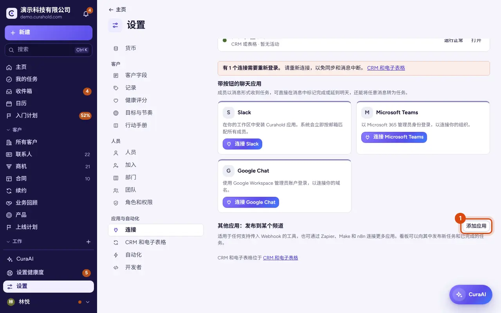
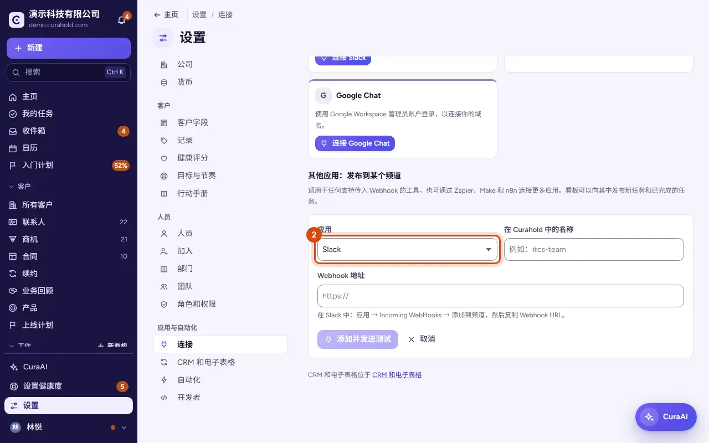

# 飞书、Lark 和 Telegram 通知

看板可以把动态（新任务、已完成任务）发到群聊。飞书和 Lark 使用群的自定义机器人；Telegram 使用你两分钟就能建好的机器人。两者都是单向的：只发送，不通过它们回复。

## 在 Curahold 中 {#connect}

1. 打开 **设置 → 连接**，点击 **添加应用**。
   
2. 选择 **Lark · Feishu** 或 **Telegram**，粘贴下面步骤得到的内容，点击 **添加并发送测试**。群里会收到一条测试消息。
   

然后打开看板，在看板设置的通知中，为想要的动态选择这个新连接。

## Lark · Feishu

1. 在群里打开 **设置 → 群机器人 → 添加机器人 → 自定义机器人**，起个名字并点击 **添加**。
2. 复制 **Webhook 地址**，格式如下：

```text
https://open.larksuite.com/open-apis/bot/v2/hook/0f3c2a9e-7d1b-4c55-9a7e-2b8f6c1d3e4f
```

可选但推荐：在 **安全设置** 中勾选 **签名校验**，把密钥复制到 Curahold 的 **签名密钥**。不要使用关键词过滤，否则消息会被丢弃。

## Telegram

1. 在 Telegram 中给 **@BotFather** 发消息，发送 `/newbot`，回答两个问题，复制它给出的 **令牌**。
2. 把机器人加入群组（频道则设为管理员）。
3. 在群里发一条消息。Curahold 会从这条消息找到群组，你不需要知道群组 ID。
4. 把令牌粘贴到 Curahold 的 **机器人令牌**。公开频道也可以直接填写它的 `@名称`。

## 限制和频率

飞书每个机器人每分钟约可接收 100 条，Telegram 每个群组每分钟约 20 条；“繁忙”的回复会重试，不会丢失。Telegram 消息为纯文本，最多 4,096 个字符。

## 出现问题时

签名密钥错误、机器人被移除或令牌被撤销时，连接会在 设置 → 连接 中显示为 **需要处理**，测试也会提示。在对方那里修正后再次点击 **发送测试**：测试成功即可清除问题。**移除** 会停止发送；机器人会留在群里，直到你在那里移除它。

## 另请参阅

- [连接和 CRM](/docs/zh-Hans/connections/)
- [通知](/docs/zh-Hans/notifications/)
