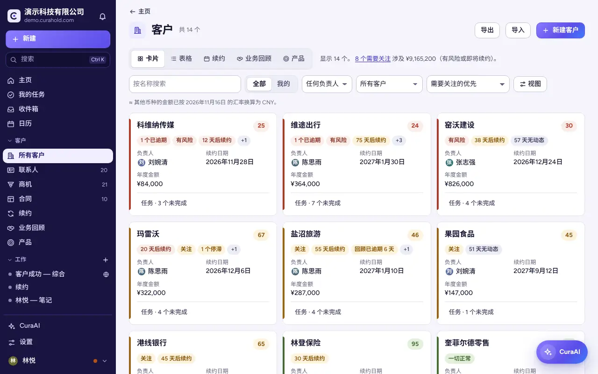
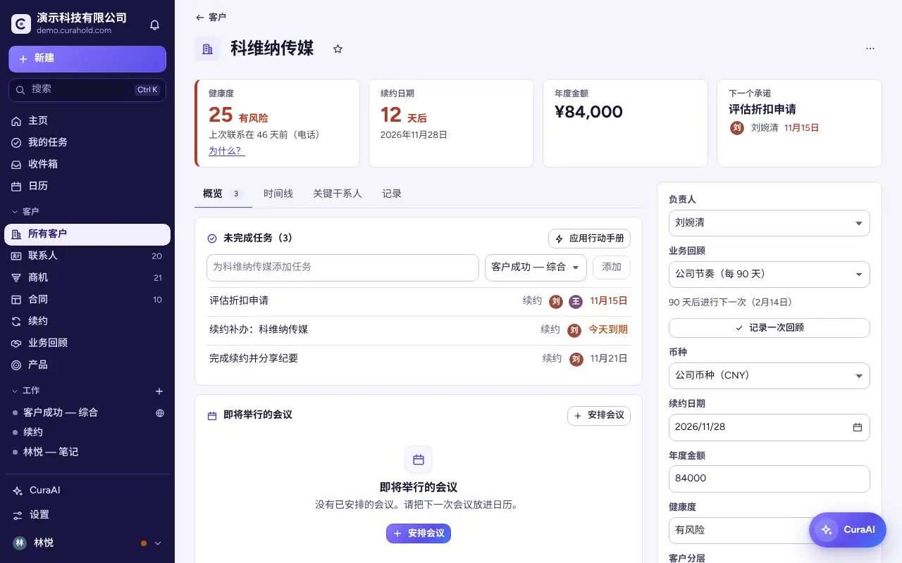

# 客户、字段和记录

客户是 Curahold 的核心。每个客户都有一位负责人、一个可选的团队，以及你们自己定义的字段。

## 客户页面

客户页面顶部有一条一眼就能读完的信息栏：带原因和 **为什么？** 按钮的 **健康度**、续约日期和剩余天数、年度金额，以及 **下一个承诺**：你对客户承诺的最近一步，以及由谁负责。信息栏下方是标签页：**概览**（未完成的任务和即将进行的会议）、**时间线**、**关键干系人**、**记录** 和 **详情**。当前打开的标签页会保留在地址中，所以刷新页面或发送链接后，打开的仍是这个标签页。

## 字段

在“设置”→ 客户字段中添加字段：文本、数字、金额、日期、选项、邮箱、链接。选项可以设置颜色，因此像健康度这样的字段会在列表和卡片中以对应颜色显示。

你也可以给“客户”改名：“客户账户”“品牌”“合作伙伴”，团队习惯怎么叫，整个界面就怎么显示。

## 记录：联系人、商机等

在客户下面保存记录：

- **联系人（关键干系人）：** 职位、决策角色（决策人、审批人（预算）、影响者、评估人、用户）以及对你们的态度（核心支持者、支持者、中立、怀疑者、阻碍者）。
- **商机：** 金额、预计成交日期、阶段和状态。
- **你们自己的记录类型：** 比如“项目”或“合同”。

记录可以为客户字段提供数据：“未结销售管道”“核心支持者数”“阻碍者数”。记录变化时，字段会自动更新。

## 视图：卡片、表格、续约、产品

用客户页面顶部的按钮在四种视图之间切换；你的选择会在这台设备上被记住。

- **卡片：** 每个客户一张卡片，说明需要关注什么：逾期任务、健康度有风险或需留意、即将到来或已过期的续约、14 天无人处理的任务、30 天没有联系。最严重的排在最前；没有问题时显示“一切正常”。卡片默认按“最需要关注优先”排序，也可以按名称、健康度、金额、续约或未完成任务排序。在 **视图** 菜单中选择卡片上显示哪些字段。
- **表格：** 可排序的列表，可以一次修改多个客户。
- **续约：** 未来 12 个月的续约，按月列出，显示每月合计，以及其中有风险或需留意的金额。
- **产品：** 按某个记录类型的选项字段（例如“订阅 → 产品”）显示谁拥有哪个产品。空白单元格里的 **+** 会为该客户打开一个交叉销售任务。

页面顶部的一句话说明有多少客户需要关注、有多少金额面临风险；点“需要关注”链接即可只看这些客户。在手机上，所有筛选条件都集中在一个 **筛选** 面板里。

## 添加续约

续约就是客户的**续约日期**。打开客户，在**详情**中填写；也可以在导入时用一列带进来。之后客户会出现在**续约**中，按月份显示，并附上金额。还没有这个字段？在“设置”→ 客户字段中添加一个日期字段。想让续约工作自动开始，请在“设置”→ **目标与节奏**中打开**自动启动续约**，并选择提前多久、使用哪个 playbook。

## 导入

拖入 Excel 或 CSV 文件，把列对应到字段，检查预览，然后导入。导入出了问题，30 天内可以一键撤销。

## 导出

按当前的筛选条件，把客户和记录列表下载为 Excel 或 CSV。文件在你的浏览器中生成，你无权查看的字段也不会出现在文件里。

## 批量修改

在列表中选中多个客户，一次性修改他们的负责人、团队或某个字段。底部的提示中提供 **撤销**。

## 删除客户，以及恢复已删除的客户

删除的客户会连同其记录、时间线、会议和门户用户一起进入 [回收站](/docs/zh-Hans/trash/)，30 天内可以恢复：删除后立即在提示中选择 **撤销**，或者打开你的菜单，选择 **回收站**，再点 **恢复**。它的任务会以“无客户”的状态留在各自的看板上，客户恢复后会重新关联。如果只想把客户移开而不删除，可以将其归档。

## 行动手册

**行动手册** 是一组带日期的任务，一键就能应用到某个客户上：客户上线、续约准备、QBR。管理员在“设置”→ **行动手册** 中写好一次（任务标题、开始后第几天、交给谁）；在客户页面上，用 **应用行动手册** 选择开始日期，即可全部添加。标题中的 `{account_name}` 会替换为客户名称。

## 业务回顾

一次性决定多久和每个客户坐下来谈一次：“设置”→ **目标与节奏** → *业务回顾*（比如每 90 天）。某个客户可以在其页面的 **业务回顾** 字段中设定自己的节奏；选“不进行回顾”则该客户不纳入节奏。

业务回顾是你定期与每个客户举行的会议（QBR），用来复盘成果和计划。**客户 → 业务回顾** 列出到期的回顾：已逾期、未来 30 天内和更晚。开完回顾后，点该行（或客户页面）上的 **完成** 打开会议表单；保存后，它会作为“业务回顾”记入客户的 **会议** 和时间线，下一次日期会自动顺延。从未回顾过的客户，从添加之日开始计算。逾期的回顾也会以标记的形式显示在客户卡片上。

## 会议

客户页面上的 **会议** 按从新到旧列出与该客户的每一次会议、业务回顾和通话：日期、类型、标题、时长、记录人、参会者（对方和我方）、备注和后续步骤。上方的按钮可以只显示一种类型；下一次业务回顾的日期显示在标题旁边。

**记录会议**（在客户页面上，或 **+ 新建 → 记录会议、电话或备注**）需要填写：

- 类型（会议、业务回顾、电话）、标题、日期和时长；
- 参会的对方人员（客户的联系人）和我方人员；
- 备注：讨论了什么、决定了什么；
- 后续步骤：每一步连同负责人和截止日期，都会在你选择的看板上成为该客户的一个任务。

后续步骤显示在会议下方，并附带进展（已完成的会被划掉）；点击即可打开对应任务。会议之后可以编辑、补充后续步骤或删除；删除会议后，它的任务会保留，会议本身可以在 30 天内从 [回收站](/docs/zh-Hans/trash/) 恢复。
