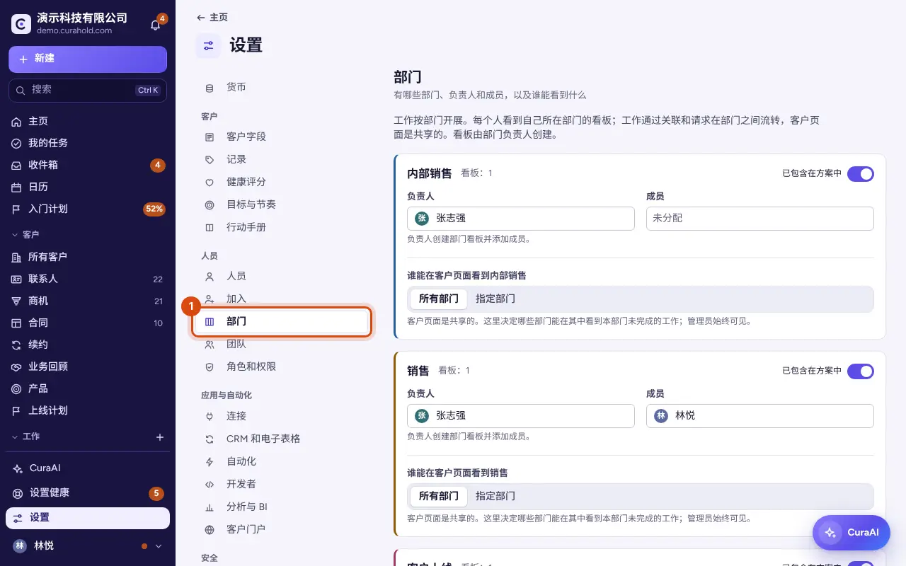
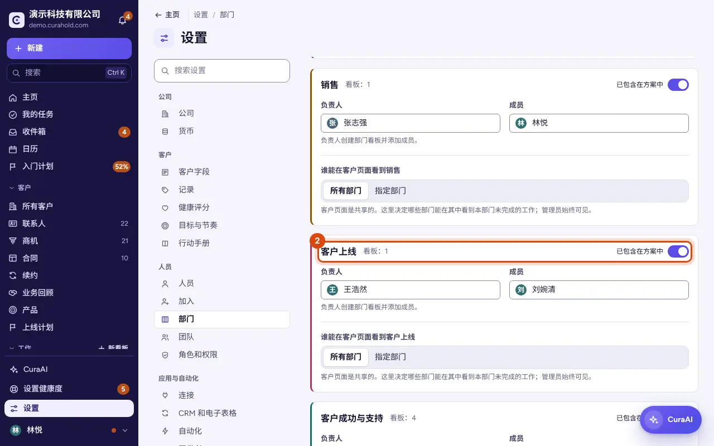
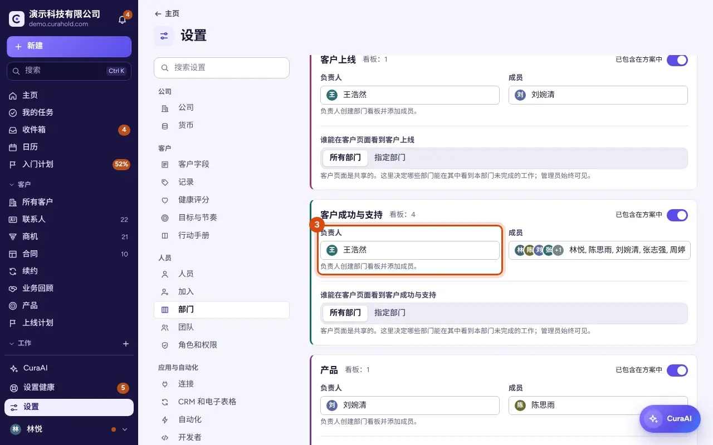
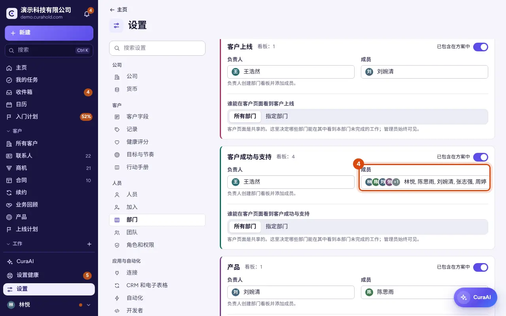
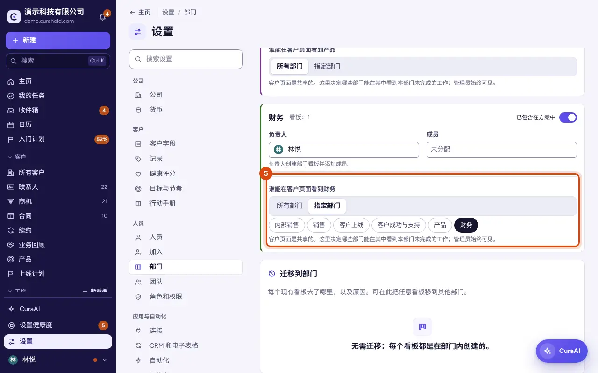
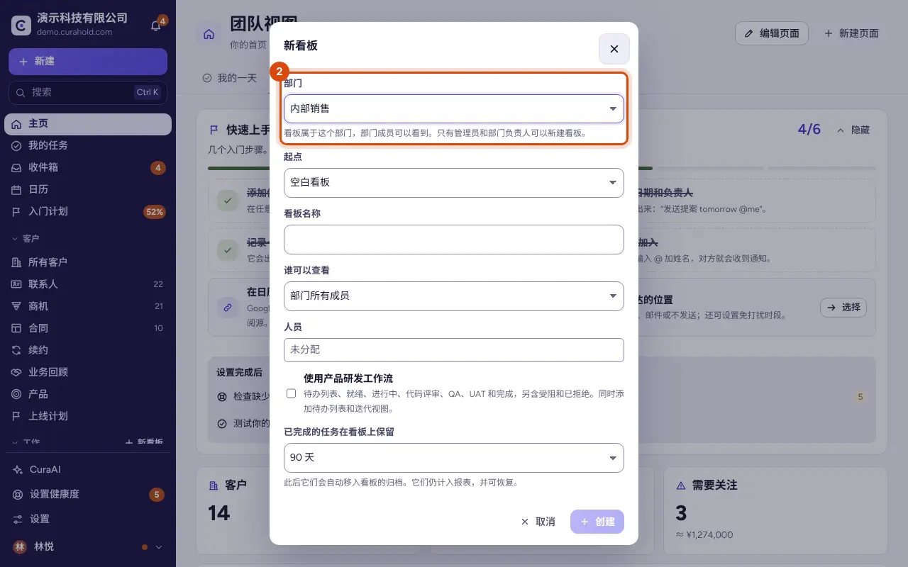
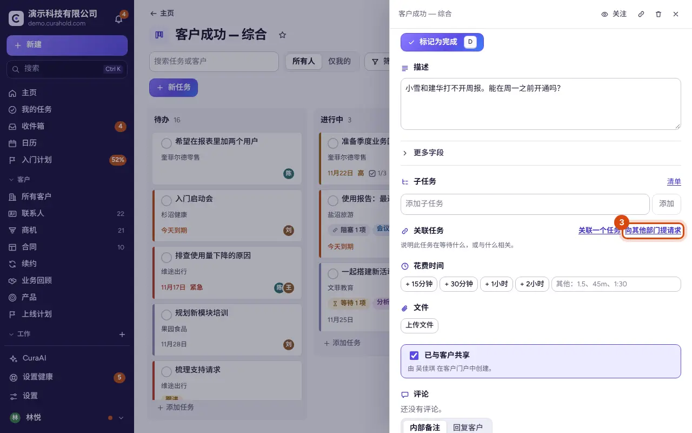
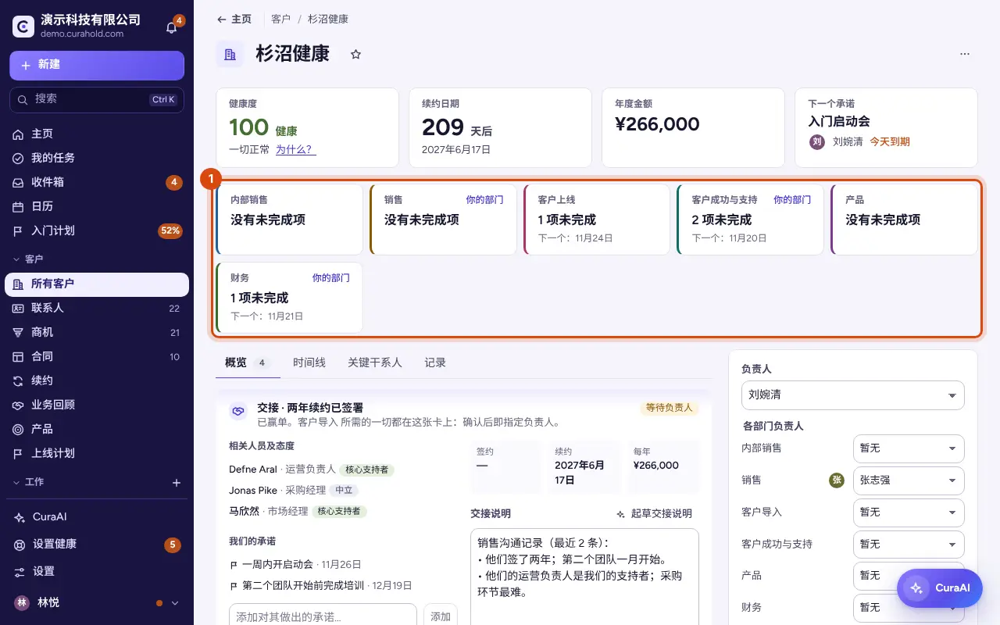
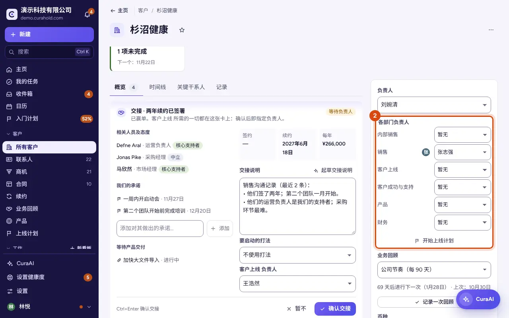

# 部门

在 Curahold 中，工作属于部门：内部销售、销售、客户上线、客户成功与支持、产品和财务。每个人看到自己所在部门的看板。工作通过请求转到另一个部门，而客户页面由所有有权查看该客户的人共享。

## 设置部门 {#set-up}

你需要是管理员（或负责管理人员的人）。

1. 在左侧菜单中点击 **设置**，然后点击 **部门**（在 **人员** 下）。
   
2. 公司有的每个部门都保持 **已包含在方案中** 为开启。不用的部门就关掉：它会对所有人隐藏，其看板会保留，直到你再次开启。
   
3. 在 **负责人** 中选择部门由谁负责。负责人可以开设部门看板并添加成员。
   
4. 在 **成员** 中选择在这个部门工作的其他人。一个人可以属于多个部门。
   
5. 在 **谁能在客户页面看到…** 下选择 **所有部门**，或选择 **指定部门** 并点击可以在那里看到本部门未完成工作的部门。管理员始终可见。财务一开始只对财务可见。
   

所有更改都会随时保存。还不属于任何部门的人，在你添加之前，把自己的工作放在 **我的任务** 里。

公司迁移到部门时，每个已有看板都被放进了一个部门。同一页面底部的 **迁移到部门** 显示每个看板去了哪里以及原因；可以在那里更改看板的部门。**待安排的人** 列出以前能看到某个看板但并不在其上工作的人：**授予访问权限** 会让他们成为成员。

## 部门里的看板 {#boards}

1. 在菜单中，看板按所属部门名称分组。你负责的部门旁会显示 **由你负责**。
   
2. 要开设新看板，点击 **工作** 旁的 **+**。在 **部门** 中选择看板所属的部门，填写名称并点击 **创建**。只有管理员和部门负责人可以开设看板。
   

可见范围默认为 **部门所有成员**；也可以缩小到某个团队或指定的人。

## 向其他部门提请求 {#ask}

1. 打开与该请求相关的任务，点击 **向其他部门提请求**。在列表中选择该部门的看板，填写请求表单并发送。
   

请求会进入该部门的看板，并关联到你的任务。你能看到它的标题和进度，但永远看不到对方部门的看板。部门负责人开启某个看板的请求表单后（**看板设置 → 字段和请求表单**），该部门即可接收请求。

## 在客户页面上 {#customer-page}

1. 在客户页面上，**各部门** 显示每个部门对该客户的未完成工作、其中逾期多少以及下一个截止日期。**你的部门** 标出你所在的部门。
   
2. 在侧边，**各部门负责人** 显示每个部门由谁负责该客户。选择一个人即可设置。
   

部门之间的交接（赢单后转给客户上线或客户成功）见 [交接、需求与回访客户](/docs/zh-Hans/handover-and-requests/)。
