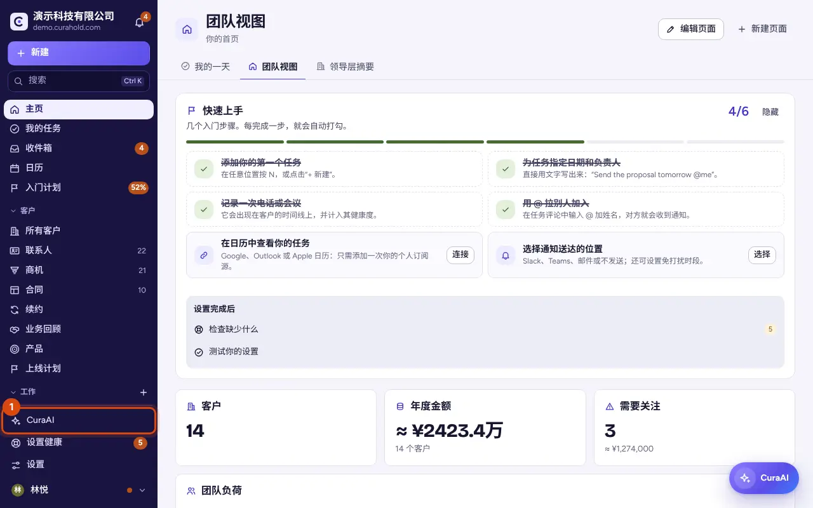
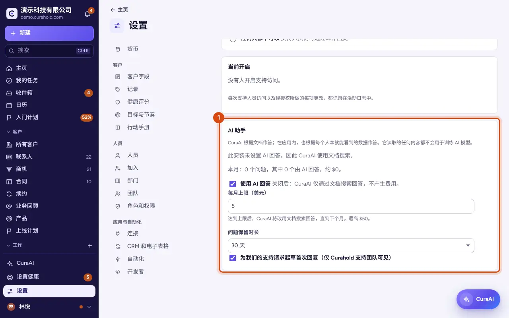
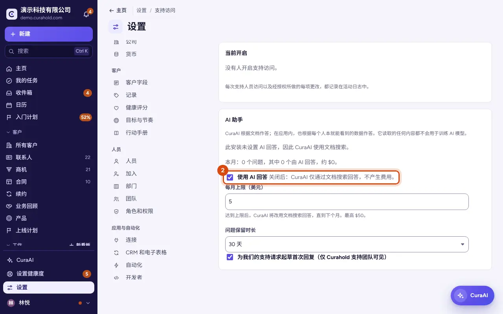

# 获取帮助

两个步骤，按这个顺序：先 **提问**，如果没有解决，再 **联系支持**。

## 先提问 {#ask}

1. 在左侧菜单中点击 **CuraAI**（手机上是角落的按钮；在本文档中是 **提问** 按钮）。用你自己的话写下问题：“如何导入客户”“谁能看到这个字段”。
   

答案来自本文档，并附上出处。当公司开启了 **使用 AI 回答**（见下文）时，CuraAI 还会读取你在 Curahold 中本就能看到的内容，例如客户、续约和任务，所以你可以问“未来 90 天有哪些续约？”。它只读取，从不更改任何内容。关闭、未设置或超出当月上限时，文档在你自己的设备上搜索，你输入的内容不会发送到任何地方。

如果答案不是你需要的，就说出来：你会看到下一个最接近的位置，以及一个已填好问题、可直接联系支持的按钮。

## 联系支持：发送请求

使用 CuraAI 底部的 **联系支持**。表单会询问支持人员找到问题所需的信息，这样他们就不必再回头问你。你没看过的内容一律不会发送；发送什么由你决定。

1. **主题**：某项功能出现故障、我该如何…？、数据或连接、一个想法，或账单和套餐。
2. **影响**：对于错误和数据问题，说明它是否让你无法工作。支持的处理顺序以此为准。
3. **标题**：几个词即可。输入时，会推荐可能已经回答了这个问题的文档页面。
4. **发生了什么**：你想做什么、期望什么，实际发生了什么。如果出现了错误信息，请逐字复制。
5. **我们怎样才能复现？**：对于错误，请一步步写出来（可选，但很有帮助）。

6. **让同事保持知情** 和 **需要完成的日期**（都是可选）：应该阅读请求并收到答复的同事，以及你需要在哪一天之前得到答复。

你会收到一个 **编号**（例如 CH-000123），以及一封邮件副本。

## 对话：答复、回复，以及轮到谁

请求就是一段对话。在 **我的请求**（CuraAI 顶部的收件箱按钮）中打开：

- **支持的答复** 会通过邮件发送，并显示在请求中。CuraAI 按钮上的标记表示有答复在等你。
- 在产品中 **回复**，或直接 **回复邮件**：你写在引用内容上方的文字会进入请求。
- 请求会显示 **轮到谁**：*支持处理中*、*等待你的回复* 或 *已解决*。**标记为已解决** 会关闭请求；再次写信会重新打开。
- **保持知情的同事** 可以阅读请求、通过邮件收到支持的答复，也可以回复。只有提问的人可以添加或移除他们。管理员可以阅读公司的任何请求，但只能在自己的请求中回复。
- Curahold 团队可能会在请求上记录 **自己的备注**。这些备注永远不会显示或发送给你们公司。

## 截图和文件

- **截取屏幕**：浏览器会询问要共享哪个标签页；选择 Curahold 的标签页。帮助窗口会让开，只截取页面本身。
- **粘贴或拖放**：把复制的图片粘贴到表单里，或把文件拖到表单上。
- **标注**：用红框圈出重点。**隐藏** 会遮住支持人员不应看到的内容（客户名称、金额）；这些内容会从发送的图片中去掉。

最多 6 个文件，每个 10 MB。支持图片、PDF、文本、CSV、JSON、Excel 和短视频。

## 自动添加到请求中的技术信息

表单会自行添加以下信息，并在发送前展示给你：

| 信息 | 为什么有帮助 |
|---|---|
| 页面地址 | 问题出在哪里。地址中的机密部分（登录码等）会被去掉。 |
| 浏览器、屏幕、应用版本 | 用于只在某一种浏览器中出现的问题。 |
| 最近打开的页面 | 你是怎么到那里的。只有地址，没有页面内容。 |
| 页面上的错误 | 后台的错误信息。邮箱地址和类似密钥的文字会被遮盖。 |
| 失败的请求 | 哪个操作失败了（路径和状态码）。 |
| 当前打开的内容 | 你打开的客户、看板或任务。 |

不想发送的项目可以取消勾选。你输入的内容和页面上的数据都不在这些信息之中。

## 允许支持人员查看你的账户

有些问题不亲眼看到很难解决。表单末尾的 **允许 Curahold 支持人员查看我的账户** 选项就是为此准备的。它永远不会被默认勾选。

- **支持人员能看到什么**：和你看到的完全一样——同样的客户、看板和字段。不多不少。
- **有效时长**：24 小时、3 天或 7 天。访问会自动结束。每次支持访问最长 8 小时。
- **支持人员能做什么**：**只能查看**。支持人员绝不会修改你账户中的任何内容。
- **永远无法触及**：你的设备和会话、API 密钥、应用和 webhook、邀请人员、角色、公司设置、导出或清除数据。支持人员也不能延长自己的访问权限。
- **关闭访问**：随时可以在 **帮助 → 我的请求 → 关闭访问** 中关闭。正在进行的支持访问会立即结束。访问开启期间，页面顶部会有一条提示。
- **记录**：每一次支持访问，以及支持人员在此期间查看的内容，都会连同支持人员的姓名写入 **“设置”→ 活动日志**。

支持人员在你的账户中时，屏幕顶部会显示是谁在查看、到什么时候为止。

## 公司设置（管理员）

在 **“设置”→ 安全 → 支持访问** 中，选择谁可以允许支持人员进入：

- **任何人**：针对其本人能看到的内容（默认）。
- **仅限管理员**：其他人已开启的访问会立即结束。
- **任何人都不可以**：支持人员仍可通过邮件答复，但不能进入。

同一页面会列出当前开启的访问、由谁开启以及最近一次访问，并可以关闭其中任何一项。

## 为支持团队录制会话

为了在出问题时让支持人员看到发生了什么，而不是请你描述，页面会在你使用时自动录制（点了哪些按钮、打开了哪些页面、应用显示了什么）。这与允许支持人员查看你的账户是两回事；它在后台静默运行。

- **你输入的任何内容都不会被录制。** 每个输入框——搜索、备注、你填写的客户信息——都会被遮盖。录制的是界面，而不是你写的内容。
- **保留 7 天**，然后删除。
- **只有 Curahold 支持团队可以打开录制**，且只能在自己的工作台中打开，每次打开都会写入支持工作台的日志。你们公司看不到自己的录制。
- **管理员可以关闭此功能**，位于 **“设置”→ 安全 → 支持访问 → 为支持团队录制会话**。关闭后不会录制任何内容。

如果你们的组织需要在隐私声明中向员工说明这一点，这个开关和本页面就是依据。

## 使用 AI 回答（管理员） {#ai-answers}

1. 打开 **设置 → 支持访问**，滚动到 **AI 助手**。
   
2. 勾选 **使用 AI 回答**，让 CuraAI 用 AI 回答；取消勾选则只用文档搜索回答，不产生费用。CuraAI 读取的内容绝不会用于训练 AI 模型。
   

同一张卡片上：

- **每月上限（美元）**：达到后，CuraAI 在下个月之前用文档搜索回答。卡片显示本月的问题数和费用。
- **问题保留时长**：问题保留多久（或完全不保留）。每个人自己的问题包含在其个人数据下载中。
- **为我们的支持请求起草首次回复**：Curahold 支持团队会看到对你们请求的首次回复草稿；你永远看不到草稿，只会看到支持团队的正式回复。

如果卡片显示此安装未设置 AI 回答，CuraAI 就使用文档搜索；AI 密钥由运行你们 Curahold 服务器的人添加。

## 错误记录（管理员） {#errors}

**设置 → 错误** 列出近 30 天你们的人员遇到了什么问题以及发生在哪里：哪个页面、哪个请求失败、发生了几次。其中不含任何个人信息。联系支持时，附上你在那里看到的内容。
