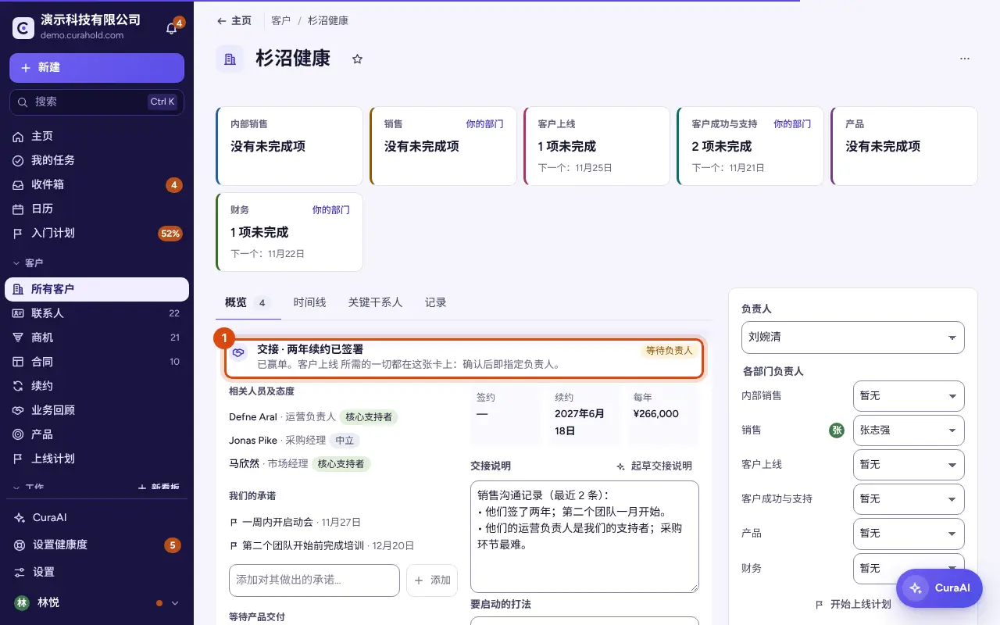
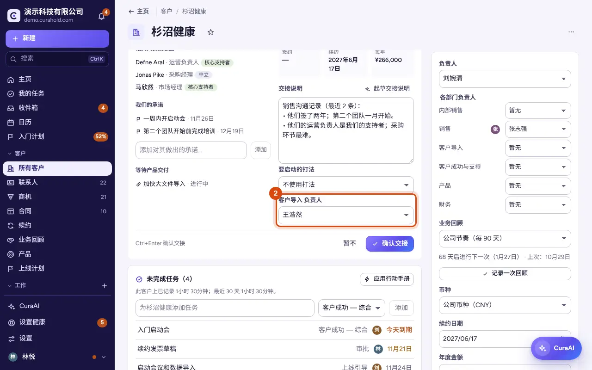
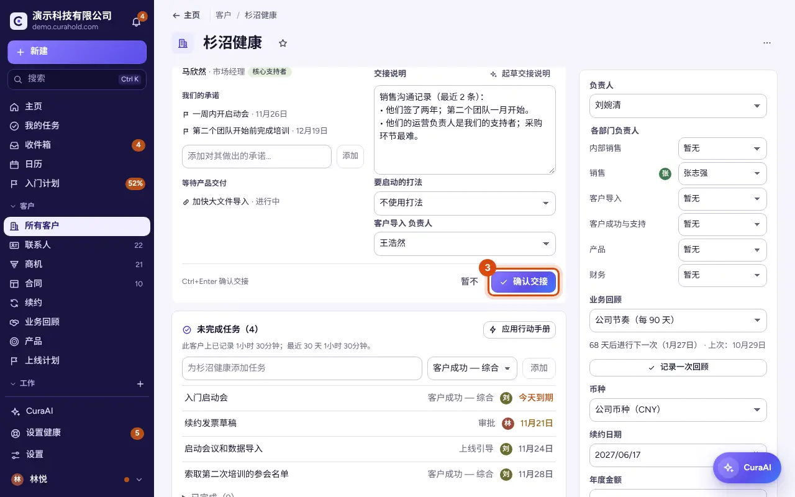
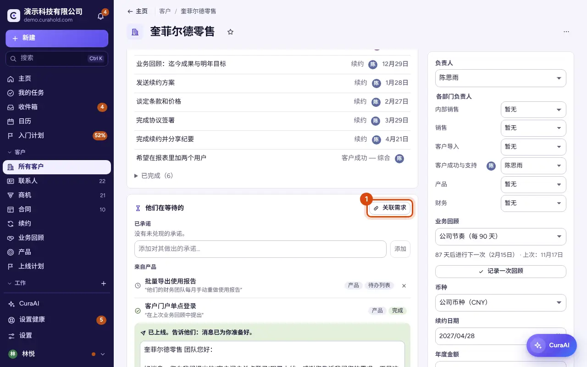
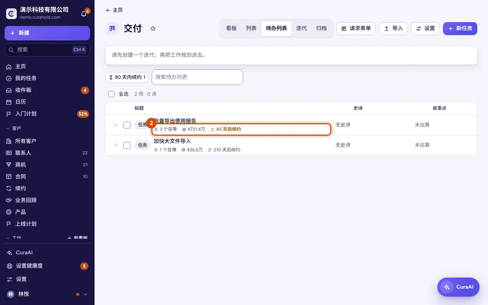
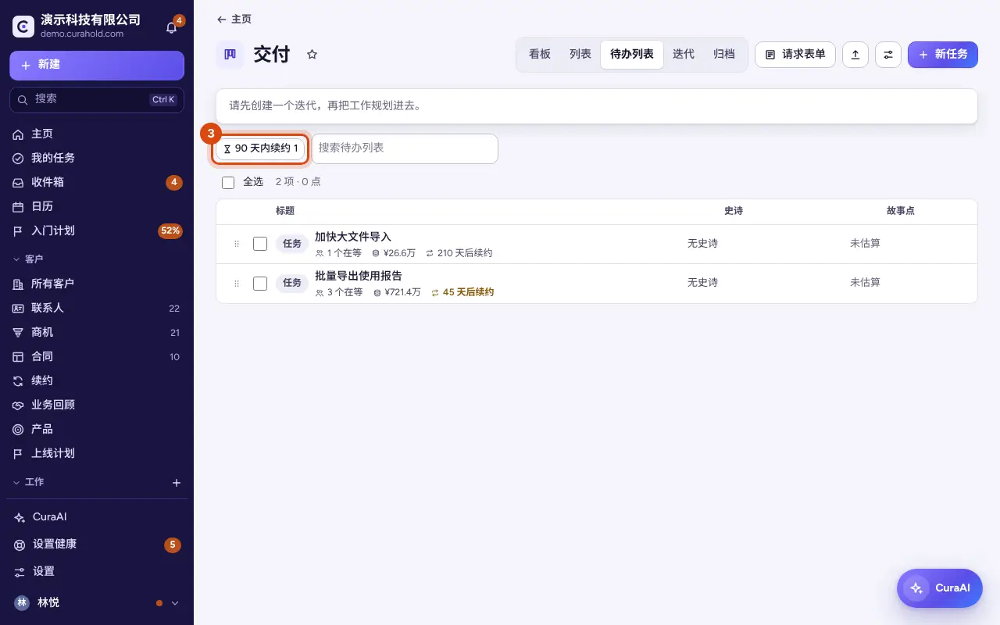
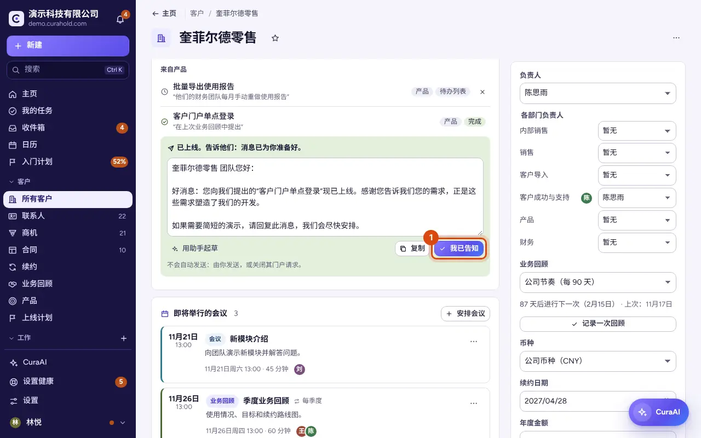
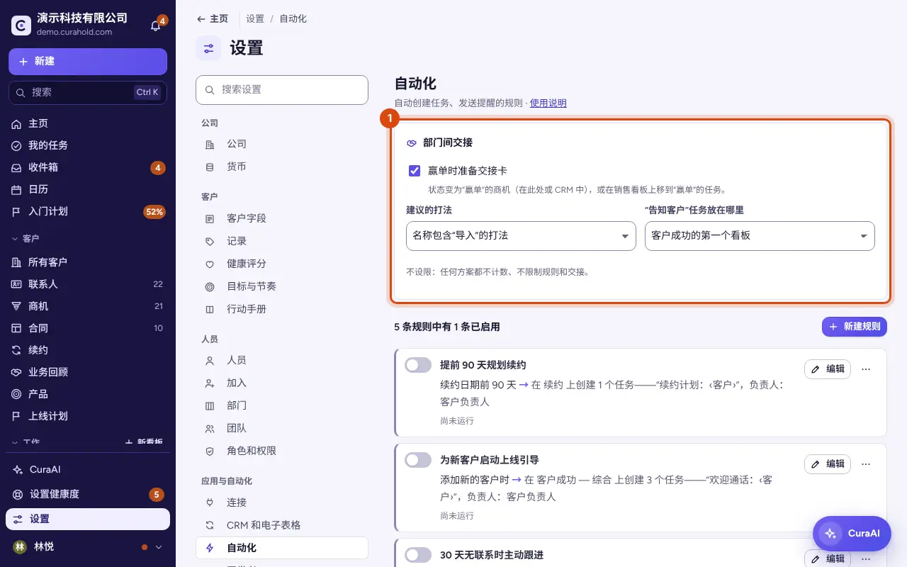

# 交接、需求与回访客户

工作从销售转到客户上线或客户成功，也从客户转到产品。Curahold 把每个团队需要的内容都放在客户页面上，无需重复录入，也没有人需要打开其他部门的看板。

## 赢单时 {#handover}

状态变为 **赢单** 的商机（在这里或在你的 CRM 中），或在销售看板上移到 **赢单** 的任务，会在客户页面上得到一张 **交接卡**。如果公司有客户上线部门，它会交给 **客户上线**，否则交给 **客户成功**。

1. 打开客户页面。交接卡位于 **概览** 顶部，标有 **等待负责人**。阅读它：相关人员及其态度、销售做出的承诺、客户仍在等待产品交付的内容、日期、年度价值（如果你有权查看该字段）以及来自销售沟通的交接说明。
   
2. 在 **… 负责人** 中选择由谁接手该客户。同时查看旁边的 **要启动的打法**。
   
3. 点击 **确认交接**（或按 Ctrl+Enter，Mac 上按 ⌘+Enter）。负责人被设置，打法开始执行，负责人收到通知，客户时间线记录这两步。
   

**暂不** 会收起这张卡。**起草交接说明** 让助手撰写说明；保存前你可以阅读并修改。

## 将客户需求关联到产品工作 {#requests}

1. 在客户页面的 **他们在等待的** 下，点击 **关联需求**。搜索产品的工作，选择对应条目，也可以用客户自己的话补充他们要的内容。如果没有合适的，就在同一窗口向产品提出。
   

许多客户可以等待同一个条目，每个都会被计入。任何能看到该客户的人都能看到这项工作的标题、状态、冲刺结束日期和部门，但永远看不到产品的看板。

## 产品看到什么 {#backlog}

1. 在产品看板上打开 **待办列表**。每个条目下显示：有多少客户在等待、他们的年度价值（仅对有权查看该字段的人）以及最近的续约。
   
2. 点击 **90 天内续约**，只查看即将续约的客户在等待的工作，最近续约的排在前面。
   

## 上线时 {#shipped}

关联的条目完成后，每个客户的负责人会收到一个任务，客户页面上该条目下方会出现一条现成的消息。

1. 阅读消息，按需修改，点击 **复制**，然后通过你自己的邮件或聊天发送。接着点击 **我已告知**。如果客户是通过门户提出的，**关闭其门户请求** 会在门户中一并关闭。
   

**不会自动发送任何内容。** 时间线会写上“为他们打造”，续约摘要也会列出。

## 设置（管理员） {#settings}

1. 打开 **设置 → 自动化**。在 **部门间交接** 下，选择赢单是否生成交接卡、建议的打法，以及“告知客户”任务放到哪里。
   

## 助手起草的内容

交接说明、“已上线”消息，以及会议中的承诺和后续步骤，都可以由助手起草。保存前你会阅读并修改每份草稿，撤销可以收回；没有助手（或超出每月上限）时，草稿来自模板。

## 规则

规则可以在任务新增或完成、通过表单收到请求、记录到达某个阶段或支持工单打开时启动，可以分配、移动、填写字段、评论、发送到你的 Webhook 或准备交接。规则从不计数，也没有上限。
