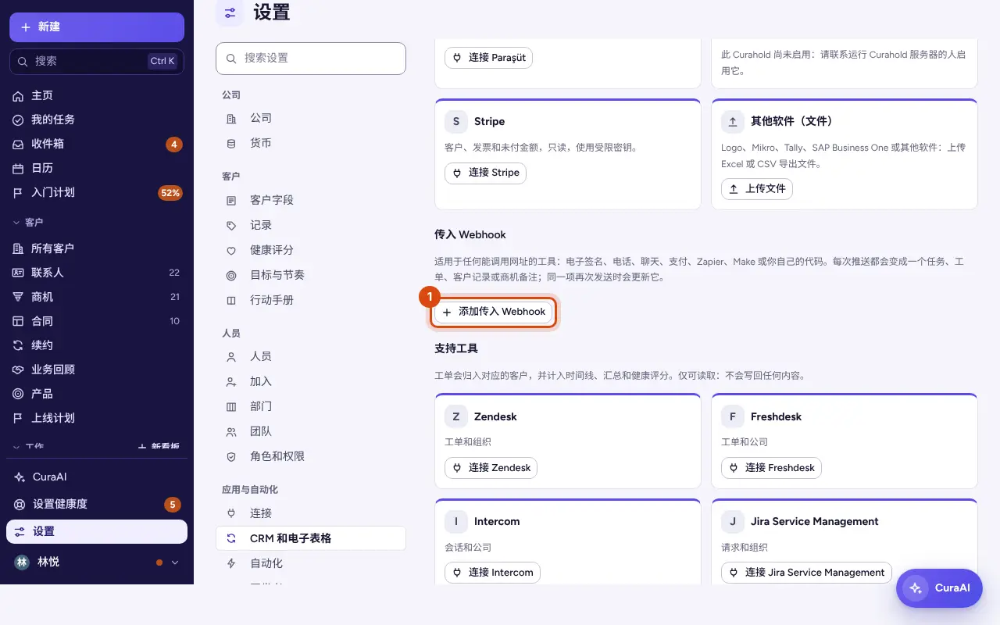
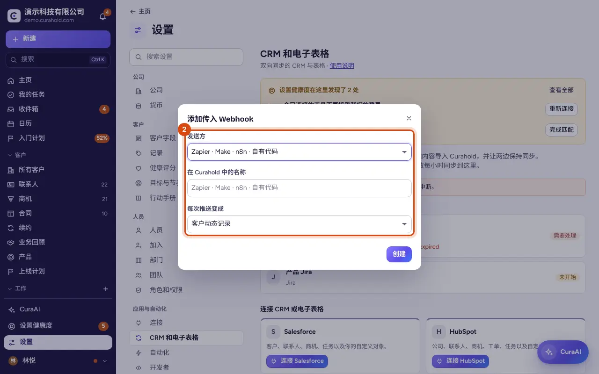
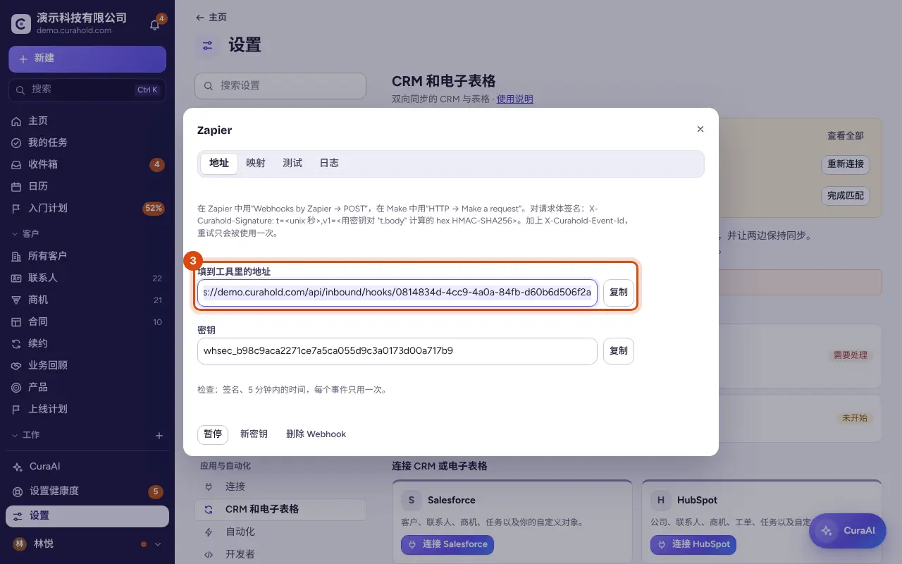
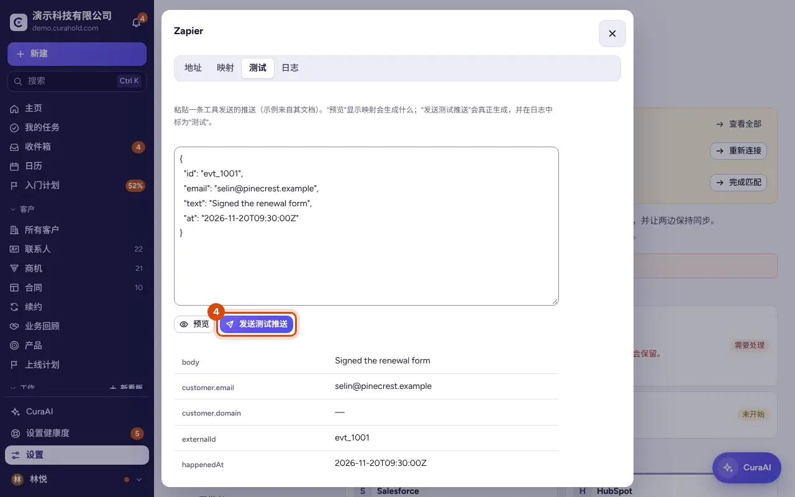
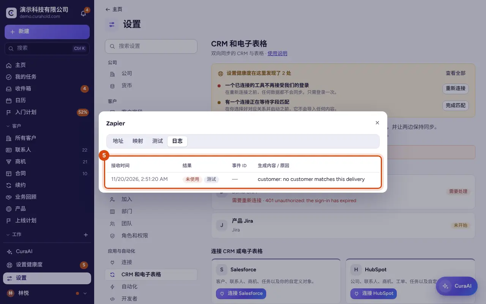

# 传入 Webhook

适用于 Curahold 还没有现成连接器的工具。工具向你专属的地址推送；每次推送都会变成一个 **任务**、一个 **支持工单**、一条 **客户时间线记录** 或一条 **商机备注**。同一项再次推送时会更新之前生成的内容。每次推送都会检查：签名（或共享令牌）、时间，以及每个事件只用一次。

## 在 Curahold 中 {#connect}

1. 打开 **设置 → CRM 和电子表格**，向下滚动到 **传入 Webhook**，点击 **添加传入 Webhook**。
   
2. 在 **发送方** 下选择工具（或 **Zapier · Make · n8n · 自有代码**），确认 **每次推送变成**，点击 **创建**。
   
3. 在 **地址** 标签中，把地址和密钥复制到工具里。
   
4. 在 **测试** 标签中点击 **预览**，查看映射会把示例变成什么，然后点击 **发送测试推送**。
   
5. 在 **日志** 标签中检查每次推送：已使用、已跳过、未使用（附原因）或已拒绝。
   

## 映射

每个值都是文本，用 `{{path}}` 引用推送中的值，例如 `{{data.envelopeSummary.status}}` 或 `{{items[0].email}}`。客户依次按联系人邮箱、网址、名称查找。**工具中该项的 ID** 让“创建或更新”生效。**仅当这个值…** 会跳过其他事件（记为已跳过）。

## 现成配方

| 工具 | 签名方式 | 生成 |
| --- | --- | --- |
| 电子签名（DocuSign Connect；CloudSign、Modusign、Leegality 同理） | `X-DocuSign-Signature-1`, HMAC-SHA256, base64, 你在工具中生成的密钥 | 商机备注 |
| Aircall | 请求体中的 Webhook token | 客户下的一次通话 |
| Tawk.to | `X-Tawk-Signature`, HMAC-SHA1, hex | 工单 |
| Razorpay（iyzico 同理） | `X-Razorpay-Signature`, HMAC-SHA256, hex | 客户下的一条记录 |
| Freshchat、Kylas、Sansan 以及其他任何工具 | 共享令牌 (`X-Curahold-Token` / `?token=`) | 由你选择 |

## 自行签名（Zapier、Make、n8n、代码） {#sign}

发送 `X-Curahold-Signature` 和 `X-Curahold-Event-Id`：

```text
X-Curahold-Signature: t=1763631000,v1=<用密钥对 "1763631000.<原始请求体>" 计算的 hex HMAC-SHA256>
X-Curahold-Event-Id: evt_1001
```

代码示例（Node.js）：

```js
const t = Math.floor(Date.now() / 1000);
const v1 = crypto.createHmac('sha256', secret).update(`${t}.${body}`).digest('hex');
fetch(address, { method: 'POST', body, headers: { 'content-type': 'application/json', 'x-curahold-signature': `t=${t},v1=${v1}`, 'x-curahold-event-id': id } });
```

时间必须在 5 分钟内。重复的事件 ID 会返回 `200` 和 `duplicate`，不会再次使用。返回：`200`（`status` 为 ok、skipped 或 failed）、`401`（签名、时间或令牌）、`404`（未知或已暂停）。完整列表： API 参考.

## 为暂无连接器的工具准备的 Zapier 和 Make 配方

使用该工具的触发器，然后用 **Webhooks by Zapier → POST**（Zapier）或 **HTTP → Make a request**（Make）带上两个请求头发送到上面的地址。Make 的 **Custom JS** 或 Zapier 的 **Code** 步骤负责计算签名（见上面的代码）。

| 工具 | 触发器 | 要发送的字段 | 生成 |
| --- | --- | --- | --- |
| LINE WORKS | 机器人频道新消息 | `id`、发件人 `email`、`text` | 记录 |
| Chatwork | 聊天室新消息 | `id`、`email`、`text` | 记录 |
| kintone | 记录新增或编辑 | `id`、`email`、`title`、`status` | 任务 |
| Money Forward Cloud | 发票创建或付款 | `id`、`email`、`text`（编号、金额、到期日） | 记录 |
| Channel Talk | 会话关闭 | `id`、`email`、`title` | 工单 |
| KakaoWork | 机器人消息 | `id`、`email`、`text` | 记录 |
| LeadSquared | 线索或商机更新 | `id`、`email`、`title`、`status` | 任务 |
| Razorpay | 付款成功 | `id`、`email`、`text` | 记录（或使用配方） |
| DingTalk | 机器人消息 | `id`、`email`、`text` | 记录 |
| WeCom | 应用消息 | `id`、`email`、`text` | 记录 |

## 保留和删除

日志保留 30 天，每个 Webhook 最多 500 条推送。**新密钥** 会让旧密钥立即失效；**暂停** 期间返回 `404`，直到恢复；**删除 Webhook** 会删除它及其日志，已生成的内容保留。Webhook 以创建者的权限运行：只能访问创建者能访问的看板和客户，创建者离开后即停止。

## 投递被拒绝或未使用时 {#log}

**日志**标签页用你的语言说明每次投递发生了什么：签名或令牌错误（从**地址**把密钥重新复制到工具里）、发送时间太早（重放的投递也会这样被拒绝）、这个 Webhook 不使用的值、没有匹配的客户，或某个字段为空（检查**映射**）。同一次投递发来两次，例如 Zapier 或 Make 的重试，只保留一次。任务 Webhook 的看板可以在**映射**的**看板**中更改：地址不变，发送工具里什么都不用改。

## 另请参阅

- [连接和 CRM](/docs/zh-Hans/connections/)
