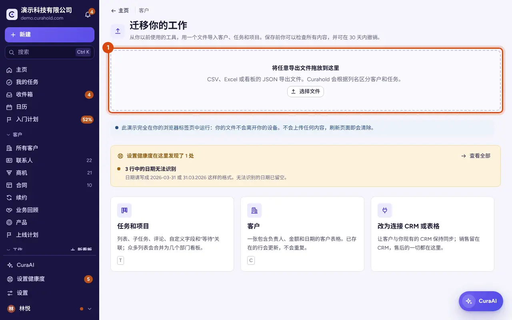
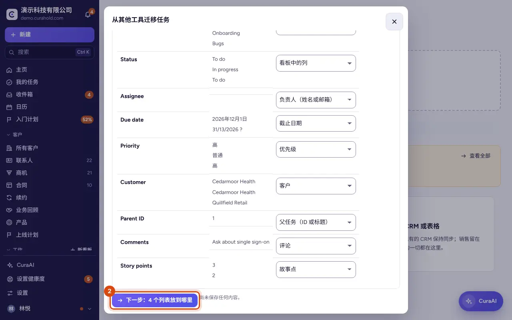
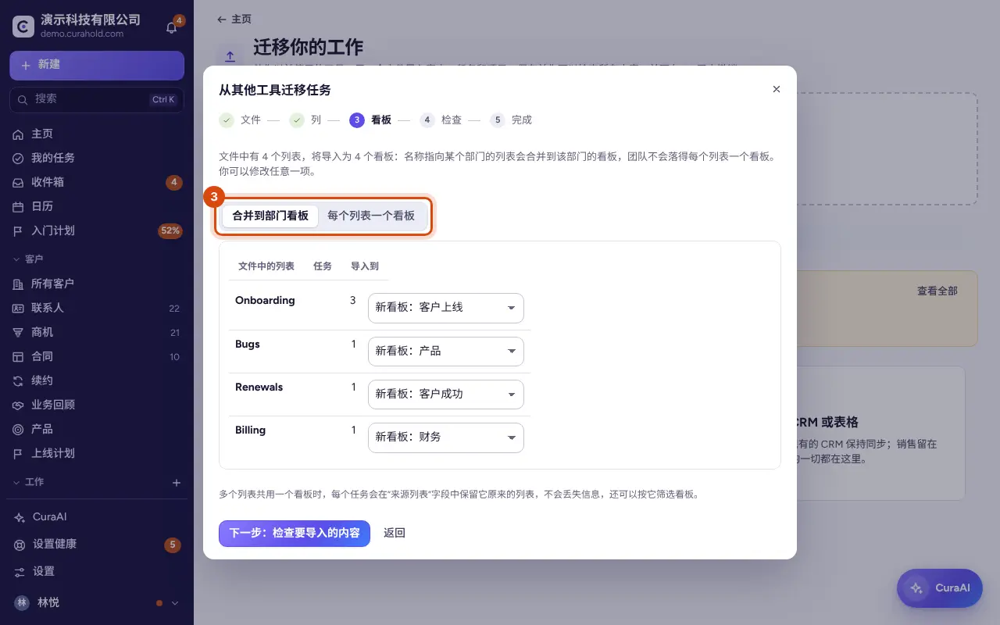
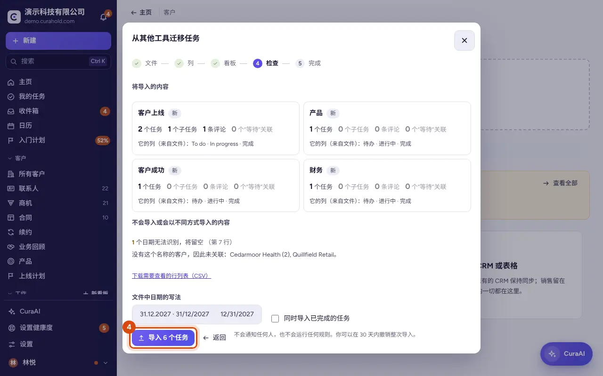

# 从其他工具迁移

从你之前使用的工具导出工作（CSV、Excel 表格 (.xlsx) 或看板的 JSON 导出），然后从该文件迁移过来。最后一步之前不会保存任何内容，不会通知任何人，也不会运行任何规则：这是搬家，不是新工作。

## 迁移你的任务 {#tasks}

1. 打开 **迁移你的工作**：在搜索中输入“import”（Ctrl K，Mac 上为 ⌘ K），或使用看板上的向上箭头按钮。把文件拖到 **将任意导出文件拖放到这里**，或点击 **选择文件**。Curahold 会根据文件的列名区分客户和任务；按 **T** 选任务，按 **C** 选客户，可自行选择。
   
2. **列。** 文件的每一列都会匹配到目标位置：标题、描述、看板上的列、人员、日期、优先级、客户、故事点、旧工具中的 ID、父任务、评论、“等待”关联，或一个自定义字段。前几个值会显示每列将变成什么。修改不对的地方，然后点击 **下一步**。
   
3. **看板。** 如果文件有很多列表，它们会合并到几个部门看板中：名为“Renewals”的列表进入客户成功，“Bugs”进入产品。点击 **每个列表一个看板** 可以让它们保持分开，也可以为任意列表选择任意看板。每个任务都会在 **来源列表** 字段中保留它原来的列表。点击 **下一步：检查要导入的内容**。
   
4. **检查。** 逐个看板查看将导入多少任务、子任务、评论和关联，并按行号查看哪些不会导入或会以不同方式导入。如果想先在文件里修正，点击 **下载需要查看的行列表（CSV）**。然后点击 **导入 … 个任务**。
   
5. **完成。** 每个看板都有 **打开看板** 链接。如果有不符合预期的地方，点击 **撤销此次导入**。
   

Curahold 能识别标题行上方的标题、每组下面重复表头的分组，以及缩进在其上级之下的子项。

## 撤销 {#undo}

**撤销此次导入** 在 30 天内有效，可以从结果页面或第一步的 **你之前的导入** 中操作。无人改动过的任务会作为一项移入回收站；之后有人修改或评论过的任务会保留在其看板的归档中。为导入而创建且仍为空的看板会被收起。

## 模板 {#template}

第一步中的 **下载模板** 会给你一个包含 Curahold 读取的所有列和三行示例的文件，可用 Excel 打开。第一行如下（Region 是自定义列的示例）：

```text
ID,Title,Description,List,Status,Assignee,Due date,Priority,Customer,Parent ID,Comments,Depends on,Story points,Region
```

## 在演示中

演示完全在你的浏览器标签页中运行。演示栏中的 **用你自己的文件试试** 会打开同一页面：文件在标签页中读取，永远不会离开你的设备，刷新页面后即被遗忘。
