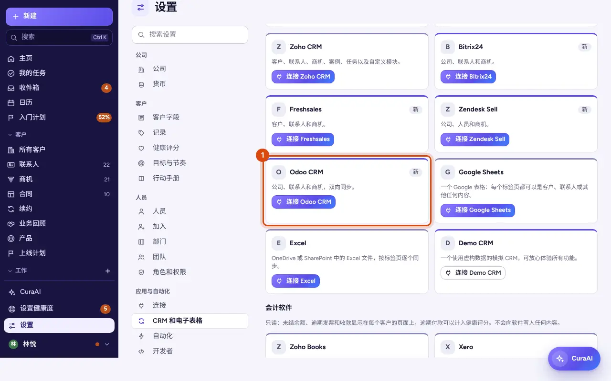

# Odoo CRM

来自 Odoo Online、Odoo.sh 或自有服务器的公司、联系人和商机，双向保持一致：Odoo 中的修改一小时内同步过来，Curahold 中的修改立即写回。

## 在 Curahold 中 {#connect}

1. 打开 **设置 → CRM 和电子表格**，点击 Odoo CRM 卡片上的 **连接 Odoo CRM**。
   

然后填写四个字段并点击 **连接**：

- **Odoo 地址**，例如：

```text
https://yourcompany.odoo.com
```

- **数据库名称**：仅在 Odoo.sh 或有多个数据库的自有服务器上需要。
- **登录名（邮箱）**：Curahold 以其权限工作的 Odoo 用户。
- **API 密钥**：见下文。

接着勾选 **公司**、**联系人** 和 **商机**，检查建议的字段对应，点击 **开始同步**。商机在概率 100% 时算赢单，被 Odoo 归档时算输单。

## 在 Odoo 中

1. 点击右上角头像 → **偏好设置**（Odoo 17 及以后为 **我的资料**）。
2. 打开 **账户安全**，点击 **新建 API 密钥**。
3. 输入名称（例如 `Curahold`），选择有效期，点击 **生成密钥**。
4. 复制密钥。Odoo 只显示一次。

在 Odoo Online 上使用 API 需要 **Custom** 方案（Odoo 的规定），并且必须安装 CRM 应用。

## 限制和频率

Odoo 没有公布固定限制；Curahold 保持每秒约两次请求。Odoo 19 及以后使用 JSON-2 API，旧版本使用 JSON-RPC（Odoo 将在第 20 版移除）。Odoo 19 中密钥最长有效三个月：到期前新建一个并重新连接。

## 冲突、错误和移除

双方修改了同一字段时，由该连接选定的规则决定（默认：较晚的修改）。被拒绝的值会带着 Odoo 自己的提示留在连接的 **状态** 标签中。密钥被撤销或过期时，连接显示 **需要处理**：用 **重新连接** 粘贴新密钥，映射保持不变。**移除** 会删除密钥；已同步的客户和记录保留在 Curahold 中。

## 另请参阅

- [连接和 CRM](/docs/zh-Hans/connections/)
- [Odoo（会计）](/docs/zh-Hans/accounting-odoo/)
