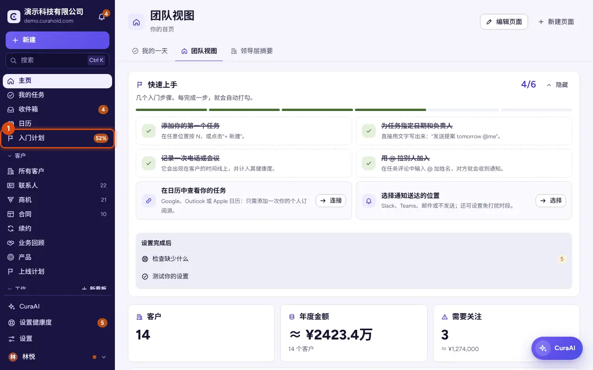
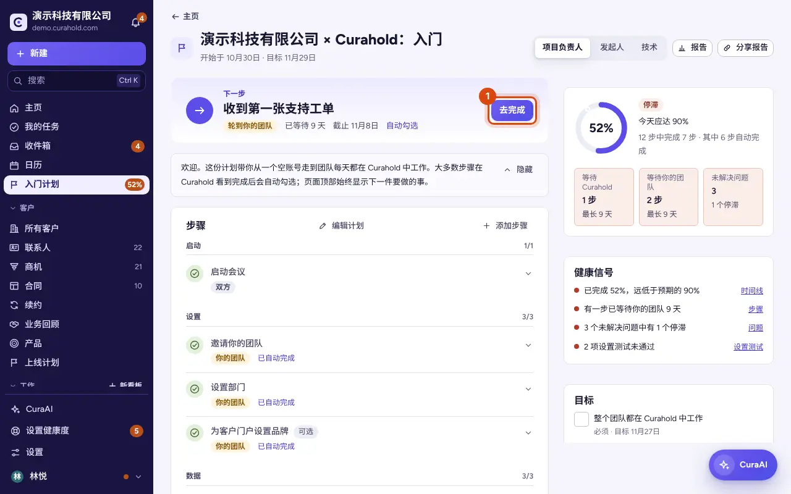
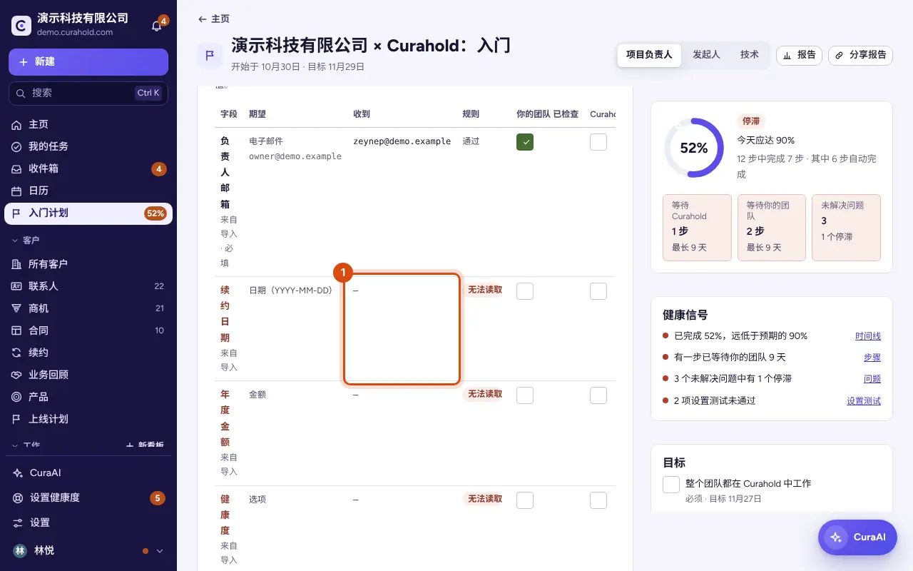
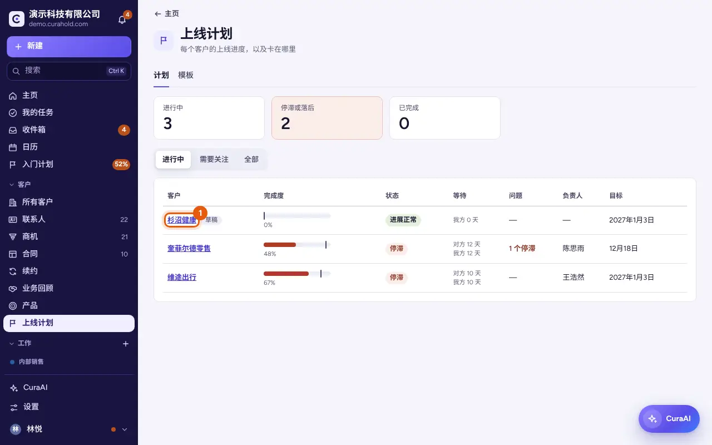
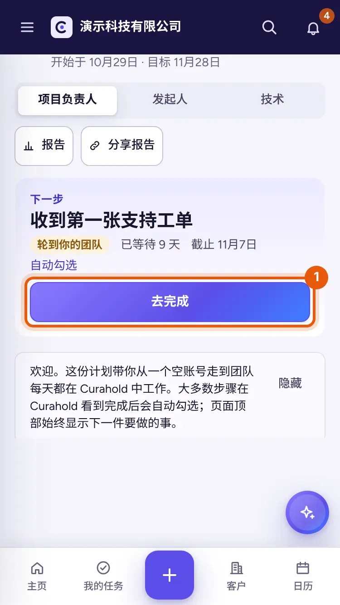

# 上线计划

上线计划是双方共同使用的一个页面。你的公司用它开始使用 Curahold，你也为每个上线的客户使用同一份计划。大多数步骤在 Curahold 看到完成后自动勾选；只有 Curahold 看不到的事（例如会议）才需要手动勾选。

## 1. 打开你的计划 {#start}

点击左侧菜单中的**入门计划**。旁边的数字是已完成的比例。

```text
https://<你的公司>.curahold.com/onboarding
```



## 2. 完成下一件事 {#next}

顶部卡片始终显示下一件要做的事、轮到谁以及已等待多久。点击**去完成**：Curahold 会打开完成该事项的界面。



## 3. 打开一个步骤 {#team}

点击任意步骤，查看它的用途、所需时间以及是否自动勾选。带锁的步骤在等待另一个步骤；下方一行说明在等哪一步、轮到谁。只对 Curahold 看不到的步骤点击**标记完成**。


## 4. 解决共享问题 {#health}

每个问题都说明轮到谁；开启超过五天或已过期的问题标为**停滞**。未通过的设置测试在这里只出现一次。修复后点击**重新测试**：测试通过后问题自动关闭。


## 5. 检查你的数据 {#mapping}

数据表为每个字段显示 Curahold 的期望、实际收到的内容以及四条规则：类型、格式、必填和空值。未通过的行会说明哪条规则不符。值正确时，勾选你这一方的方框。

```text
2027-03-31
```



## 6. 指定人员 {#people}

在**双方人员**下点击**添加人员**并选择角色。轮到某一步的负责人时，Curahold 会在应用内提醒他，步骤停滞时会再次提醒。邮件提醒默认关闭，需管理员开启。

## 7. 分享进度报告 {#report}

点击**分享报告**并复制链接。拥有链接的人只能看到报告（不含备注和联系方式）。打开**报告**可打印或另存为 PDF。


## 8. 你的客户的计划 {#customers}

点击客户下的**上线计划**。赢得交易时会自动开启带交接备注的草稿计划，交接确认后开始。客户会在你的门户中以你的品牌颜色看到同一份计划。完成后点击**完成并交接**：健康分作为基准保存，客户成功团队会收到交接卡。



## 在手机上

同一个页面，单列显示：下一件事在最前。


