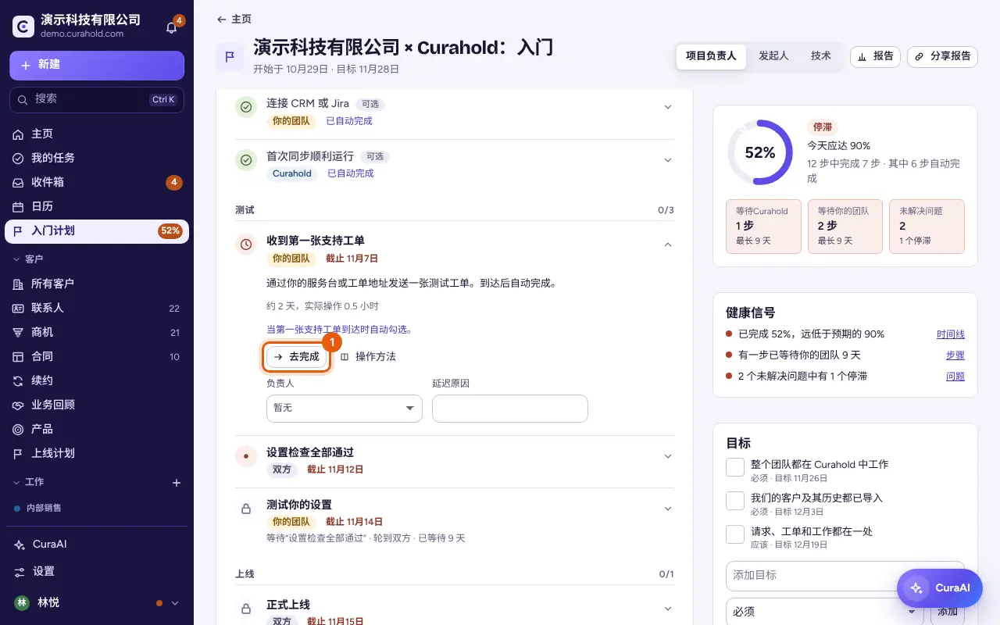
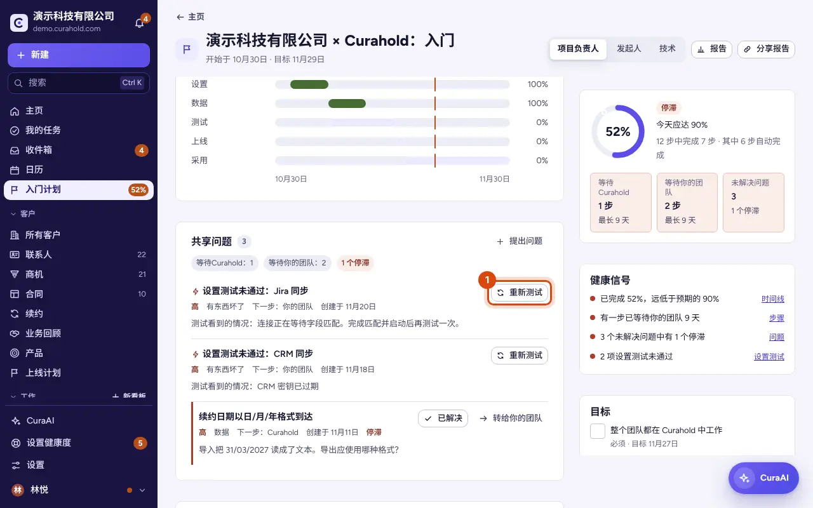
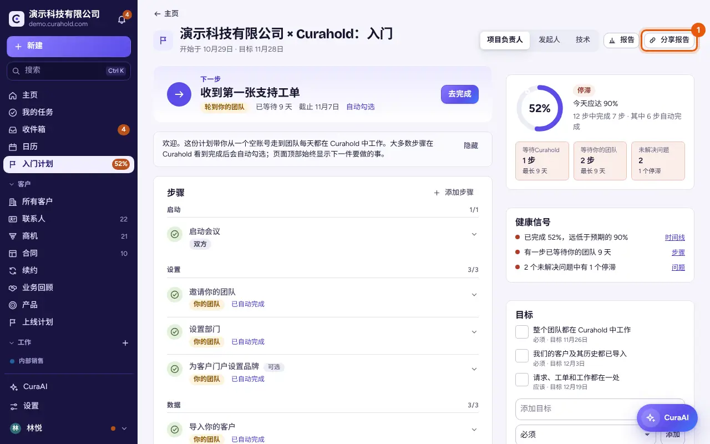

# 上线计划

上线计划是双方共同使用的一个页面。你的公司用它开始使用 Curahold，你也为每个上线的客户使用同一份计划。大多数步骤在 Curahold 看到完成后自动勾选；只有 Curahold 看不到的事（例如会议）才需要手动勾选。

## 1. 打开你的计划 {#start}

点击左侧菜单中的**入门计划**。旁边的数字是已完成的比例。

```text
https://<你的公司>.curahold.com/onboarding
```


## 2. 完成下一件事 {#next}

顶部卡片始终显示下一件要做的事、轮到谁以及已等待多久。点击**去完成**：Curahold 会打开完成该事项的界面。


## 3. 打开一个步骤 {#team}

点击任意步骤，查看它的用途、所需时间以及是否自动勾选。带锁的步骤在等待另一个步骤；下方一行说明在等哪一步、轮到谁。只对 Curahold 看不到的步骤点击**标记完成**。



## 4. 解决共享问题 {#health}

每个问题都说明轮到谁；开启超过五天或已过期的问题标为**停滞**。未通过的设置测试在这里只出现一次。修复后点击**重新测试**：测试通过后问题自动关闭。



## 5. 检查你的数据 {#mapping}

数据表为每个字段显示 Curahold 的期望、实际收到的内容以及四条规则：类型、格式、必填和空值。未通过的行会说明哪条规则不符。值正确时，勾选你这一方的方框。

```text
2027-03-31
```


## 6. 指定人员 {#people}

在**双方人员**下点击**添加人员**并选择角色。轮到某一步的负责人时，Curahold 会在应用内提醒他，步骤停滞时会再次提醒。邮件提醒默认关闭，需管理员开启。

## 7. 分享进度报告 {#report}

点击**分享报告**并复制链接。拥有链接的人只能看到报告（不含备注和联系方式）。打开**报告**可打印或另存为 PDF。



## 8. 你的客户的入门计划 {#customers}

点击客户下的**上线计划**。只有开启了相应设置，赢得商机时才会自动开启计划（第 10 节）。客户会在你的门户中以你的品牌颜色看到同一份计划。完成后点击**完成并交接**：健康评分作为基准保存，客户成功团队会收到交接卡。

要为客户开启计划，点击右上角的**新建计划**，选择客户和模板，再点击**打开计划**。计划今天开始：按这个客户修改（第 9 节）。

在客户页面的“各部门负责人”下点击**开始上线计划**，效果相同。


## 9. 为客户量身调整计划 {#personal}

每个客户的计划都是独立的副本：修改它不会影响模板。

1. 在计划的**步骤**中，点击**编辑计划**。
2. 在阶段的输入框中改名，用箭头移动，或用**添加阶段**新增阶段。仍有步骤的阶段不能删除：请先移动或删除其中的步骤。
3. 在步骤的输入框中改名，用箭头移动，为它选择其他阶段，或删除它。
4. 点击**完成编辑**。若要再次使用此计划，点击**另存为模板**并命名。

## 10. 自动打开的计划 {#won}

由管理员在**上线计划 → 模板**页面底部决定：

1. 勾选**赢单时打开入门计划**。在你开启之前它是关闭的。
2. 选择要使用的模板，或选择**每次询问**：草稿会请接手客户的人来选择。
3. 可选：按细分、套餐或地区（任意客户字段）添加规则。客户符合的第一条规则决定模板。

提醒始终显示在应用中。是否同时通过电子邮件接收，由每个人在自己的通知设置中决定。

## 在手机上

同一个页面，单列显示：下一件事在最前。


