# 设置检查与测试设置

两个页面帮你不靠猜测完成设置。**设置健康**告诉你缺什么、哪里不对。**测试你的设置**让你按团队的实际用法逐项试用。系统不会替你更改任何东西：每个修复都是一个打开正确页面的按钮，剩下的由你完成。

## 找出缺少的内容

1. 在左侧菜单中点击**设置健康**。旁边的数字表示有几项值得查看；一切正常后它会消失。
   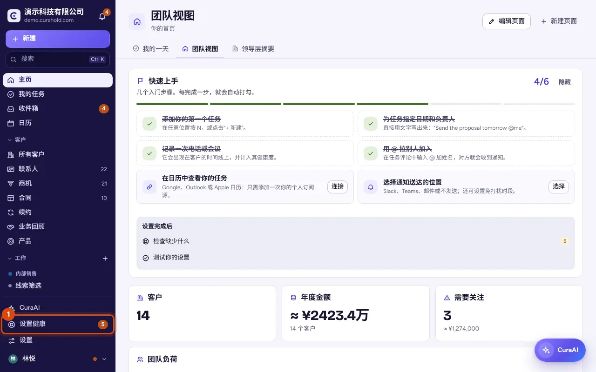
2. 阅读第一行。最重要的排在最前：**优先处理**，然后是**值得修复**，最后是**有空时处理**。每一行都写明我们发现了什么、为什么重要。
   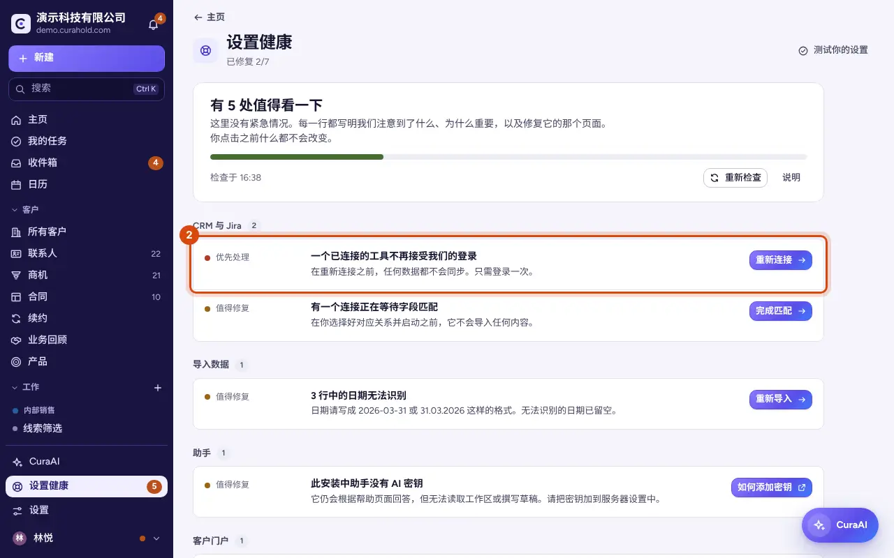
3. 点击该行的按钮，会直接打开修复它的页面。
   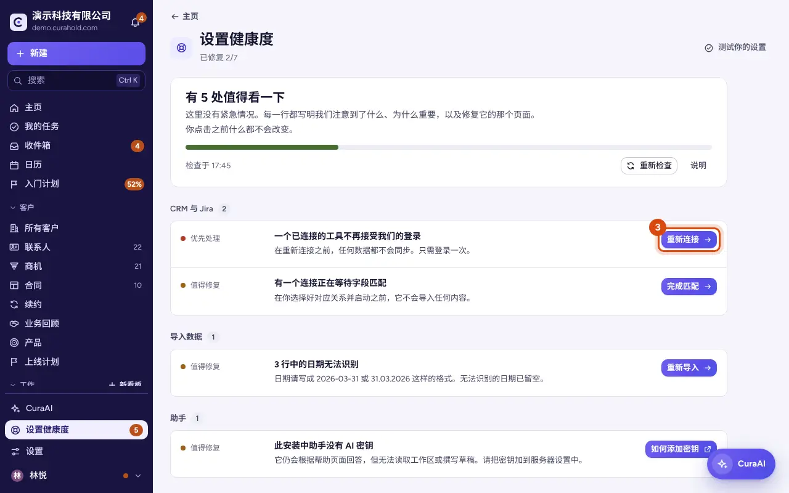
4. 修复后回来点击**重新检查**。该行会移到**已修复**，页面顶部会显示已修复几项。
   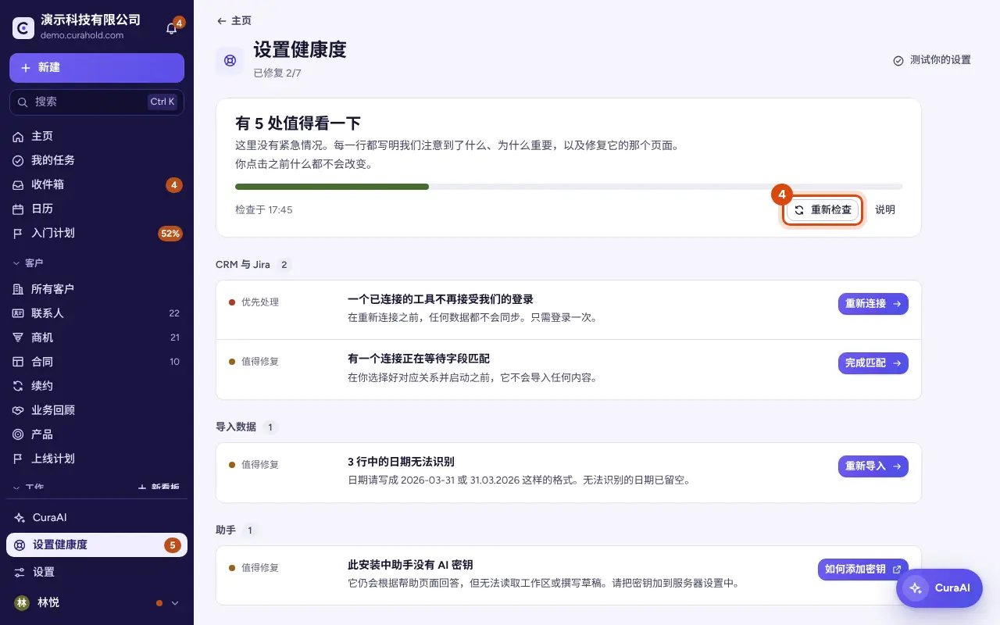
5. 在负责修复的页面顶部，也会用黄色框显示这个问题。点击**查看全部**查看完整列表。
   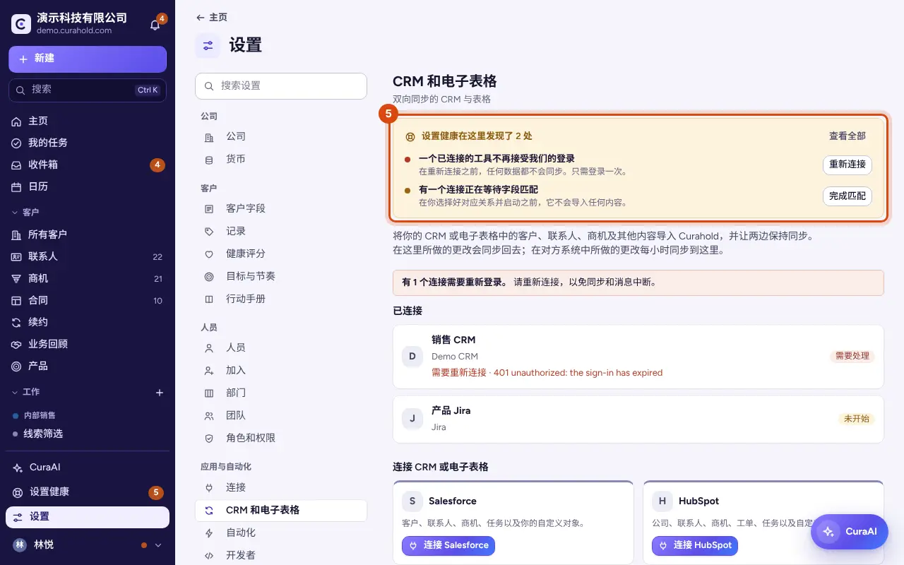

有些内容我们无法在这里读取，例如邮件域名的 SPF、DKIM 和 DMARC 记录。添加后，在该行点击**我已完成**。

每个人只看到自己能修复的内容。管理员看到公司的全部检查；运行 Curahold 服务器的人还会看到邮件和 AI 密钥。我们每天重新检查一次，并标出新出现的问题。

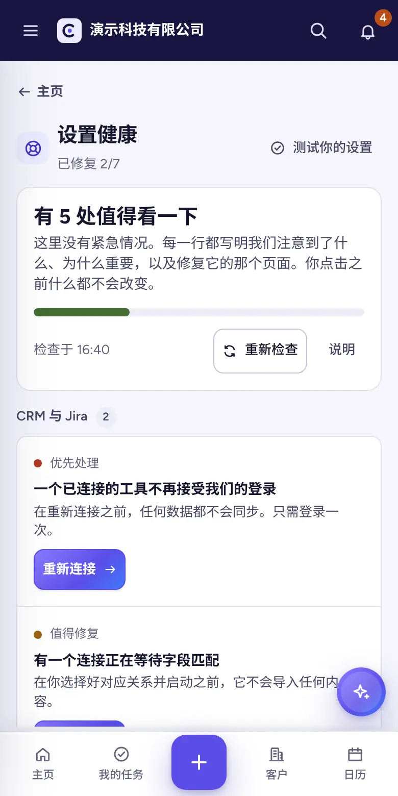

## 询问助手

打开助手，原样输入：

```text
我的设置有什么问题？
```

它会列出同样的问题和对应按钮。它只读取，从不自行修复任何东西。

## 测试你的设置

1. 在**设置健康**页面，点击右上角的**测试你的设置**。
   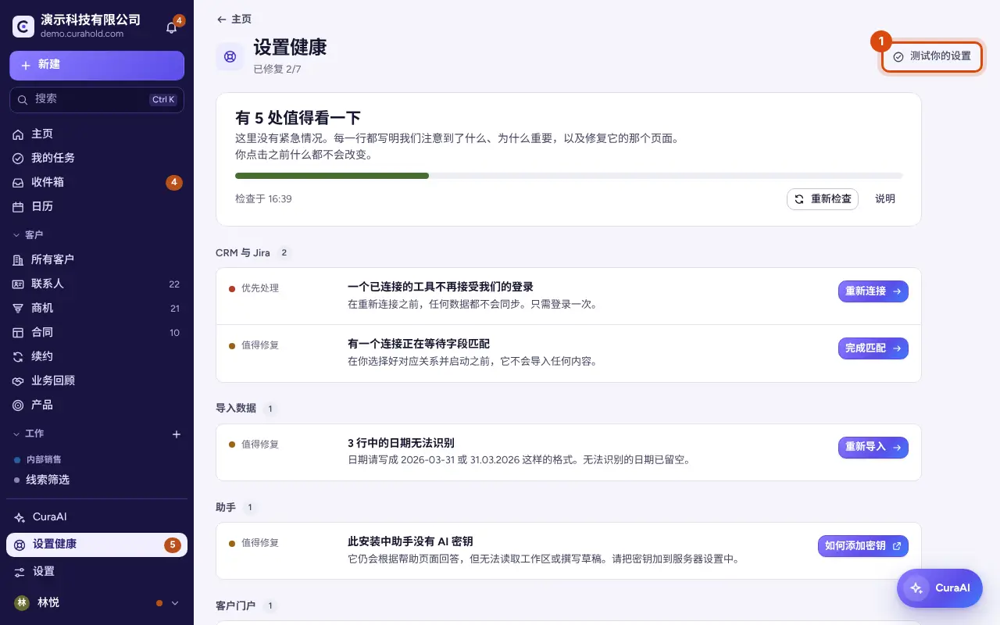
2. 在某个步骤上点击**测试**。需要你亲眼确认的步骤则显示**可以了**和**不行**。如果步骤询问用什么来测试（客户、连接、同事），只需选择一次，下次测试会沿用。
   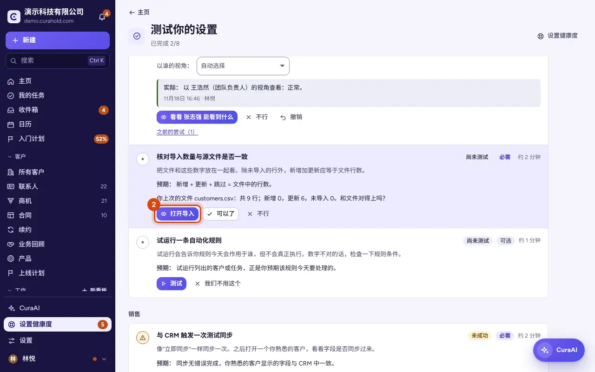
3. 对照**实际**和**预期**。两者一致即表示通过。每次尝试都会记录执行人和时间，你可以随时重测。
   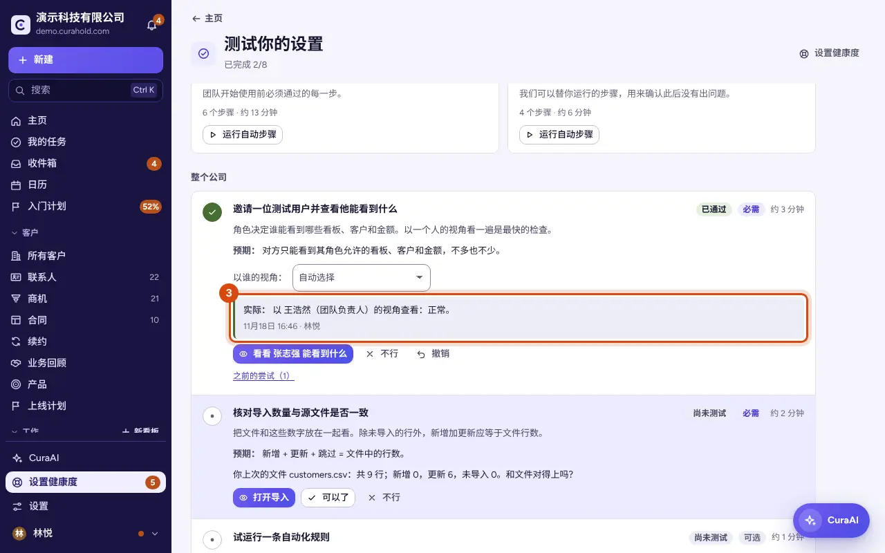
4. 如果没有成功，点击**打开修复页面**，修复后再测。如需帮助，点击**创建问题**：问题会和该步骤放在一起，步骤通过后自动关闭。
   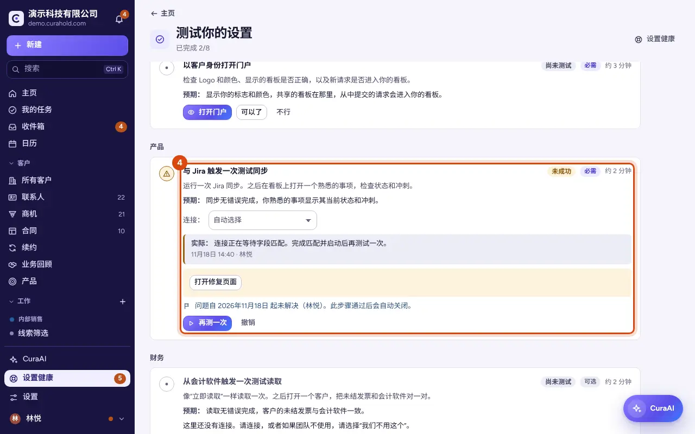
5. 要一次运行多个步骤，选择一个组合：**上线前**或**每月检查**，然后点击**运行自动步骤**。
   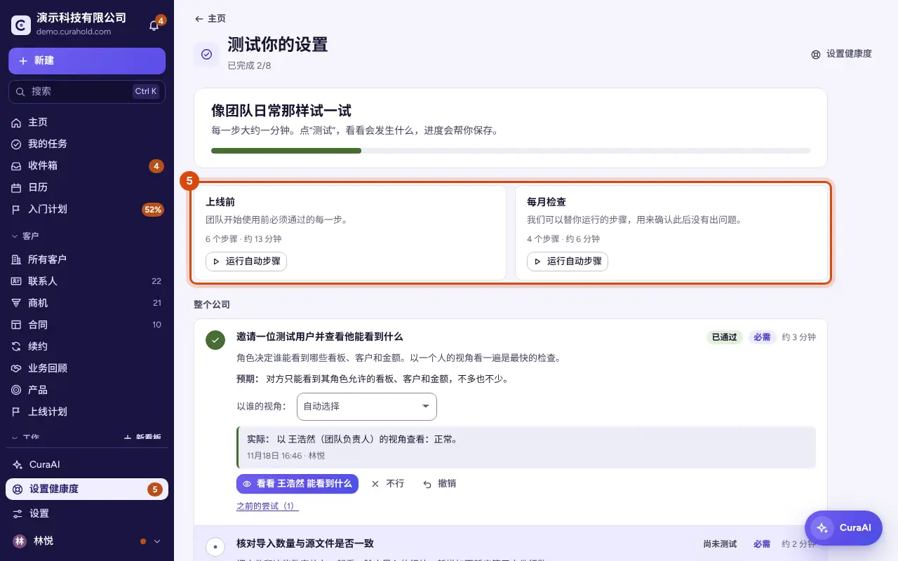
6. 所有**必需**步骤通过后，先由贵公司的管理员点击**批准**，再由 Curahold 的人批准。页面随即显示**设置完成**和日期。
   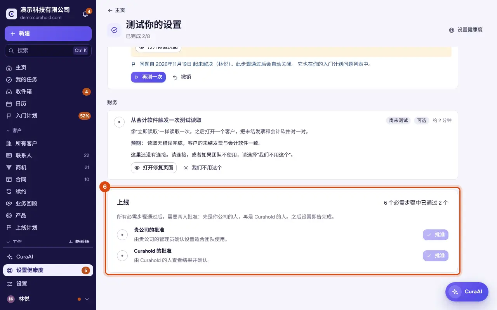

## 每项检查的含义

此表直接取自产品本身的文字，因此始终与页面一致。

<!-- setup-checks:start (scripts/docs/setup-health-page.ts writes this part) -->

### 团队

| 我们发现的问题 | 为什么重要 | 按钮 |
| --- | --- | --- |
| 目前这里只有你一个人 (优先处理) | 任务、交接和提醒都需要有人接收。请邀请会在 Curahold 中工作的人。 | **邀请成员** |
| … 个邀请超过一周未被接受 (有空时处理) | 他们可能错过了邮件。请重新发送，或检查邮箱地址。 | **查看邀请** |
| … 个角色没有任何成员 (有空时处理) | 没人担任的角色不起作用。把它分配给合适的人，或删除它让列表保持清晰。 | **打开角色** |

### 部门

| 我们发现的问题 | 为什么重要 | 按钮 |
| --- | --- | --- |
| 部门尚未设置 (值得修复) | 看板、交接以及谁能看到什么都依据部门。请把每个人放进所属部门。 | **设置部门** |
| … 个部门没有负责人 (值得修复) | 只有负责人能打开部门的看板，交给该部门的交接也会送到负责人。 | **选择负责人** |

### 导入数据

| 我们发现的问题 | 为什么重要 | 按钮 |
| --- | --- | --- |
| 上次导入有 … 行没有导入 (值得修复) | 这些行里有内容无法读取。导入完成后会立即列出它们的行号；在文件中改好后重新导入：已导入的行会更新，不会重复。 | **打开导入** |
| 上次导入有 … 行没有客户名称 (值得修复) | 名称是每行都必须有的一列。请在文件中填写后重新导入：已导入的行会被更新，不会重复。 | **重新导入** |
| … 行中的日期无法识别 (值得修复) | 日期请写成 2026-03-31 或 31.03.2026 这样的格式。无法识别的日期已留空。 | **重新导入** |
| … 行中的金额无法识别 (值得修复) | 只用数字，例如 12500 或 12.500,00，币种单独放一列。这些金额已留空。 | **重新导入** |
| … 个客户重复出现 (有空时处理) | 任务和笔记会分散在两份记录里。保留一份，把另一份合并进去。 | **查看** |

### CRM 与 Jira

| 我们发现的问题 | 为什么重要 | 按钮 |
| --- | --- | --- |
| 一个已连接的工具不再接受我们的登录 (优先处理) | 在重新连接之前，任何数据都不会同步。只需登录一次。 | **重新连接** |
| 与 … 个工具的上次同步没有完成 (优先处理) | 此后的更改都在等待。连接页面会说明是什么让它停下的。 | **查看原因** |
| 有一个连接正在等待字段匹配 (值得修复) | 在你选择好对应关系并启动之前，它不会导入任何内容。 | **完成匹配** |
| … 项更改无法发送到另一个工具 (值得修复) | 我们已尝试三次。连接页面会列出每一项及原因，并可以重试。 | **查看** |
| … 个 API 密钥将在两周内失效 (值得修复) | 使用它的地方都会停止发送。请在此之前创建新密钥并替换。 | **打开 API 密钥** |
| 本周有 … 项更改被另一个工具覆盖 (有空时处理) | 两边改了同一处。什么都没丢：被替换的值保存在每个任务的历史里。请确认连接的规则是你想要的。 | **检查规则** |

### 会计

| 我们发现的问题 | 为什么重要 | 按钮 |
| --- | --- | --- |
| 无法读取你的会计软件 (优先处理) | 客户页面上的发票和付款会停留在上次成功读取时的状态。 | **打开连接** |
| 会计数据已两天没有读取 (值得修复) | 逾期发票可能不是最新的。现在读取一次，或查看每日读取为何停止。 | **打开连接** |

### BI 工具

| 我们发现的问题 | 为什么重要 | 按钮 |
| --- | --- | --- |
| … 个分析密钥将在两周内失效 (值得修复) | BI 工具中的报表将停止刷新。请轮换密钥，并把新密钥粘贴过去。 | **打开分析密钥** |
| 你的 BI 工具已一周没有拉取数据 (有空时处理) | 它的仪表板显示的是上周的数字。请检查定时刷新，或它使用的密钥。 | **打开分析密钥** |

### 客户门户检查

| 我们发现的问题 | 为什么重要 | 按钮 |
| --- | --- | --- |
| 客户门户已开启，但没有向客户显示任何内容 (值得修复) | 至少与门户共享一个看板，客户才能提交并跟进请求。 | **选择共享内容** |
| 还没有人被邀请到门户 (有空时处理) | 客户只有被邀请后才能登录。先邀请某个客户的一位联系人开始吧。 | **邀请客户** |
| 门户仍在使用 Curahold 的配色 (有空时处理) | 你的 Logo 和颜色让客户知道自己来对了地方。 | **添加品牌** |

### 自动化

| 我们发现的问题 | 为什么重要 | 按钮 |
| --- | --- | --- |
| … 条自动化规则监视的字段不存在 (优先处理) | 照现在这样它永远不会运行。点“修改规则”，再点“编辑”和“保存”：它会改用你们自己的日期字段。或者关闭这条规则。 | **修改规则** |
| … 条自动化规则指向已不存在的看板 (优先处理) | 它要创建的任务无处可去。请选择另一个看板。 | **修改规则** |
| 还没有自动化规则 (有空时处理) | 一条规则，比如每次续约前 60 天自动建任务，每次都替你提醒。现成的规则可以直接开启。 | **查看现成规则** |

### 你的数据检查

| 我们发现的问题 | 为什么重要 | 按钮 |
| --- | --- | --- |
| … 个客户没有负责人 (值得修复) | 它们的提醒发不到任何人，也不在任何人的列表里。请给每一个指定负责人。 | **指定负责人** |
| … 个进行中的商机没有阶段 (值得修复) | 它们不会出现在销售漏斗和预测中。 | **打开商机** |
| … 个未结工单无人跟进 (有空时处理) | 没有负责人的工单不在任何人的队列里。请逐个分配，或添加一条自动分配的规则。 | **打开工单** |

### 邮件

| 我们发现的问题 | 为什么重要 | 按钮 |
| --- | --- | --- |
| 此安装还不能发送邮件 (优先处理) | 邀请、登录链接和提醒只会写进服务器日志。请设置邮件中继或邮件服务商。 | **如何设置邮件** |
| 确认邮件域名的 SPF、DKIM 和 DMARC 记录 (值得修复) | 没有它们，邀请会进垃圾箱或被拒收。我们无法从这里读取你的 DNS：请添加记录后再确认。 | **查看记录** |

### 隐私

| 我们发现的问题 | 为什么重要 | 按钮 |
| --- | --- | --- |
| 没有人能处理个人数据请求 (值得修复) | 根据 KVKK 和 GDPR，必须有人能导出或删除某人的数据。请给一个角色隐私权限。 | **打开角色** |

### 试用与方案

| 我们发现的问题 | 为什么重要 | 按钮 |
| --- | --- | --- |
| 你的试用将于 … 结束 (值得修复) | 之后在选择方案前，工作区将变为只读。不会删除任何内容。 | **选择方案** |
| 试用的席位已全部占用 (值得修复) | 新成员只能以查看者身份加入。请申请更多席位，或空出一个。 | **查看席位** |

### 助手

| 我们发现的问题 | 为什么重要 | 按钮 |
| --- | --- | --- |
| 此安装中助手没有 AI 密钥 (值得修复) | 它仍会根据帮助页面回答，但无法读取工作区或撰写草稿。请把密钥加到服务器设置中。 | **如何添加密钥** |

<!-- setup-checks:end -->

## 面向开发者

同样的检查也可通过 API 读取，以密钥所有者的身份执行。把两个示例替换为你公司的地址和你的密钥：

```bash
curl -H "Authorization: Bearer YOUR_API_KEY" https://your-company.curahold.com/api/setup-health
```

完整地址列表见[参考：设置检查](/docs/zh-Hans/ref-setup/)。
