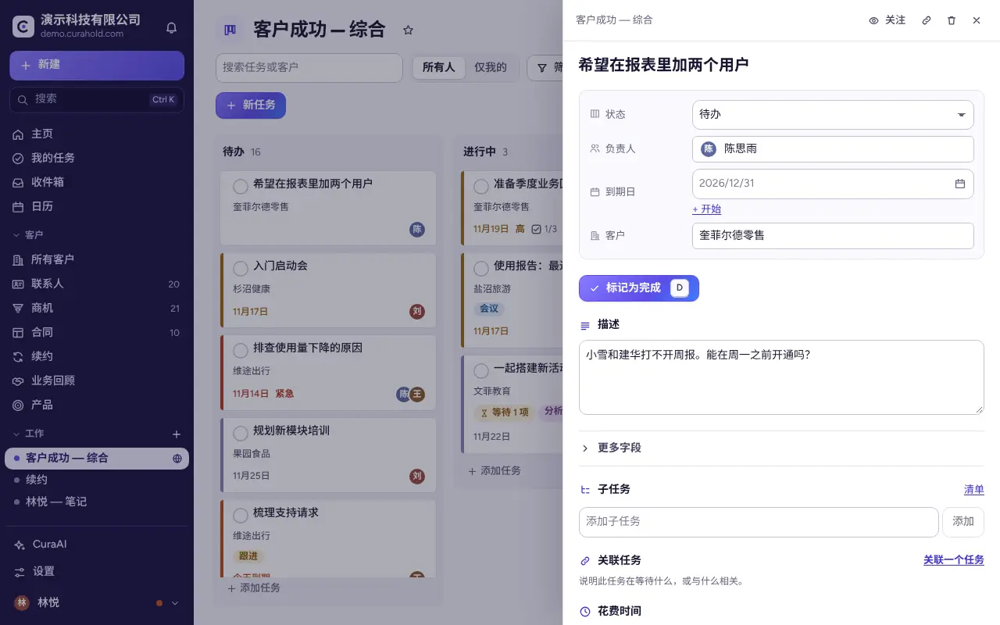

# 任务和看板

工作在看板上推进。看板可以属于一个团队、整个公司或只属于你自己，列由你来定。

## 任务

任务有标题、描述、负责人（最多 10 人）、截止日期、优先级，还可以关联一个客户。可以添加子任务、文件和评论。任务在看板旁边的面板中打开，它的链接发给谁都能打开。

每张卡片边缘的细条显示任务相对于时间的状态：宽松、临近、今天、逾期、完成。同样的颜色也出现在日历和“我的任务”中。日期通过产品自带的日期选择器选择，使用你的语言和你习惯的日期顺序。

## 两个人同时修改同一个任务时

Curahold 从不悄悄覆盖任何人的修改。如果你编辑时别人先保存了，他的修改会保留，你的修改在其基础上生效。只有同一个字段真正冲突时才会询问你。

## 批量修改和撤销

在看板或列表中选中多个任务，一次性修改状态、负责人、日期或优先级。底部的提示中提供 **撤销**。

## 重复任务

可以让任务每隔若干天、周或月重复一次。当前任务完成后，下一个任务才会出现。新日期有两种计算方式：

- **从截止日期算起：** 适合固定日程，比如“每月 1 日交报告”。
- **从完成那天算起：** 适合“上次通话两周后再打一次”这类工作。

## 提及和静音

在评论中输入 `@` 提及某人，对方会收到通知。如果不想再收到某个任务的消息，在它的菜单中选择 **停止此任务的评论通知**。

## 快速搜索

在任何地方按 Ctrl K（Mac 上为 ⌘ K）即可查找客户、任务、人员、看板或页面。用方向键移动，按 Enter 打开。

## 任务的更多功能

- **关注：** 用任务顶部的按钮，即使任务不是你的，也能收到评论和列变动的消息。
- **关联任务：** 指定一个任务 **等待** 另一个任务、**阻塞** 另一个任务，或 **相关于** 另一个任务。等待中的任务卡片上显示“等待 1 项”；它等待的任务完成后，其负责人会收到“你可以开始了”的通知。任务之间不能形成循环等待。
- **开始日期：** 截止日期旁的 **+ 开始** 记录工作何时开始；时间线会把它画成一条横条。
- **花费时间：** 用 +15 分钟、+30 分钟、+1 小时按钮，或手动输入（“1.5”“45m”“1:30”）。客户页面会显示为该客户记录的总时长。
- **清单：** 把常用的步骤保存一次（添加子任务 → **将这些子任务保存为清单**），之后一键添加到任何任务。
- **历史：** 谁在什么时候改了什么，逐行显示在任务底部。
- **相似提醒：** 如果你要添加的任务和某个尚未完成的任务很像，快速添加会提醒你。

## 看板自己的字段

看板设置 → **字段和请求表单**：为该看板上的每个任务添加字段（文本、数字、金额、日期、选项、链接、邮箱、人员、是/否）。标记为 **完成前必须填写** 的字段，必须填好任务才能移到“完成”列；批量修改会跳过这些任务并告诉你有几个。选项字段在卡片上显示为彩色标签，也可以用来筛选。

## 筛选和保存的视图

看板顶部的 **筛选** 可以按人员、截止日期（逾期、今天、7 天内等）、优先级和看板的选项字段缩小范围。在手机上，所有筛选条件集中在一个 **筛选** 面板里。用 **视图 → 保存** 给当前的筛选命名，如果愿意，也可以把这个视图共享给看板上的所有人。

## 请求表单

在看板设置中开启 **通过表单接收请求**，并选择表单要问哪些内容。同事使用看板上的 **请求表单** 按钮；请求会作为任务进入你指定的列，提出请求的人会自动关注它。

## 从其他工具迁移：从文件导入任务

看板顶部的向上箭头按钮（**从文件导入任务**）可以导入你从旧工具导出的 CSV 或 Excel 文件。文件在浏览器中读取；在你确认每一列的去向之前，什么都不会发送。

- 列会被自动识别（Title、Description、Status、Assignee、Due date、Start date、Priority、Customer、Completed on，以及它们的土耳其语名称）。每一列都可以修改；“导入为”一列会显示前几行将如何导入。
- **Status** 会进入看板上同名的列。“To do”“In progress”“Done”等常见名称也能识别；其他值会进入第一列，并在结果中列出。
- **Assignee** 按姓名或邮箱匹配；找不到的人会被略过，并告诉你是谁。客户名称也以同样方式匹配。
- 已完成的任务默认不导入，除非勾选“同时导入已完成的任务”。
- 不会通知任何人，也不会运行任何规则。整个导入可以在 30 天内 **撤销**：没人动过的任务会被删除，有人处理过的会移入归档。

每次最多 5,000 行。

## 日历

**日历** 显示每一天有什么：按截止日期排列的任务、已举行的会议、电话和回顾、续约，以及到期的业务回顾。上方的标签可以开关每一种类型。

- **日、周、月、年：** 顶部的切换按钮。日视图列出当天的所有事项，以及对应的客户和负责人；年视图显示十二个小月份，事项越多颜色越深。点击日期数字即可打开那一天。
- **谁的日历：** 你自己的，或你能看到的所有人。角色允许 *查看队友日历* 的人（最初是管理员和团队负责人）还可以选择某一个人或整个团队。这只会缩小他们本来就能看到的范围，不会显示任何新内容，所以私有看板仍然是私有的。
- 视图、日期以及是谁的日历都保存在地址中，所以链接打开的是同样的内容。

## 归档

已完成的任务在看板保留足够长时间后（默认 90 天；可在看板设置中设为 30–365 天或“始终”）会自动移入看板的 **归档**。用了好几年的看板也能立即打开。归档的任务仍会计入报表；在看板 / 列表旁边的 **归档** 视图中搜索，用 **恢复** 把任务放回来。恢复的任务会再在看板上保留同样的天数。你在列表视图中手动归档的任务也在这里。

## 删除任务，以及恢复已删除的任务

删除的任务会连同其子任务、评论、时间记录和文件一起进入 [回收站](/docs/zh-Hans/trash/)，30 天内可以恢复：删除后立即在提示中选择 **撤销**，或打开你的菜单，选择 **回收站**，再点 **恢复**。只有任务的创建者，或角色允许删除任何任务的人，才能删除任务。如果只想把已完成的任务移开而不删除，可以将其归档。
