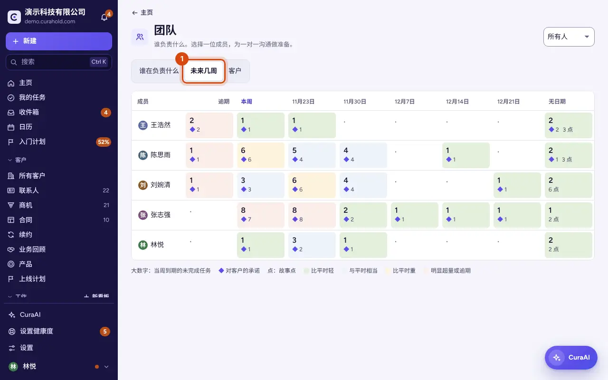
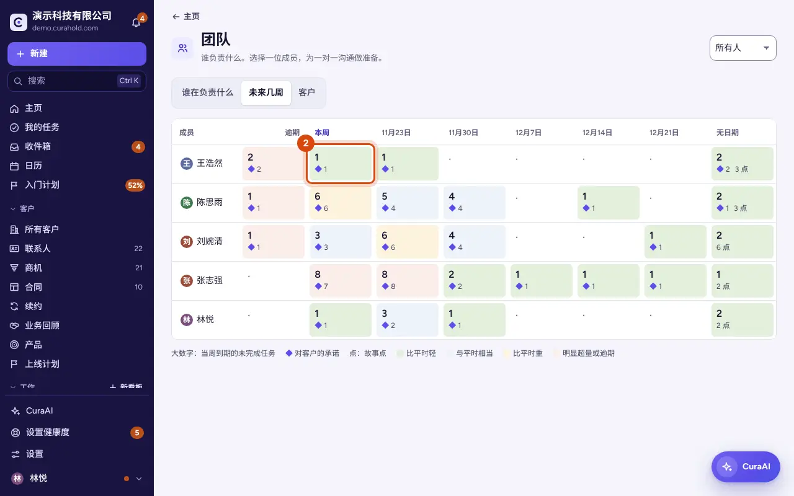
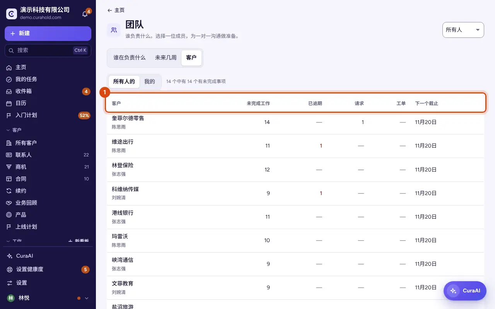

# 团队的未来几周、客户组合和服务成本

**团队**（左侧菜单中）有三种视图：**谁在负责什么**、**未来几周** 和 **客户**。在顶部选择一个团队可缩小任一视图的范围。只统计你有权查看的任务。

## 未来几周谁有空 {#weeks}

1. 打开 **团队**，点击 **未来几周**。
   
2. 按周查看某个人的行。每个格子里，大数字是当周到期的未完成任务，◆ 是其中对客户的承诺数量，**pt** 是它们的故事点。颜色把这一周与此人通常的负荷相比：较轻、正常、较重或远超。**逾期** 和 **无日期** 各有单独的列。点击格子可打开此人的一对一视图。
   

## 每个客户的未完成工作 {#customers}

1. 打开 **团队**，点击 **客户**。列出每个有未完成事项的客户，最忙的在前：未完成工作、其中逾期多少、其人员通过门户发来的请求、尚未解决的支持工单以及下一个截止日期。点击列名可按该列排序；在 **所有人的** 和 **我的** 之间切换。
   

这里故意不显示金额：谁能看到金额是按字段决定的。

## 服务成本 {#cost-to-serve}

1. 在菜单中打开 **报表**，点击 **报表** 标签，然后点击 **服务成本**。它按客户显示近 12 个月在其工作上记录的工时，按每 1,000 年度价值计算（ARR，否则 MRR × 12，否则第一个金额字段）。数值最高的就是服务成本最高的客户。
   

它在报表构建器中附带两个字段：**记录工时（近 12 个月）** 和 **每 1,000 年度价值所用小时**。无权查看客户价值的人看不到成本数字。
