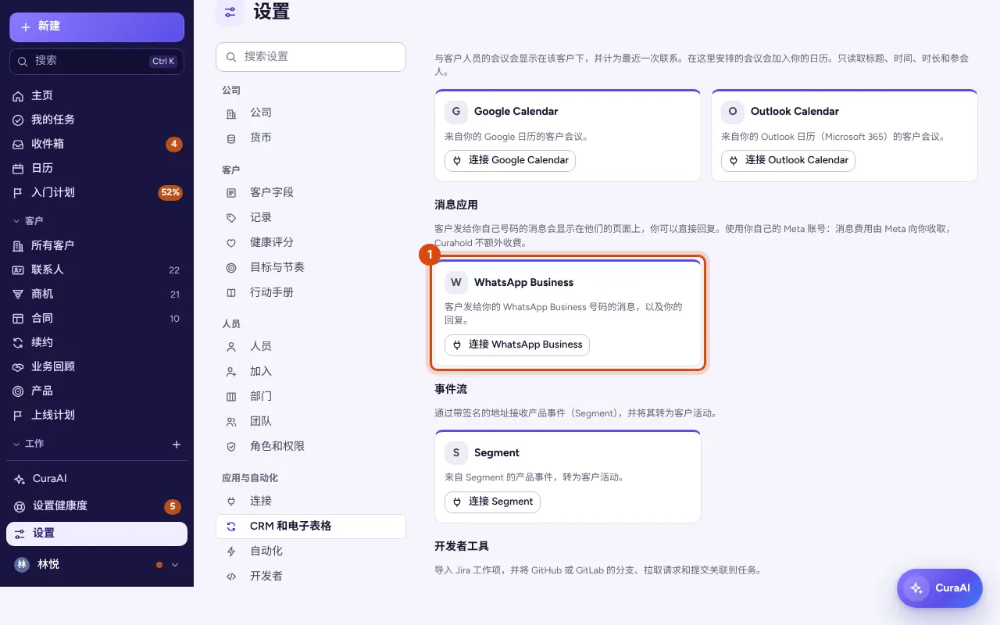
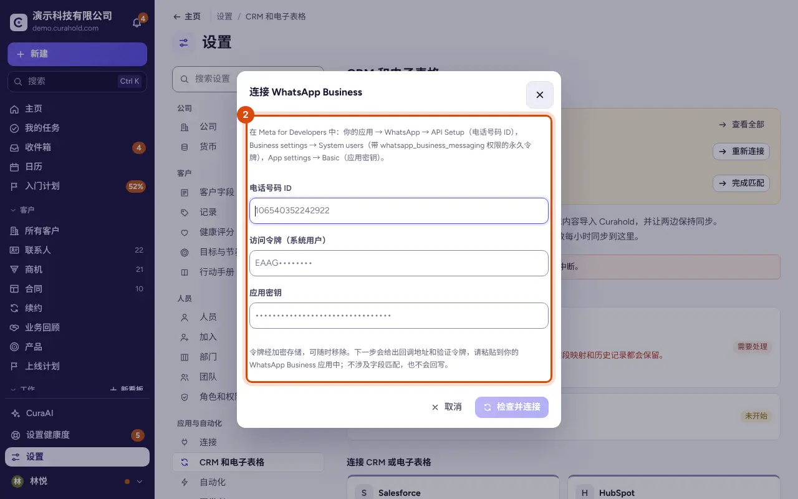

# WhatsApp Business

客户发到你的 WhatsApp Business 号码的消息会显示在他们的页面上，你可以在那里回复。使用的是你 **自己** 的 Meta 应用和号码：消息费用由 Meta 向你收取，Curahold 不额外收费，也看不到你的 Meta 账单。

## 开始之前

你需要一个在 Cloud API 上有 WhatsApp Business 号码的 Meta 商务账号、一个添加了 WhatsApp 产品的 Meta 应用，以及一个带永久令牌的 **系统用户**（权限 `whatsapp_business_messaging`）。Meta 的页面会一步步引导，大约 15 分钟。

## 在 Curahold 中 {#connect}

1. 打开 **设置 → CRM 和电子表格**，找到 **消息应用**，点击 **连接 WhatsApp Business**。
   
2. 粘贴下面三个值并点击 **连接**。随后连接页面会显示 **回调地址** 和 **验证令牌**。
   

- **电话号码 ID**：Meta for Developers → 你的应用 → **WhatsApp → API Setup**。
- **访问令牌（系统用户）**：Business settings → **System users** → 该用户 → **Generate new token**。
- **应用密钥**：你的应用 → **App settings → Basic** → **App secret** → **Show**。

## 在 Meta 中

1. 打开应用 → **WhatsApp → Configuration**，在 **Webhook** 旁点击 **Edit**。
2. 把回调地址粘贴到 **Callback URL**，把验证令牌粘贴到 **Verify token**，点击 **Verify and save**。
3. 在 **Webhook fields** 下点击 **Manage**，订阅 **messages**。

## 会收到什么，如何回复

消息会作为备注落到联系人中有发件人号码的客户下（`0532…` 这类本地写法也能匹配）。在这条备注上点击 **在 WhatsApp 上回复**。WhatsApp 只允许在客户最后一条消息后的 24 小时内发送自由文本；之后 Curahold 会要求填写已获批准的 **模板** 名称和语言。

## 限制和频率

消息随 Meta 的推送到达。Meta 会对失败的推送重试最多 7 天；每条消息只保存一次。Meta 限制单个号码的发送速度；“繁忙”的回复会说明，不会丢失任何内容。

## 出现问题时

令牌过期或被撤销会在回复时显示：用 **重新连接** 粘贴新令牌。来自任何联系人都没有的号码的消息只计数，不保存。**移除** 会立即停止回调；客户下已有的备注保留。

## 另请参阅

- [时间线和健康评分](/docs/zh-Hans/timeline-and-health/)
- [连接和 CRM](/docs/zh-Hans/connections/)
