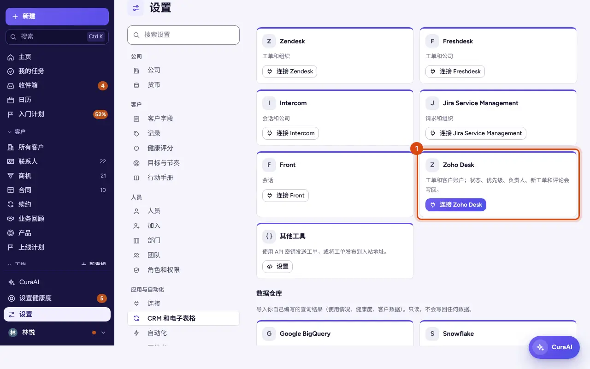

# Zoho Desk

Zoho Desk 的工单和客户账户会显示在匹配的客户下、汇总中和健康评分里。在 Curahold 中修改的状态、优先级和负责人会写回 Zoho Desk，在 Curahold 中新建的工单也会在那里创建，回复或内部备注会以评论形式添加。

## 在 Curahold 中 {#connect}

1. 打开 **设置 → CRM 和电子表格**，找到 **支持工具**，点击 **连接 Zoho Desk**。
   

会打开 Zoho 页面。用服务台的一名客服账号登录并点击 **接受**。Curahold 会找到你的数据中心（.com、.eu、.in、.com.au、.jp、.sa、.uk、.ae、.ca、.com.cn）和门户。回来后勾选 **工单** 和 **客户账户**，检查字段对应，点击 **开始同步**。

## 限制和频率

每小时读取一次变更。Zoho 按方案的每日额度为每次调用扣除积分；用完时 Zoho 会要求等待，Curahold 下次继续。从 Curahold 发出的公开回复是工单上的公开评论；邮件回复由 Zoho Desk 发送。

## 出现问题时

登录过期会自动续期。客服失去访问权限时，连接显示 **需要处理**：点击 **重新连接** 并重新登录。**移除** 会删除登录信息；已同步的工单保留。

## 另请参阅

- [连接和 CRM](/docs/zh-Hans/connections/)
