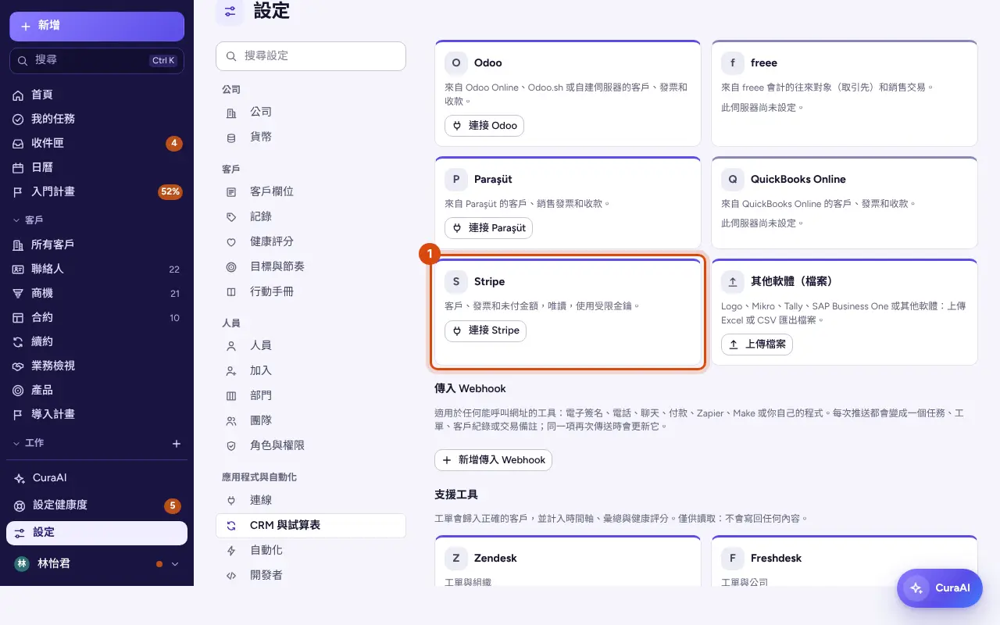

# Stripe（唯讀）

來自 Stripe 的客戶、發票（含到期日和未付金額）和付款。Curahold 絕不寫入 Stripe：你提供的金鑰只能讀取。

## 在 Curahold 中 {#connect}

1. 開啟 **設定 → CRM 與試算表**，找到 **會計軟體**，點選 **連接 Stripe**。
   

把受限金鑰貼到 **受限金鑰**，點選 **連接**。完整的私密金鑰（`sk_…`）會刻意被拒絕。接著點選 **開始**，並在 **配對** 分頁檢查未配對的客戶。

## 在 Stripe 中

1. 開啟 **Developers → API keys**，點選 **Create restricted key**。
2. 命名為 `Curahold`。
3. 把 **Customers**、**Invoices** 和 **Events** 設為 **Read**，其餘保持 **None**。
4. 點選 **Create key**，完成第二步驗證，複製金鑰。它的開頭如下：

```text
rk_live_
```

可以先用沙盒金鑰（`rk_test_…`）試用。

## 限制與頻率

第一次讀取會取得全部資料；之後只讀取變更，來源是 Stripe 的事件清單（Stripe 保留 30 天）。Stripe 每秒允許 100 次請求（沙盒 25 次）；Curahold 遠低於此。金額依各幣別自己的小數位數讀取（日圓沒有小數）。Stripe 標為「uncollectible」的發票在這裡仍算欠款，因此逾期仍然看得到。

## 發生問題時

金鑰被輪替或刪除時，連線會顯示 **需要處理**：建立新的受限金鑰，用 **重新連線** 貼上。缺少權限時，連接步驟會指出是哪一項。**移除** 會刪除金鑰；已讀取的資料會保留，直到你刪除。

## 另請參閱

- [會計軟體](/docs/zh-Hant/accounting/)
