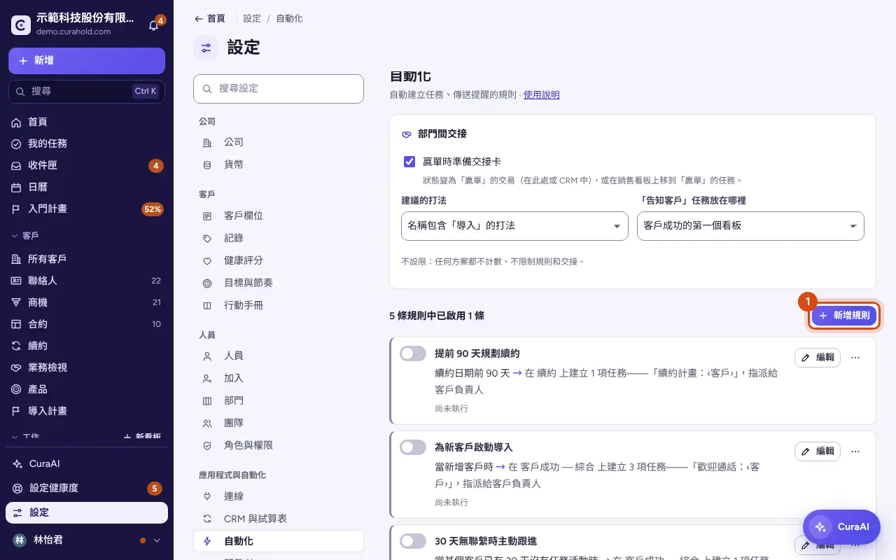
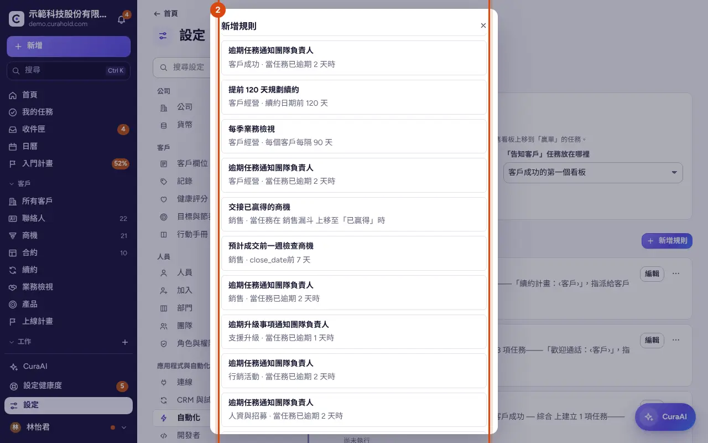
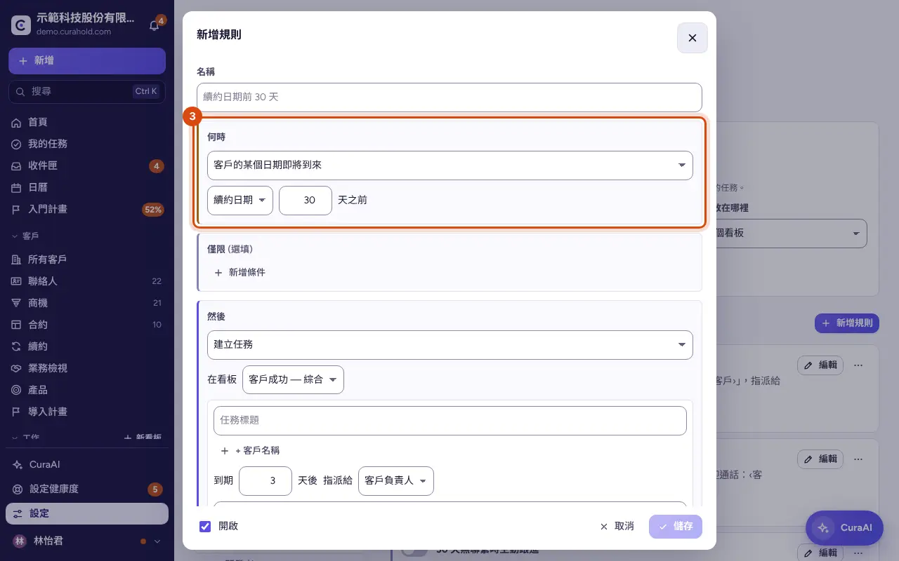
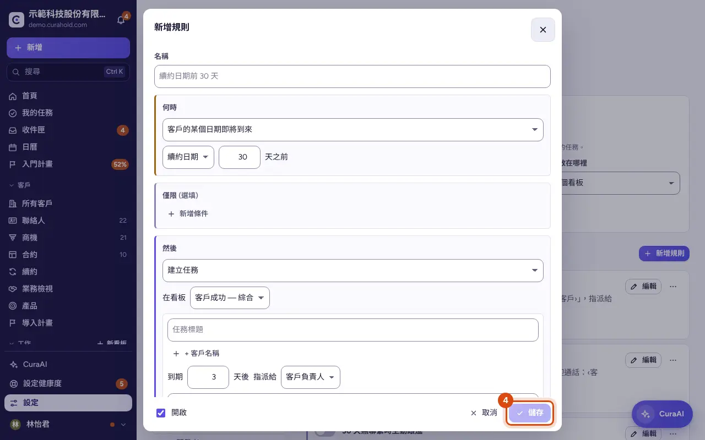

# 自動化

規則替你完成例行工作：提前 90 天的續約計畫、給新客戶的歡迎電話、任務逾期時的提醒、贏單時的交接卡。任何方案都不計數、不設上限。

## 新增規則 {#new-rule}

你需要管理自動化的權限（管理員擁有）。

1. 開啟 **設定 → 自動化**，點選 **新增規則**。
   
2. 選擇一個合適的現成規則，或點選 **從空白開始**。
   
3. 在 **何時** 下選擇什麼會啟動規則以及細節（哪個日期、幾天、哪個看板）。點選 **新增條件** 可以縮小到部分客戶或任務。在 **然後** 下選擇要做什麼。下方「今天這會對……執行動作」顯示它現在會影響哪些內容；此時還沒有任何變更。
   
4. 填寫 **名稱**，保持 **開啟** 勾選，點選 **儲存**。
   

## 什麼能啟動規則 {#when}

客戶上即將到來的日期（續約、合約結束）、每隔若干天針對每個客戶、客戶沉寂、新增客戶、任務逾期、任務移到某一欄、任務新增或完成、透過看板表單收到申請、記錄到達某個階段、支援工單開啟。

## 規則能做什麼 {#then}

開任務（可帶檢查清單，給客戶負責人或任何人）、發提醒、指派、移動、填寫欄位、留言、傳送到你的 Webhook，或準備交接卡。

## 執行與停止 {#running}

每條規則都會顯示近 30 天執行了幾次。**立即執行** 會馬上執行排程規則，不必等到下一個整點；每個情況仍然只作用一次。關閉規則即可暫停。刪除規則後，它已開的任務會保留，規則在垃圾桶中保留 30 天。

同一頁面頂端的交接設定請見 [交接、需求與回覆客戶](/docs/zh-Hant/handover-and-requests/)。
