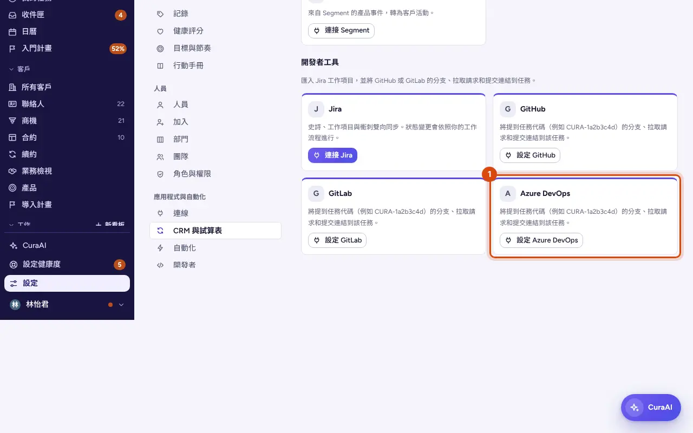
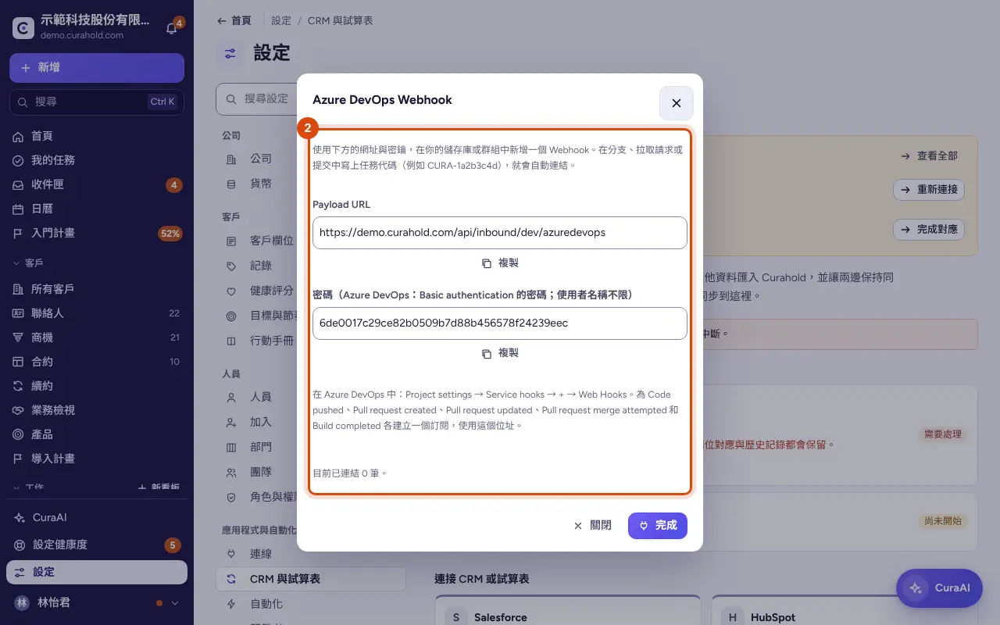

# Azure DevOps

Azure Repos 中提到某個任務的分支、提取要求和認可會連結到該任務，並顯示狀態（開啟、已合併、已關閉）和建置結果。用法與 GitHub、GitLab 相同：在分支名稱、提取要求標題或認可訊息中寫上任務鍵，例如 `CURA-1a2b3c4d`。

## 在 Curahold 中 {#connect}

1. 開啟 **設定 → CRM 與試算表**，找到 **開發者工具**，點選 **設定 Azure DevOps**。
   
2. 點選 **開啟**，然後複製顯示的 **位址** 和 **密碼**。
   

## 在 Azure DevOps 中

每個事件做一次（Code pushed、Pull request created、Pull request updated、Pull request merge attempted、Build completed）：

1. 開啟專案 → **Project settings** → **Service hooks** → **+**（Create subscription）。
2. 選擇 **Web Hooks**，點選 **Next**。
3. 選擇事件，篩選條件保持不變，點選 **Next**。
4. 把位址貼到 **URL**。**Username** 任意填寫（例如 `azure`），把密碼貼到 **Password**。
5. **Resource details to send** 保持 **All**，點選 **Test**，再點選 **Finish**。

## 限制與頻率

Azure DevOps 一送出，連結就會出現。Azure DevOps 只透過 HTTPS 傳送且不簽名：密碼就是憑證，請像密碼一樣保管。

## 發生問題時

Azure DevOps 會在 **Service hooks → History** 中顯示每次推送的回應：401 表示密碼錯誤（重新開啟 Webhook 取得新密碼，並更新每個訂閱）。**關閉** 會停止新的連結；既有連結保留在任務上。

## 另請參閱

- [連線與 CRM](/docs/zh-Hant/connections/)
- [任務與看板](/docs/zh-Hant/tasks/)
