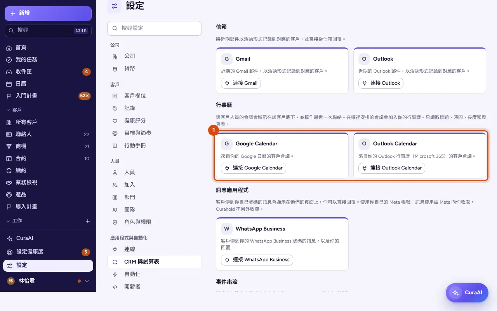

# Google 日曆與 Outlook 行事曆

連接行事曆後，你與客戶人員開過的每場會議都會以會議（含長度）出現在該客戶的時間軸上，並算作最近一次聯絡。在客戶的時間軸上也可以直接在行事曆中安排會議，由行事曆寄出邀請。

## 會讀取什麼、不讀取什麼

只讀取主要行事曆中已經開過的會議：標題、時間、長度和與會者。從不讀取說明、地點或會議連結。私人會議、全天活動以及沒有外部人員的會議會被略過。會議歸入有聯絡人與會、或網址與與會者電子郵件網域相同的客戶。

## 在 Curahold 中 {#connect}

1. 開啟 **設定 → CRM 與試算表**，找到 **行事曆**，點選 **連接 Google Calendar** 或 **連接 Outlook Calendar**。
   

會開啟 Google 或 Microsoft 頁面。選擇工作帳號，點選 **允許**（Google）或 **接受**（Microsoft）。回到 Curahold 後點選 **開始**：先讀取最近 90 天，之後每小時一次。

## 安排會議

在客戶頁面開啟 **時間軸**，點選 **在 Google Calendar 中安排會議**（或 Outlook）。填寫標題、時間、長度和與會者電子郵件，點選 **加入 …**。會議開完後會出現在時間軸上。

## 限制與頻率

每小時讀取一次；最近一週內改名或取消的會議會被更新或移除。Google 和 Microsoft 限制每分鐘的請求數：遇到「忙碌」時讀取會暫停，下次繼續。

## 發生問題時

登入過期會自動更新。如果存取權被收回（變更密碼、管理員決定），連線會顯示 **需要處理**：點選 **重新連線**，用同一個帳號登入。**移除** 會刪除登入資訊；已在時間軸上的會議保留。

## 另請參閱

- [時間軸與健康評分](/docs/zh-Hant/timeline-and-health/)
- [連線與 CRM](/docs/zh-Hant/connections/)
