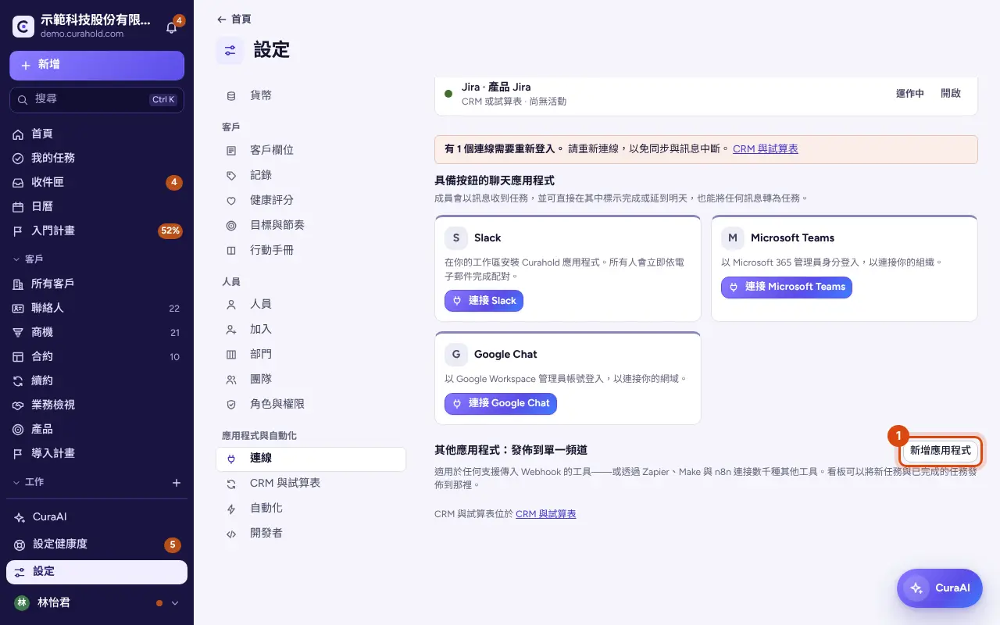
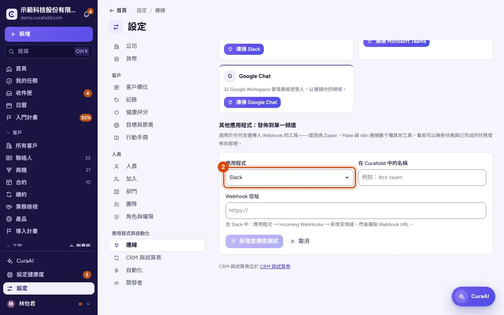

# 飛書、Lark 與 Telegram 通知

看板可以把動態（新任務、已完成任務）發到群組聊天。飛書和 Lark 使用群組的自訂機器人；Telegram 使用你兩分鐘就能建好的機器人。兩者都是單向的：只會發送，不會透過它們回覆。

## 在 Curahold 中 {#connect}

1. 開啟 **設定 → 連線**，點選 **新增應用程式**。
   
2. 選擇 **Lark · Feishu** 或 **Telegram**，貼上下列步驟取得的內容，點選 **新增並傳送測試**。群組會收到一則測試訊息。
   

接著開啟看板，在看板設定的通知中，為想要的動態選擇這個新連線。

## Lark · Feishu

1. 在群組中開啟 **設定 → 群機器人 → 新增機器人 → 自訂機器人**，取個名稱並點選 **新增**。
2. 複製 **Webhook 位址**，格式如下：

```text
https://open.larksuite.com/open-apis/bot/v2/hook/0f3c2a9e-7d1b-4c55-9a7e-2b8f6c1d3e4f
```

選用但建議：在 **安全設定** 中勾選 **簽名校驗**，把密鑰複製到 Curahold 的 **簽名金鑰**。不要使用關鍵字過濾，否則訊息會被丟棄。

## Telegram

1. 在 Telegram 中傳訊息給 **@BotFather**，傳送 `/newbot`，回答兩個問題，複製它給的 **權杖**。
2. 把機器人加入群組（頻道則設為管理員）。
3. 在群組中傳一則訊息。Curahold 會從這則訊息找到群組，你不需要知道群組 ID。
4. 把權杖貼到 Curahold 的 **機器人權杖**。公開頻道也可以直接填寫它的 `@名稱`。

## 限制與頻率

飛書每個機器人每分鐘約可接收 100 則，Telegram 每個群組每分鐘約 20 則；「忙碌」的回應會重試，不會遺失。Telegram 訊息為純文字，最多 4,096 個字元。

## 發生問題時

簽名金鑰錯誤、機器人被移除或權杖被撤銷時，連線會在 設定 → 連線 中顯示為 **需要處理**，測試也會提示。在對方那裡修正後再次點選 **傳送測試**：測試成功即可清除問題。**移除** 會停止發送；機器人會留在群組裡，直到你在那裡移除它。

## 另請參閱

- [連線與 CRM](/docs/zh-Hant/connections/)
- [通知](/docs/zh-Hant/notifications/)
