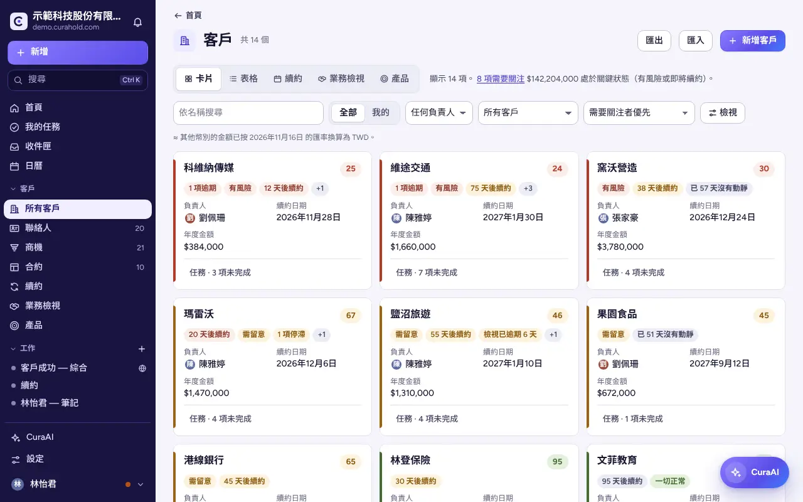
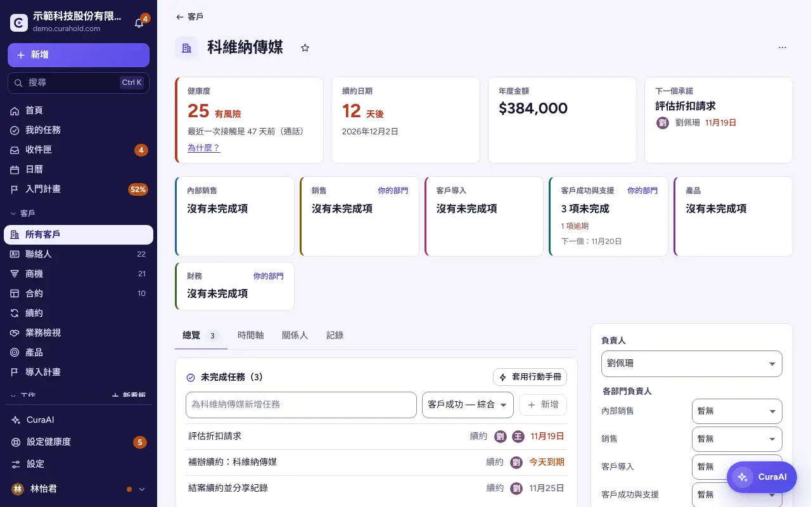

# 客戶、欄位與記錄

客戶是 Curahold 的核心。每個客戶都有一位負責人、一個可選的團隊，以及你們自訂的欄位。

## 客戶頁面

客戶頁面頂端有一條一眼就能看完的資訊列：附原因與 **為什麼？** 按鈕的 **健康度**、續約日期與剩餘天數、年度金額，以及 **下一個承諾**：你對客戶承諾的最近一步，以及由誰負責。資訊列下方是分頁：**總覽**（未完成的任務和即將舉行的會議）、**時間軸**、**關係人**、**記錄** 和 **詳細內容**。目前開啟的分頁會保留在網址中，所以重新整理或傳送連結後，開啟的仍是這個分頁。

## 欄位

在「設定」→ 客戶欄位中新增欄位：文字、數字、金額、日期、選項、電子郵件、連結。選項可以設定顏色，因此像健康度這樣的欄位會在清單和卡片中以該顏色顯示。

你也可以替「客戶」改名：「客戶帳戶」、「品牌」、「合作夥伴」，團隊習慣怎麼稱呼，整個介面就怎麼顯示。

## 記錄：聯絡人、交易等

在客戶底下保存記錄：

- **聯絡人（關係人）：** 職稱、決策角色（決策者、核准者（預算）、影響者、評估者、使用者），以及對你們的態度（核心支持者、支持者、中立、懷疑者、阻礙者）。
- **交易：** 金額、預計成交日、階段與狀態。
- **你們自己的記錄類型：** 例如「專案」或「合約」。

記錄可以為客戶欄位提供資料：「未結銷售漏斗」、「核心支持者數」、「阻礙者數」。記錄變動時，欄位會自動更新。

## 檢視：卡片、表格、續約、產品

用客戶頁面頂端的按鈕在四種檢視之間切換；你的選擇會記在這台裝置上。

- **卡片：** 每個客戶一張卡片，說明需要關注什麼：逾期任務、健康度有風險或需留意、即將到來或已過期的續約、14 天沒人處理的任務、30 天沒有聯繫。最嚴重的排在最前；沒有問題時顯示「一切正常」。卡片預設依「最需要關注優先」排序，也可以依名稱、健康度、金額、續約或未完成任務排序。在 **檢視** 選單中選擇卡片上要顯示哪些欄位。
- **表格：** 可排序的清單，能一次修改多個客戶。
- **續約：** 未來 12 個月的續約，逐月列出，顯示每月合計，以及其中有風險或需留意的金額。
- **產品：** 依某個記錄類型的選項欄位（例如「訂閱 → 產品」）顯示誰擁有哪項產品。空白儲存格裡的 **+** 會為該客戶開啟一個交叉銷售任務。

頁面頂端的一句話說明有多少客戶需要關注、有多少金額面臨風險；點「需要關注」連結就只會看到這些客戶。在手機上，所有篩選條件都集中在同一個 **篩選** 面板裡。

## 新增續約

續約就是客戶的**續約日期**。打開客戶，在**詳細資料**中填寫；也可以在匯入時用一欄帶進來。之後客戶會出現在**續約**中，依月份顯示，並附上金額。還沒有這個欄位？在「設定」→ 客戶欄位中新增一個日期欄位。想讓續約工作自動開始，請在「設定」→ **目標與節奏**中開啟**自動開始續約**，並選擇提前多久、使用哪個 playbook。

## 匯入

拖入 Excel 或 CSV 檔案，把欄位對應好，檢查預覽，然後匯入。匯入出了問題，30 天內可以一鍵復原。

## 匯出

依目前的篩選條件，把客戶與記錄清單下載為 Excel 或 CSV。檔案在你的瀏覽器中產生，你無權查看的欄位也不會出現在檔案裡。

## 一次修改多筆

在清單中選取多個客戶，一次變更他們的負責人、團隊或某個欄位。底部的通知會提供 **復原**。

## 刪除客戶，以及還原已刪除的客戶

刪除的客戶會連同其記錄、時間軸、會議和入口使用者一起移到 [垃圾桶](/docs/zh-Hant/trash/)，30 天內都能還原：刪除後立刻在通知中選擇 **復原**，或開啟你的選單，選擇 **垃圾桶**，再點 **還原**。它的任務會以「無客戶」的狀態留在各自的看板上，客戶還原後會重新連結。如果只是想把客戶移開而不刪除，可以將它封存。

## 行動手冊

**行動手冊** 是一組有日期的任務，一鍵就能套用到某個客戶：客戶導入、續約準備、QBR。管理員在「設定」→ **行動手冊** 中寫好一次（任務標題、開始後第幾天、交給誰）；在客戶頁面上用 **套用行動手冊** 選擇開始日期，就能全部加入。標題中的 `{account_name}` 會換成客戶名稱。

## 業務檢視

一次決定多久要和每個客戶坐下來談一次：「設定」→ **目標與節奏** → *業務檢視*（例如每 90 天）。個別客戶可以在其頁面的 **業務檢視** 欄位設定自己的節奏；選「不進行檢視」則該客戶不列入節奏。

業務檢視是你定期和每個客戶舉行的會議（QBR），用來回顧成果與計畫。**客戶 → 業務檢視** 列出到期的檢視：已逾期、未來 30 天內和更晚。開完檢視後，點該列（或客戶頁面）上的 **完成** 開啟會議表單；儲存後，它會以「業務檢視」記入客戶的 **會議** 和時間軸，下次日期也會自動往後推。從未檢視過的客戶，從加入當天開始計算。逾期的檢視也會在客戶卡片上顯示標記。

## 會議

客戶頁面上的 **會議** 依新到舊列出和該客戶的每一場會議、業務檢視和通話：日期、類型、標題、時長、記錄者、與會者（對方和我方）、備註和後續步驟。上方的按鈕可以只顯示一種類型；下一次業務檢視的日期顯示在標題旁。

**記錄會議**（在客戶頁面上，或 **+ 新增 → 記錄會議、通話或備註**）需要填寫：

- 類型（會議、業務檢視、通話）、標題、日期和時長；
- 與會的對方人員（客戶的聯絡人）和我方人員；
- 備註：討論了什麼、決定了什麼；
- 後續步驟：每一步連同負責人和期限，都會在你選擇的看板上成為該客戶的一個任務。

後續步驟會顯示在會議下方並附上進度（已完成的會劃掉）；點一下即可開啟任務。會議之後可以編輯、補充後續步驟或刪除；刪除會議後它的任務會保留，會議本身可在 30 天內從 [垃圾桶](/docs/zh-Hant/trash/) 還原。
