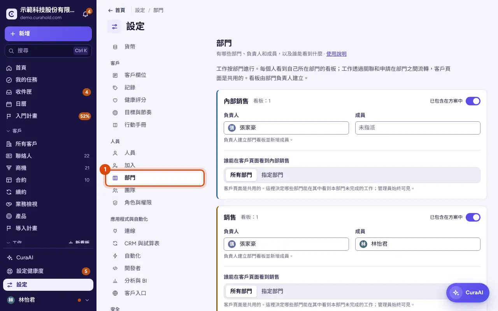
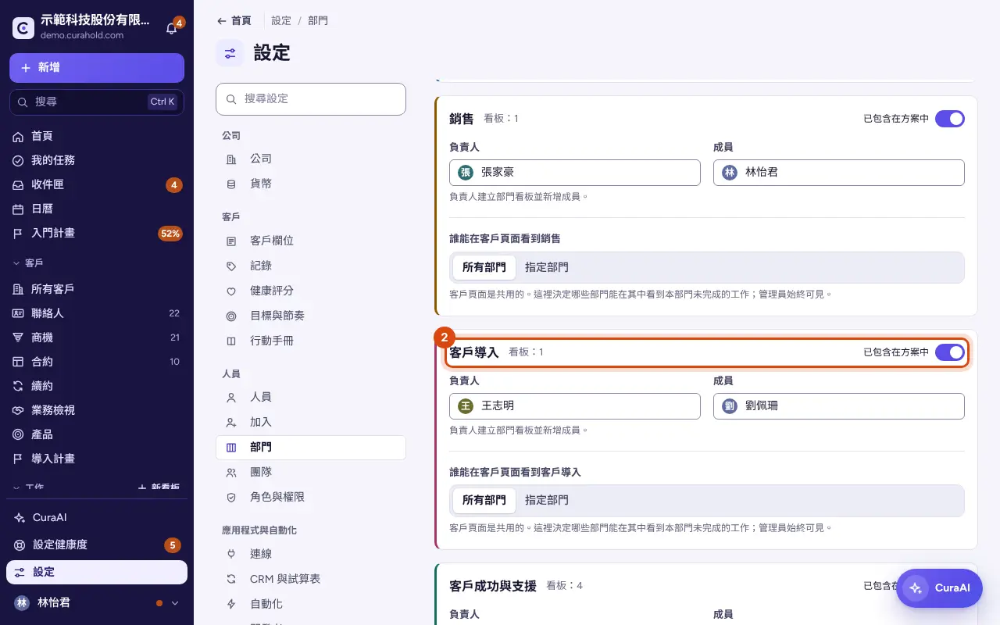
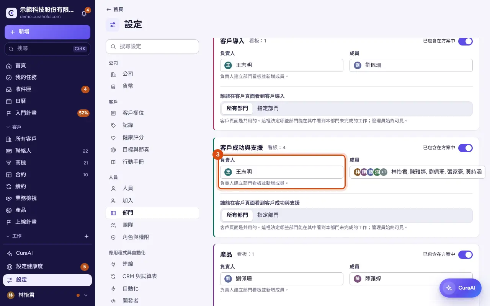
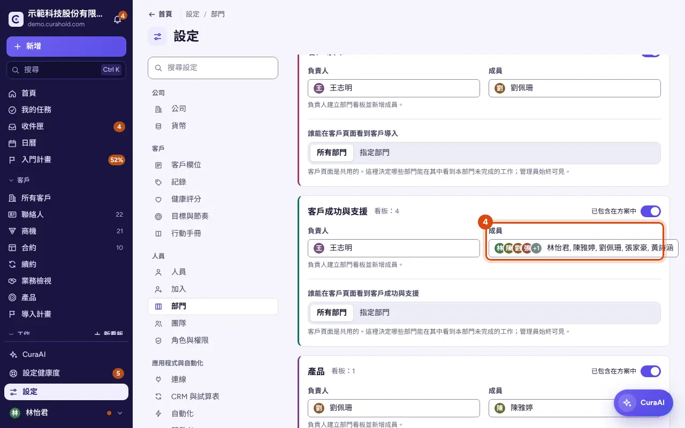
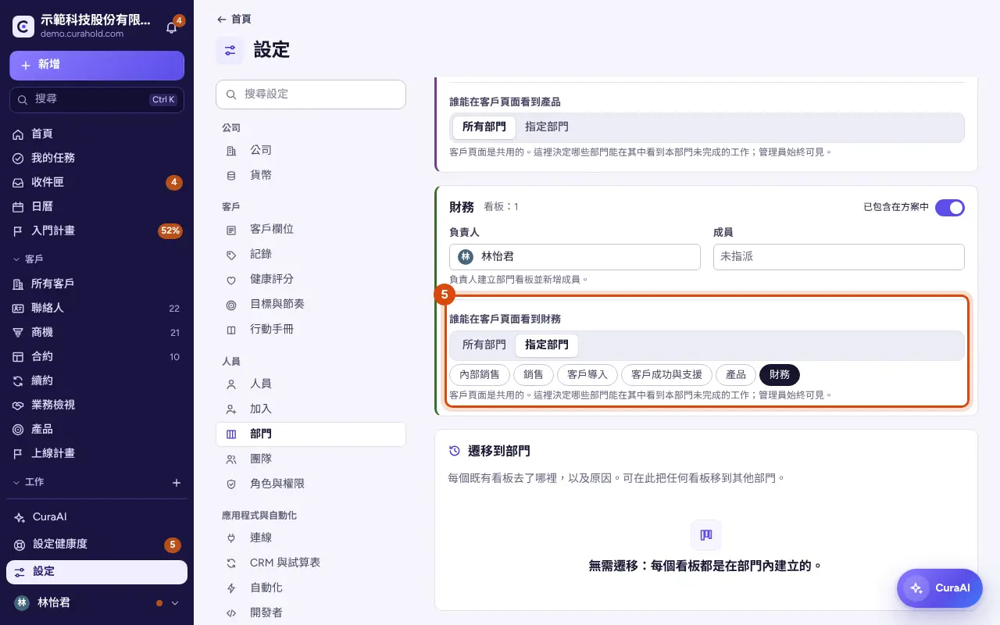
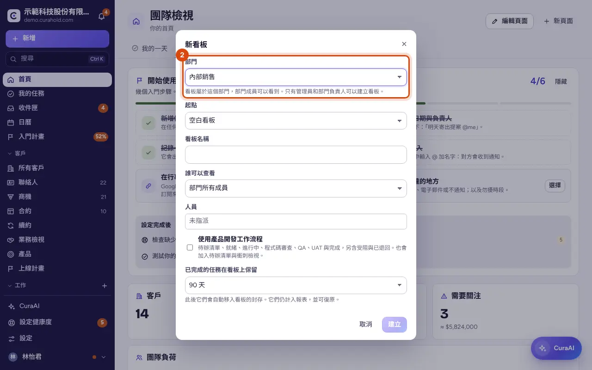

# 部門

在 Curahold 中，工作屬於部門：內部銷售、銷售、客戶導入、客戶成功與支援、產品和財務。每個人看到自己所在部門的看板。工作透過申請轉到另一個部門，而客戶頁面由所有有權查看該客戶的人共用。

## 設定部門 {#set-up}

你需要是管理員（或負責管理人員的人）。

1. 在左側選單中點選 **設定**，再點選 **部門**（在 **人員** 下）。
   
2. 公司有的每個部門都讓 **已包含在方案中** 保持開啟。不用的部門就關閉：它會對所有人隱藏，其看板會保留，直到你再次開啟。
   
3. 在 **負責人** 中選擇部門由誰負責。負責人可以開設部門看板並新增成員。
   
4. 在 **成員** 中選擇在這個部門工作的其他人。一個人可以屬於多個部門。
   
5. 在 **誰能在客戶頁面看到…** 下選擇 **所有部門**，或選擇 **指定部門** 並點選可以在那裡看到本部門未完成工作的部門。管理員一律可見。財務一開始只對財務可見。
   

所有變更都會隨時儲存。還不屬於任何部門的人，在你新增之前，把自己的工作放在 **我的任務** 裡。

公司遷移到部門時，每個既有看板都被放進一個部門。同一頁面底部的 **遷移到部門** 顯示每個看板去了哪裡以及原因；可以在那裡變更看板的部門。**待安排的人** 列出以前能看到某個看板但並不在其上工作的人：**授予存取權** 會讓他們成為成員。

## 部門裡的看板 {#boards}

1. 在選單中，看板依所屬部門名稱分組。你負責的部門旁會顯示 **由你負責**。
   
2. 要開設新看板，點選 **工作** 旁的 **+**。在 **部門** 中選擇看板所屬的部門，填寫名稱並點選 **建立**。只有管理員和部門負責人可以開設看板。
   

可見範圍預設為 **部門所有成員**；也可以縮小到某個團隊或指定的人。

## 向其他部門提出申請 {#ask}

1. 開啟與該申請相關的任務，點選 **向其他部門提出申請**。在清單中選擇該部門的看板，填寫申請表單並送出。
   

申請會進入該部門的看板，並關聯到你的任務。你能看到它的標題和進度，但永遠看不到對方部門的看板。部門負責人開啟某個看板的申請表單後（**看板設定 → 欄位與申請表單**），該部門即可接收申請。

## 在客戶頁面上 {#customer-page}

1. 在客戶頁面上，**各部門** 顯示每個部門對該客戶的未完成工作、其中逾期多少以及下一個截止日期。**你的部門** 標出你所在的部門。
   
2. 在側邊，**各部門負責人** 顯示每個部門由誰負責該客戶。選擇一個人即可設定。
   

部門之間的交接（贏單後轉給客戶導入或客戶成功）請見 [交接、需求與回覆客戶](/docs/zh-Hant/handover-and-requests/)。
