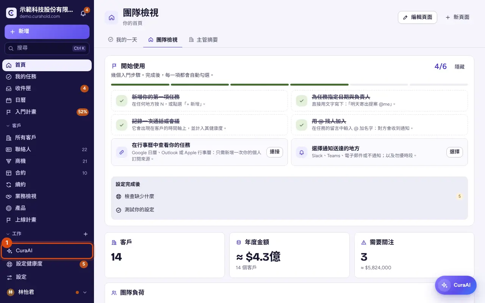
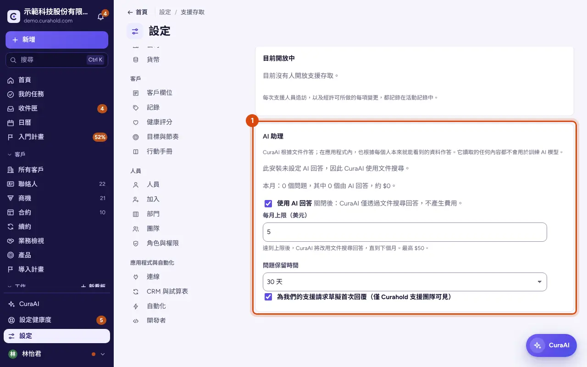
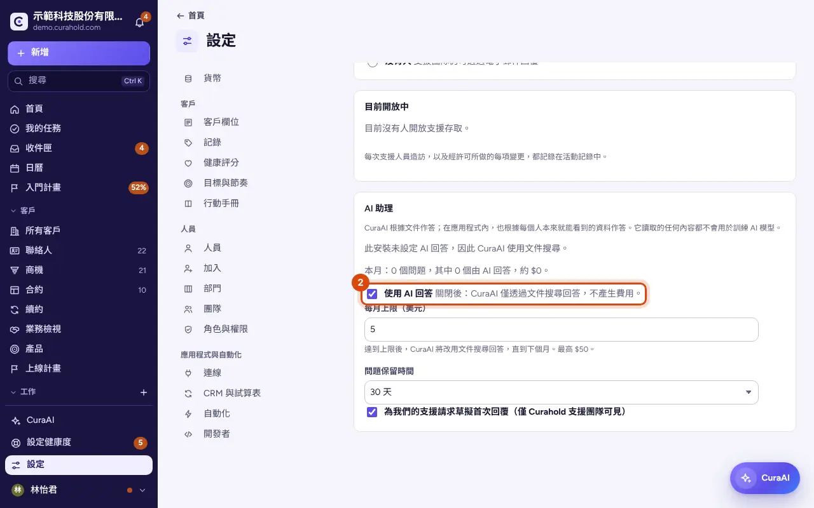

# 取得協助

兩個步驟，依這個順序：先 **詢問**，如果還沒解決，再 **聯絡支援**。

## 先詢問 {#ask}

1. 在左側選單中點選 **CuraAI**（手機上是角落的按鈕；在本文件中是 **提問** 按鈕）。用你自己的話寫下問題：「如何匯入客戶」「誰能看到這個欄位」。
   

答案來自本文件，並附上出處。當公司開啟了 **使用 AI 回答**（見下文）時，CuraAI 也會讀取你在 Curahold 中本來就能看到的內容，例如客戶、續約和任務，所以你可以問「未來 90 天有哪些續約？」。它只讀取，從不變更任何內容。關閉、未設定或超出當月上限時，文件在你自己的裝置上搜尋，你輸入的內容不會傳送到任何地方。

如果答案不是你需要的，就說出來：你會看到下一個最接近的位置，以及一個已填好問題、可直接聯絡支援團隊的按鈕。

## 聯絡支援：送出請求

使用 CuraAI 底部的 **聯絡支援**。表單會詢問支援人員找到問題所需的資訊，這樣他們就不用再回頭問你。你沒看過的東西一律不會送出；要送什麼由你決定。

1. **主題**：某些功能無法運作、我該如何…？、資料或連線、一個點子，或帳單與方案。
2. **影響**：遇到錯誤和資料問題時，說明它是否讓你無法工作。支援的處理順序依此而定。
3. **標題**：幾個字就好。輸入時，會建議可能已經回答了這個問題的文件頁面。
4. **發生了什麼事**：你想做什麼、預期什麼，結果發生了什麼。如果出現錯誤訊息，請一字不差地複製。
5. **我們要如何重現這個問題？**：遇到錯誤時，請一步一步寫出來（選填，但很有幫助）。

6. **一併通知** 和 **需要完成的期限**（都是選填）：應該閱讀請求並收到答覆的同事，以及你需要在哪一天之前得到答覆。

你會收到一個 **編號**（例如 CH-000123），以及一份電子郵件副本。

## 對話：答覆、回覆，以及輪到誰

請求就是一段對話。在 **我的請求**（CuraAI 頂端的收件匣按鈕）中開啟：

- **支援的答覆** 會以電子郵件寄出，也會顯示在請求中。CuraAI 按鈕上的標記表示有答覆在等你。
- 在產品中 **回覆**，或直接 **回覆電子郵件**：你寫在引用內容上方的文字會進入請求。
- 請求會顯示 **輪到誰**：*支援團隊處理中*、*等待你的回覆* 或 *已解決*。**標示為已解決** 會關閉請求；再次寫信會重新開啟。
- **一併通知的同事** 可以閱讀請求、以電子郵件收到支援的答覆，也能回覆。只有提問的人能新增或移除他們。管理員可以閱讀公司的任何請求，但只會在自己的請求中回覆。
- Curahold 團隊可能會在請求上留下 **自己的備註**。這些備註永遠不會顯示或寄給你們公司。

## 螢幕截圖與檔案

- **擷取螢幕畫面**：瀏覽器會詢問要分享哪個分頁；選擇 Curahold 的分頁。說明視窗會讓開，只擷取頁面本身。
- **貼上或拖放**：把複製的圖片貼到表單中，或把檔案拖到表單上。
- **標註**：用紅框圈出重點。**隱藏** 會遮住支援人員不該看到的內容（客戶名稱、金額）；這些內容會從送出的圖片中移除。

最多 6 個檔案，每個 10 MB。支援圖片、PDF、文字、CSV、JSON、Excel 和短片。

## 自動加入請求的技術資訊

表單會自行加入以下資訊，並在送出前讓你看到：

| 資訊 | 為什麼有幫助 |
|---|---|
| 頁面網址 | 問題出在哪裡。網址中的機密部分（登入碼等）會被移除。 |
| 瀏覽器、螢幕、App 版本 | 用於只在某一種瀏覽器中發生的問題。 |
| 最近開啟的頁面 | 你是怎麼到那裡的。只有網址，沒有頁面內容。 |
| 頁面上的錯誤 | 背景中的錯誤訊息。電子郵件地址和類似金鑰的文字會被遮蓋。 |
| 失敗的請求 | 哪個動作失敗了（路徑和狀態碼）。 |
| 目前開啟的內容 | 你開啟的客戶、看板或任務。 |

不想送出的項目可以取消勾選。你輸入的內容和頁面上的資料都不在這些資訊之中。

## 讓支援人員查看你的帳號

有些問題不親眼看到很難解決。表單最後的 **允許 Curahold 支援人員檢視我的帳號** 選項就是為此而設。它永遠不會預先幫你勾選。

- **支援人員看得到什麼**：和你看到的完全一樣——同樣的客戶、看板和欄位。不會更多。
- **持續時間**：24 小時、3 天或 7 天。存取會自動結束。每次支援造訪最長 8 小時。
- **支援人員能做什麼**：**只能查看**。支援人員絕不會變更你帳號中的任何東西。
- **永遠碰不到**：你的裝置和工作階段、API 金鑰、應用程式和 webhook、邀請人員、角色、公司設定、匯出或清除資料。支援人員也不能延長自己的存取權。
- **關閉存取**：隨時都能在 **說明 → 我的請求 → 關閉存取** 中關閉。進行中的支援造訪會立刻結束。存取開啟期間，頁面頂端會有一條提示。
- **紀錄**：每一次支援造訪，以及支援人員在期間讀取的內容，都會連同支援人員的姓名寫入 **「設定」→ 活動紀錄**。

支援人員在你的帳號中時，畫面頂端會顯示是誰在查看、到什麼時候為止。

## 公司設定（管理員）

在 **「設定」→ 安全 → 支援存取** 中，選擇誰可以讓支援人員進入：

- **任何人**：針對他們自己看得到的內容（預設）。
- **僅限管理員**：其他人已開啟的存取會立刻結束。
- **沒有人**：支援人員仍能透過電子郵件答覆，但無法進入。

同一頁會列出目前開啟的存取、由誰開啟以及最近一次造訪，並能關閉其中任何一項。

## 供支援使用的工作階段錄製

為了在出問題時讓支援人員看到發生了什麼，而不是請你描述，頁面會在你使用時自動錄製（按了哪些按鈕、開了哪些畫面、App 顯示了什麼）。這和讓支援人員查看你的帳號是兩回事；它會在背景安靜地執行。

- **你輸入的任何內容都不會被錄製。** 每個欄位——搜尋、備註、你輸入的客戶資料——都會被遮蓋。錄製的是介面，而不是你寫進去的內容。
- **保留 7 天**，之後刪除。
- **只有 Curahold 支援團隊能開啟錄製**，而且只能從自己的工作台開啟，每次開啟都會寫入支援工作台的紀錄。你們公司看不到自己的錄製。
- **管理員可以關閉此功能**，位於 **「設定」→ 安全 → 支援存取 → 供支援使用的工作階段錄製**。關閉後不會錄製任何東西。

如果你們組織需要在隱私權聲明中向員工說明這一點，這個開關和本頁就是依據。

## 使用 AI 回答（管理員） {#ai-answers}

1. 開啟 **設定 → 支援存取**，捲動到 **AI 助理**。
   
2. 勾選 **使用 AI 回答**，讓 CuraAI 以 AI 回答；取消勾選則只用文件搜尋回答，不產生費用。CuraAI 讀取的內容絕不會用於訓練 AI 模型。 新公司預設**關閉**此項：在管理員勾選之前，不會傳送任何內容給 AI 服務供應商；關閉期間，卡片上會清楚說明。
   

同一張卡片上：

- **每月上限（美元）**：達到後，CuraAI 在下個月之前以文件搜尋回答。卡片顯示本月的問題數和費用。可設定的最高額度取決於您的方案及其完整席次數，試用期間固定不變；卡片上會顯示。
- **問題保留時間**：問題保留多久（或完全不保留）。每個人自己的問題包含在其個人資料下載中。
- **為我們的支援請求草擬首次回覆**：Curahold 支援團隊會看到對你們請求的首次回覆草稿；你永遠看不到草稿，只會看到支援團隊的正式回覆。只有已接受 CuraAI 說明的人提出的請求才會草擬；其他人的請求會直接交給支援團隊，內容不會傳送給 AI 服務供應商。

如果卡片顯示此安裝未設定 AI 回答，CuraAI 就使用文件搜尋；AI 金鑰由執行你們 Curahold 伺服器的人新增。

**每個人都會先被詢問。** 在 AI 回答已開啟時，有人第一次打開 CuraAI，CuraAI 會說明哪些內容會傳送給 AI 服務供應商、目的與保存多久，並附上隱私權聲明連結，提供**同意**和**拒絕**（沒有任何預先勾選）。在同意之前，輸入的內容都不會離開裝置，由文件搜尋回答；拒絕不會有任何損失。可以隨時在 CuraAI 下方或**你的設定 → AI 助理同意**撤回，說明變更時會再次詢問。沒有「同意」的問題會被伺服器拒絕，每次回答都會記入活動紀錄。客戶入口網站與公開文件也以同樣方式詢問。

## 錯誤記錄（管理員） {#errors}

**設定 → 錯誤** 列出近 30 天你們的人員遇到了什麼問題以及發生在哪裡：哪個頁面、哪個請求失敗、發生了幾次。其中不含任何個人資訊。聯絡支援團隊時，附上你在那裡看到的內容。
