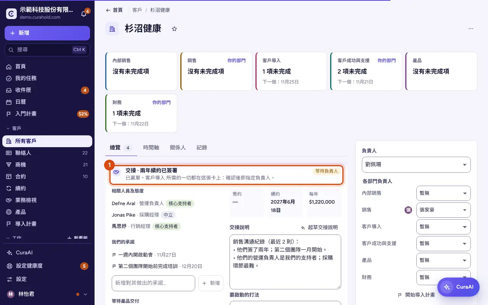
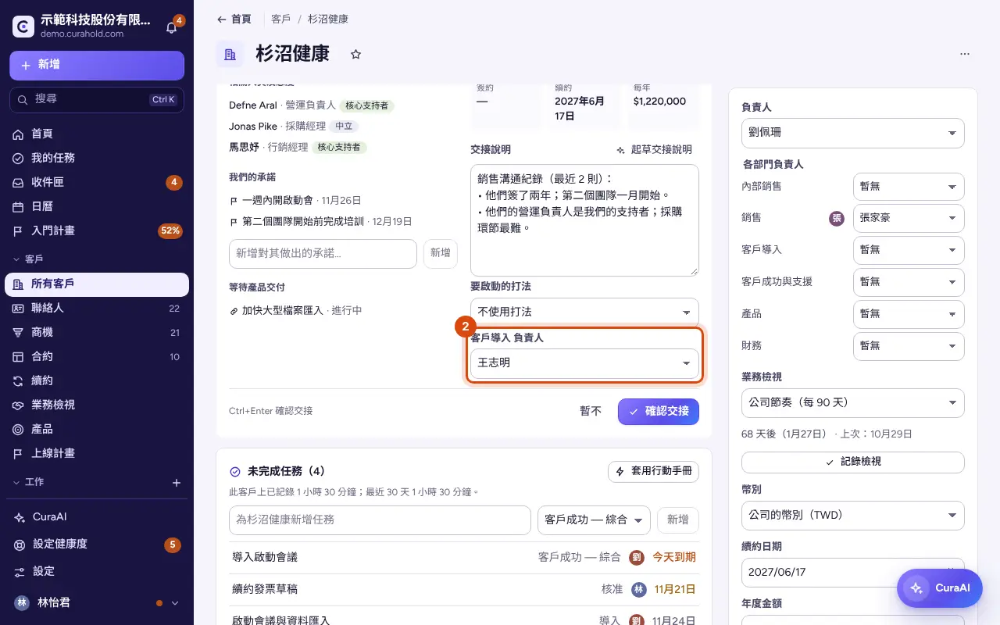
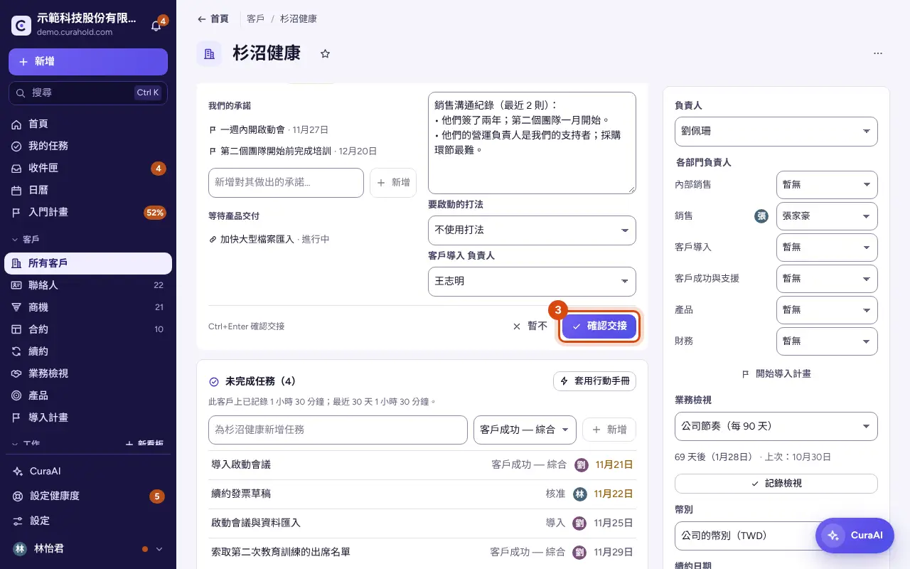
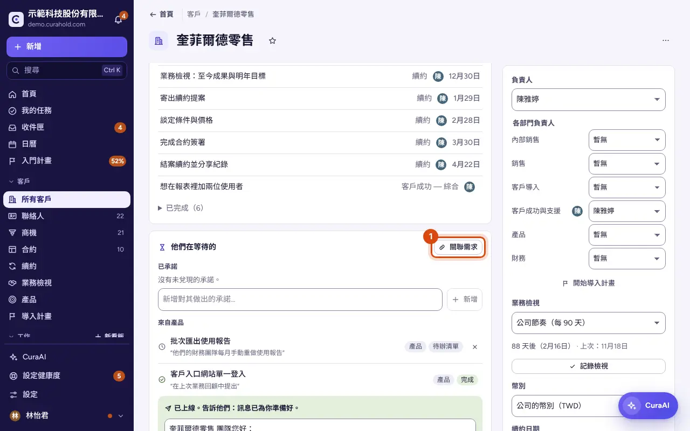
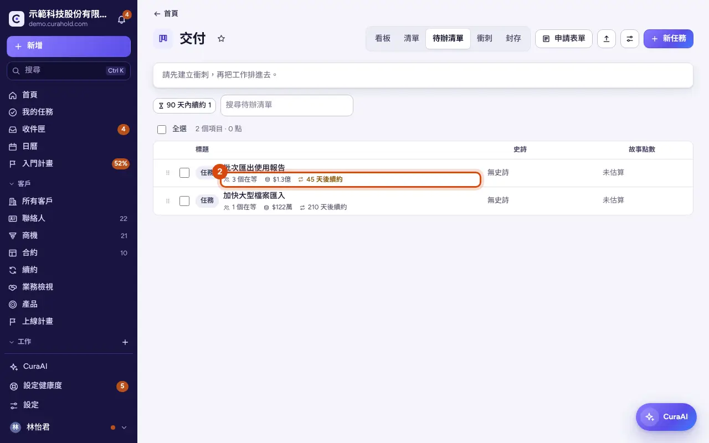
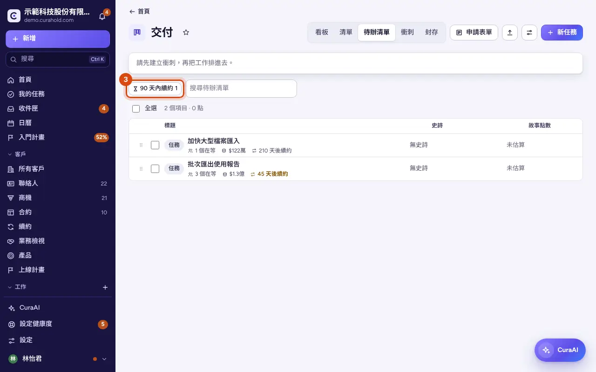
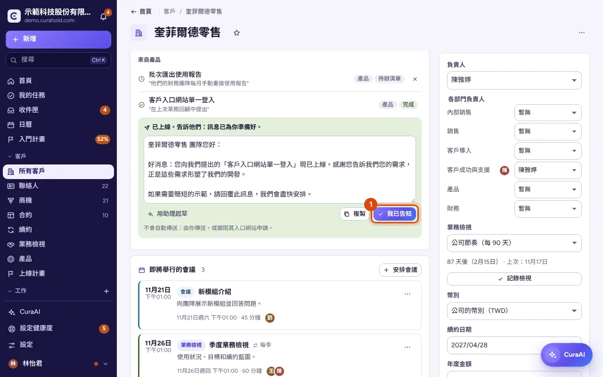
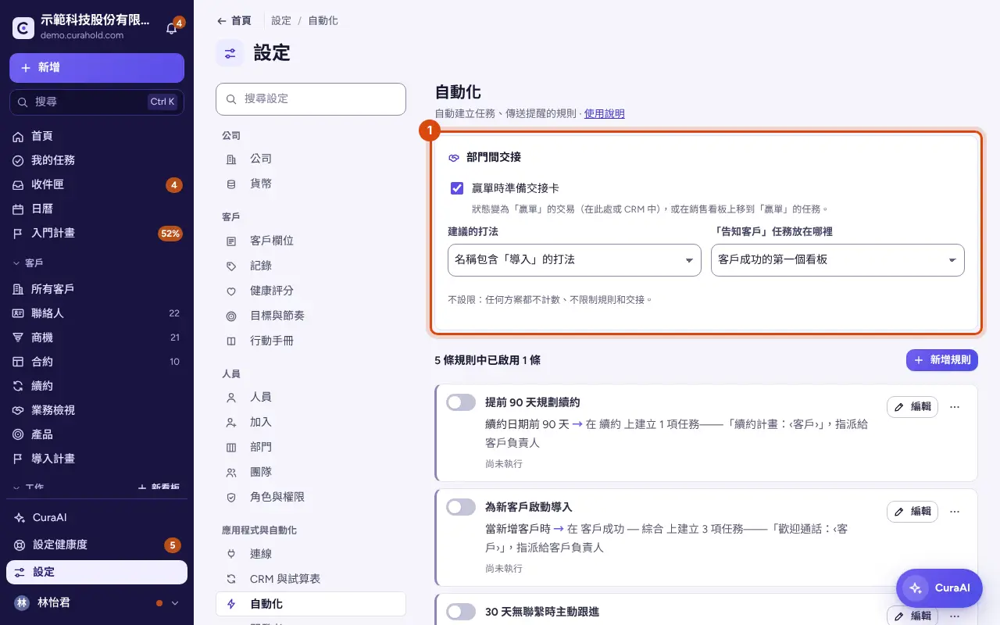

# 交接、需求與回覆客戶

工作從銷售轉到客戶導入或客戶成功，也從客戶轉到產品。Curahold 把每個團隊需要的內容都放在客戶頁面上，不必重複輸入，也沒有人需要開啟其他部門的看板。

## 贏單時 {#handover}

狀態變為 **贏單** 的交易（在這裡或在你的 CRM 中），或在銷售看板上移到 **贏單** 的任務，會在客戶頁面上得到一張 **交接卡**。如果公司有客戶導入部門，它會交給 **客戶導入**，否則交給 **客戶成功**。

1. 開啟客戶頁面。交接卡位於 **總覽** 頂端，標示 **等待負責人**。閱讀它：相關人員及其態度、銷售做出的承諾、客戶仍在等待產品交付的內容、日期、年度價值（如果你有權查看該欄位）以及來自銷售溝通的交接說明。
   
2. 在 **… 負責人** 中選擇由誰接手該客戶。同時查看旁邊的 **要啟動的打法**。
   
3. 點選 **確認交接**（或按 Ctrl+Enter，Mac 上按 ⌘+Enter）。負責人被設定，打法開始執行，負責人收到通知，客戶時間軸記錄這兩步。
   

**暫不** 會收起這張卡。**起草交接說明** 讓助理撰寫說明；儲存前你可以閱讀並修改。

## 將客戶需求關聯到產品工作 {#requests}

1. 在客戶頁面的 **他們在等待的** 下，點選 **關聯需求**。搜尋產品的工作，選擇對應項目，也可以用客戶自己的話補充他們要的內容。如果沒有合適的，就在同一視窗向產品提出。
   

許多客戶可以等待同一個項目，每個都會被計入。任何能看到該客戶的人都能看到這項工作的標題、狀態、衝刺結束日期和部門，但永遠看不到產品的看板。

## 產品看到什麼 {#backlog}

1. 在產品看板上開啟 **待辦清單**。每個項目下顯示：有多少客戶在等待、他們的年度價值（僅對有權查看該欄位的人）以及最近的續約。
   
2. 點選 **90 天內續約**，只查看即將續約的客戶在等待的工作，最近續約的排在前面。
   

## 上線時 {#shipped}

關聯的項目完成後，每個客戶的負責人會收到一個任務，客戶頁面上該項目下方會出現一則現成的訊息。

1. 閱讀訊息，視需要修改，點選 **複製**，然後透過你自己的郵件或聊天送出。接著點選 **我已告知**。如果客戶是透過入口網站提出的，**關閉其入口網站申請** 會一併在那裡關閉。
   

**不會自動送出任何內容。** 時間軸會寫上「為他們打造」，續約摘要也會列出。

## 設定（管理員） {#settings}

1. 開啟 **設定 → 自動化**。在 **部門間交接** 下，選擇贏單是否產生交接卡、建議的打法，以及「告知客戶」任務放到哪裡。
   

## 助理起草的內容

交接說明、「已上線」訊息，以及會議中的承諾和後續步驟，都可以由助理起草。儲存前你會閱讀並修改每份草稿，復原可以收回；沒有助理（或超出每月上限）時，草稿來自範本。

## 規則

規則可以在任務新增或完成、透過表單收到申請、記錄到達某個階段或支援工單開啟時啟動，可以指派、移動、填寫欄位、留言、傳送到你的 Webhook 或準備交接。規則從不計數，也沒有上限。
