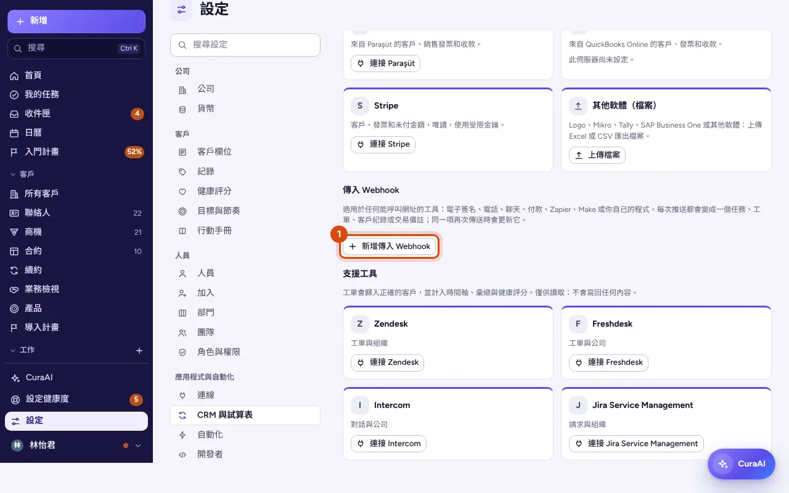
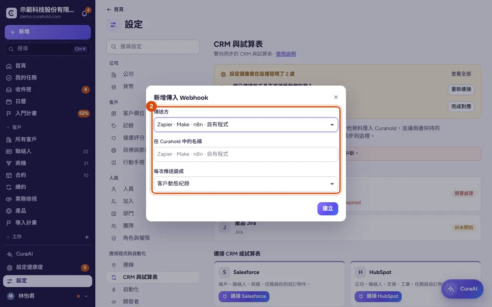
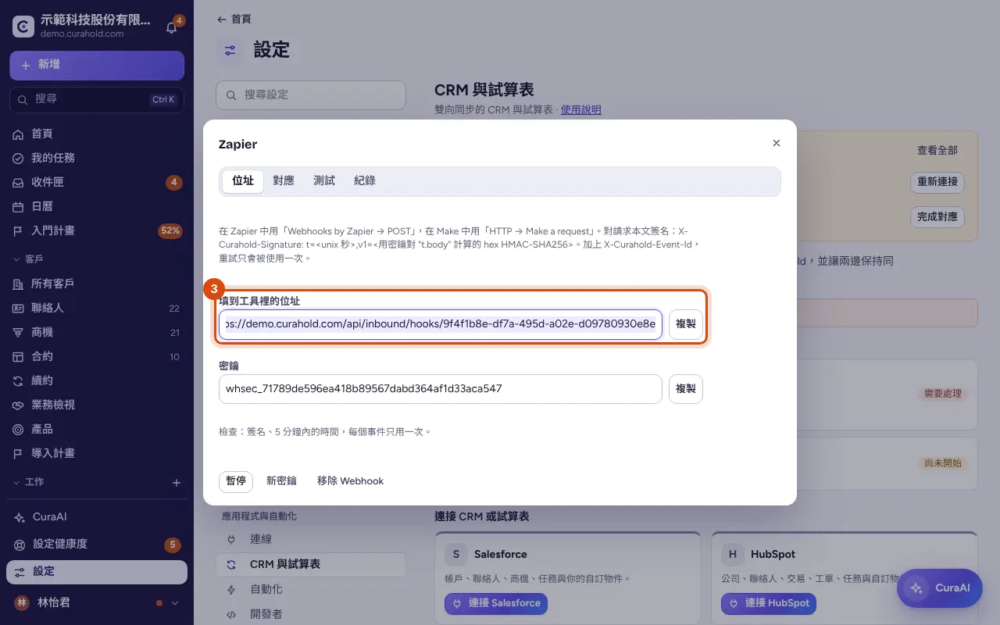
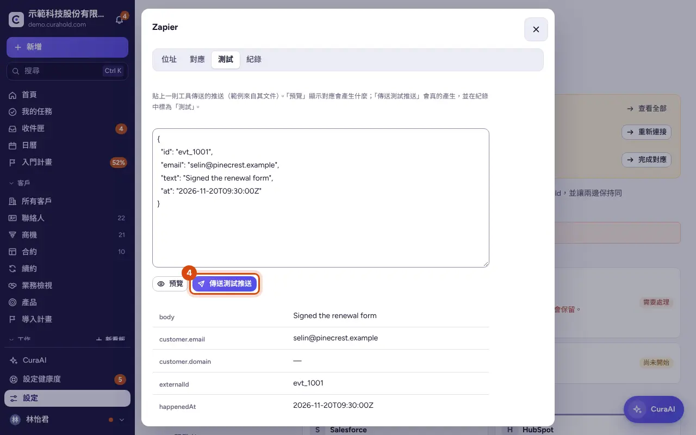
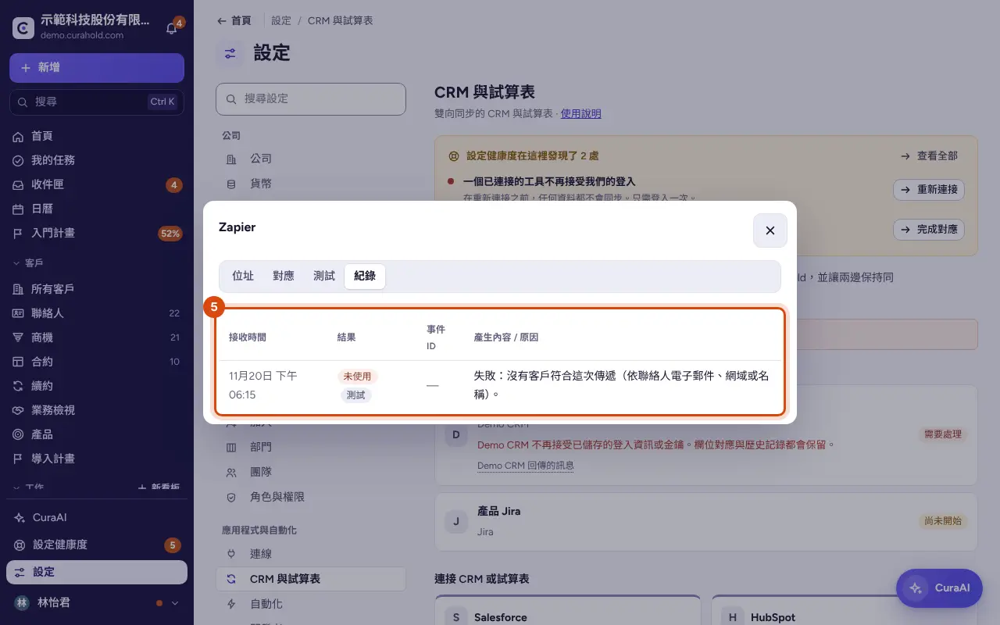

# 傳入 Webhook

適用於 Curahold 還沒有現成連接器的工具。工具向你專屬的位址推送；每次推送都會變成一個 **任務**、一張 **支援工單**、一筆 **客戶時間軸紀錄** 或一則 **交易備註**。同一項再次推送時會更新先前產生的內容。每次推送都會檢查：簽名（或共用權杖）、時間，以及每個事件只用一次。

## 在 Curahold 中 {#connect}

1. 開啟 **設定 → CRM 與試算表**，往下捲到 **傳入 Webhook**，點選 **新增傳入 Webhook**。
   
2. 在 **傳送方** 下選擇工具（或 **Zapier · Make · n8n · 自有程式**），確認 **每次推送變成**，點選 **建立**。
   
3. 在 **位址** 分頁，把位址和密鑰複製到工具裡。
   
4. 在 **測試** 分頁點選 **預覽**，看看對應會把範例變成什麼，然後點選 **傳送測試推送**。
   
5. 在 **紀錄** 分頁檢查每次推送：已使用、已略過、未使用（附原因）或已拒絕。
   

## 對應

每個值都是文字，用 `{{path}}` 引用推送中的值，例如 `{{data.envelopeSummary.status}}` 或 `{{items[0].email}}`。客戶依序按聯絡人電子郵件、網址、名稱尋找。**工具中該項的 ID** 讓「建立或更新」生效。**僅當這個值…** 會略過其他事件（記為已略過）。

## 現成配方

| 工具 | 簽名方式 | 產生 |
| --- | --- | --- |
| 電子簽名（DocuSign Connect；CloudSign、Modusign、Leegality 同理） | `X-DocuSign-Signature-1`, HMAC-SHA256, base64, 你在工具中產生的金鑰 | 交易備註 |
| Aircall | 請求本文中的 Webhook token | 客戶底下的一通通話 |
| Tawk.to | `X-Tawk-Signature`, HMAC-SHA1, hex | 工單 |
| Razorpay（iyzico 同理） | `X-Razorpay-Signature`, HMAC-SHA256, hex | 客戶底下的一筆紀錄 |
| Freshchat、Kylas、Sansan 以及其他任何工具 | 共用權杖 (`X-Curahold-Token` / `?token=`) | 由你選擇 |

## 自行簽名（Zapier、Make、n8n、程式） {#sign}

傳送 `X-Curahold-Signature` 和 `X-Curahold-Event-Id`：

```text
X-Curahold-Signature: t=1763631000,v1=<用密鑰對 "1763631000.<原始本文>" 計算的 hex HMAC-SHA256>
X-Curahold-Event-Id: evt_1001
```

程式範例（Node.js）：

```js
const t = Math.floor(Date.now() / 1000);
const v1 = crypto.createHmac('sha256', secret).update(`${t}.${body}`).digest('hex');
fetch(address, { method: 'POST', body, headers: { 'content-type': 'application/json', 'x-curahold-signature': `t=${t},v1=${v1}`, 'x-curahold-event-id': id } });
```

時間必須在 5 分鐘內。重複的事件 ID 會回應 `200` 和 `duplicate`，不會再次使用。回應：`200`（`status` 為 ok、skipped 或 failed）、`401`（簽名、時間或權杖）、`404`（未知或已暫停）。完整清單： API 參考.

## 為尚無連接器的工具準備的 Zapier 與 Make 配方

使用該工具的觸發器，然後用 **Webhooks by Zapier → POST**（Zapier）或 **HTTP → Make a request**（Make）帶著兩個標頭傳送到上方位址。Make 的 **Custom JS** 或 Zapier 的 **Code** 步驟負責計算簽名（見上方程式）。

| 工具 | 觸發器 | 要傳送的欄位 | 產生 |
| --- | --- | --- | --- |
| LINE WORKS | 機器人頻道的新訊息 | `id`、寄件者 `email`、`text` | 紀錄 |
| Chatwork | 聊天室的新訊息 | `id`、`email`、`text` | 紀錄 |
| kintone | 紀錄新增或編輯 | `id`、`email`、`title`、`status` | 任務 |
| Money Forward Cloud | 發票建立或付款 | `id`、`email`、`text`（編號、金額、到期日） | 紀錄 |
| Channel Talk | 對話結束 | `id`、`email`、`title` | 工單 |
| KakaoWork | 機器人訊息 | `id`、`email`、`text` | 紀錄 |
| LeadSquared | 潛在客戶或交易更新 | `id`、`email`、`title`、`status` | 任務 |
| Razorpay | 收款成功 | `id`、`email`、`text` | 紀錄（或使用配方） |
| DingTalk | 機器人訊息 | `id`、`email`、`text` | 紀錄 |
| WeCom | 應用程式訊息 | `id`、`email`、`text` | 紀錄 |

## 保留與刪除

紀錄保留 30 天，每個 Webhook 最多 500 筆推送。**新密鑰** 會讓舊密鑰立即失效；**暫停** 期間回應 `404`，直到恢復；**移除 Webhook** 會刪除它和它的紀錄，已產生的內容保留。Webhook 以建立者的權限運作：只能存取建立者能存取的看板和客戶，建立者離開後即停止。

## 另請參閱

- [連線與 CRM](/docs/zh-Hant/connections/)
