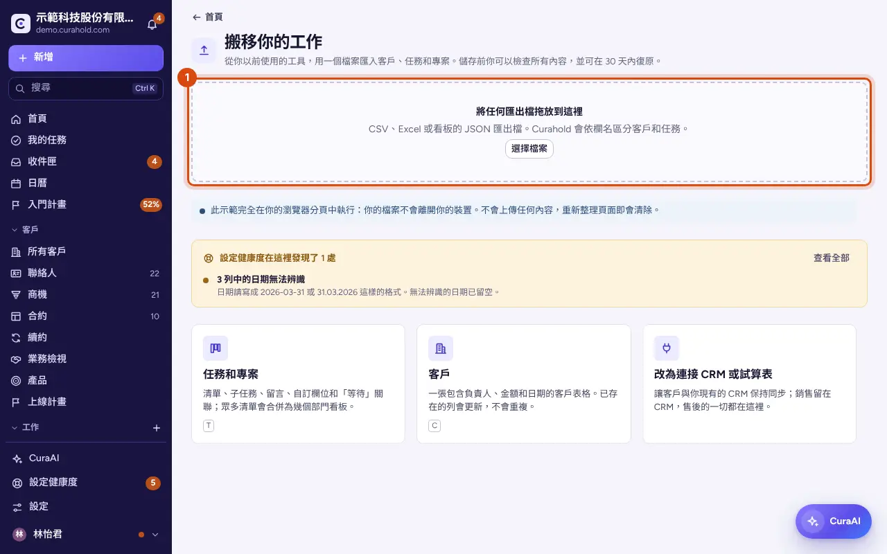
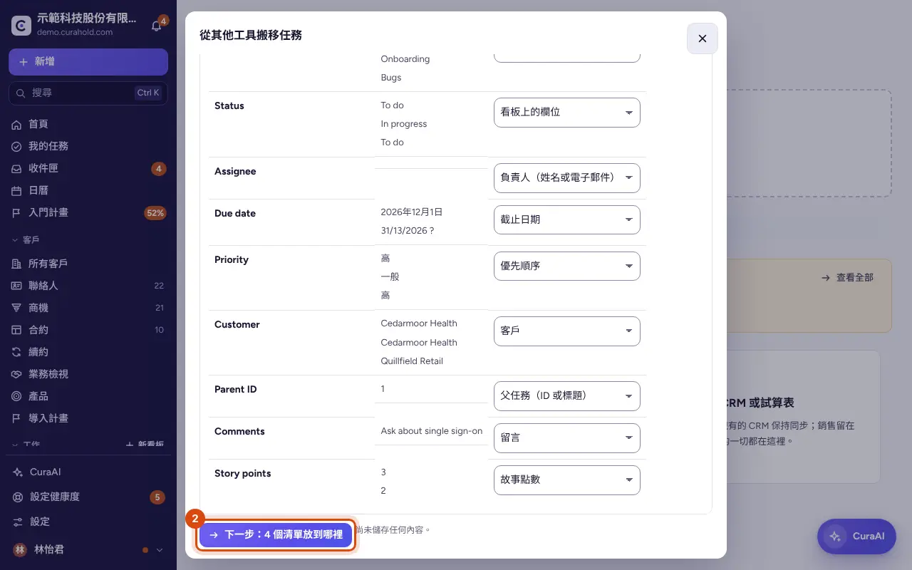
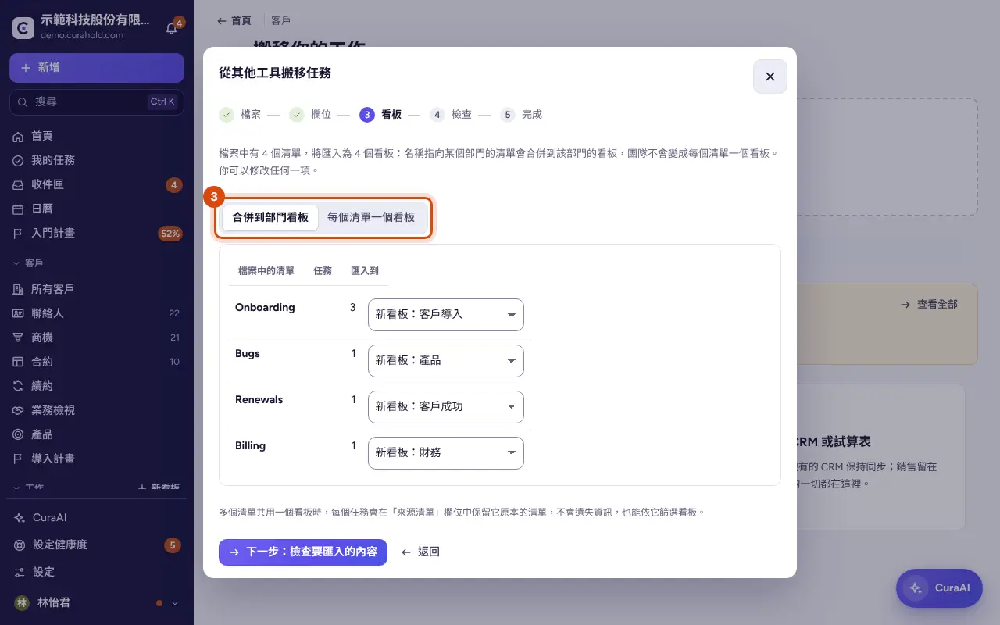
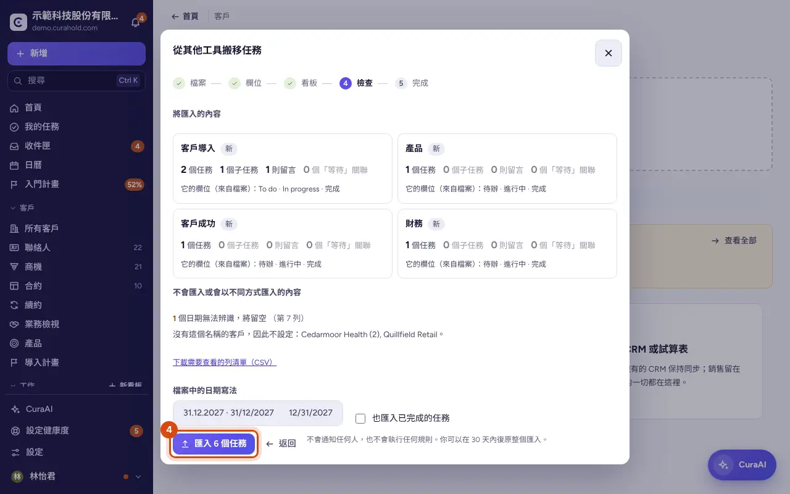

# 從其他工具搬移

從你之前使用的工具匯出工作（CSV、Excel 工作表 (.xlsx) 或看板的 JSON 匯出），再從該檔案搬移過來。最後一步之前不會儲存任何內容，不會通知任何人，也不會執行任何規則：這是搬家，不是新工作。

## 搬移你的任務 {#tasks}

1. 開啟 **搬移你的工作**：在搜尋中輸入「import」（Ctrl K，Mac 上為 ⌘ K），或使用看板上的向上箭頭按鈕。把檔案拖到 **將任何匯出檔拖放到這裡**，或點選 **選擇檔案**。Curahold 會依檔案的欄名區分客戶和任務；按 **T** 選任務，按 **C** 選客戶，可自行選擇。
   
2. **欄位。** 檔案的每一欄都會對應到目標位置：標題、描述、看板上的欄、人員、日期、優先順序、客戶、故事點、舊工具中的 ID、上層任務、留言、「等待」關聯，或一個自訂欄位。前幾個值會顯示每欄將變成什麼。修改不對的地方，然後點選 **下一步**。
   
3. **看板。** 如果檔案有很多清單，它們會合併到幾個部門看板中：名為「Renewals」的清單進入客戶成功，「Bugs」進入產品。點選 **每個清單一個看板** 可以讓它們保持分開，也可以為任何清單選擇任何看板。每個任務都會在 **來源清單** 欄位中保留它原本的清單。點選 **下一步：檢查要匯入的內容**。
   
4. **檢查。** 逐個看板查看將匯入多少任務、子任務、留言和關聯，並依列號查看哪些不會匯入或會以不同方式匯入。如果想先在檔案裡修正，點選 **下載需要查看的列清單（CSV）**。然後點選 **匯入 … 個任務**。
   
5. **完成。** 每個看板都有 **開啟看板** 連結。如果有不符預期的地方，點選 **復原此次匯入**。
   

Curahold 能辨識標題列上方的標題、每組下面重複表頭的分組，以及縮排在其上層之下的子項目。

## 復原 {#undo}

**復原此次匯入** 在 30 天內有效，可以從結果頁面或第一步的 **你之前的匯入** 中操作。無人改動過的任務會作為一項移入垃圾桶；之後有人修改或留言過的任務會保留在其看板的封存中。為匯入而建立且仍為空的看板會被收起。

## 範本 {#template}

第一步中的 **下載範本** 會給你一個包含 Curahold 讀取的所有欄位和三列範例的檔案，可用 Excel 開啟。第一列如下（Region 是自訂欄位的範例）：

```text
ID,Title,Description,List,Status,Assignee,Due date,Priority,Customer,Parent ID,Comments,Depends on,Story points,Region
```

## 在示範中

示範完全在你的瀏覽器分頁中執行。示範列中的 **用你自己的檔案試試** 會開啟同一頁面：檔案在分頁中讀取，永遠不會離開你的裝置，重新整理頁面後即被遺忘。
