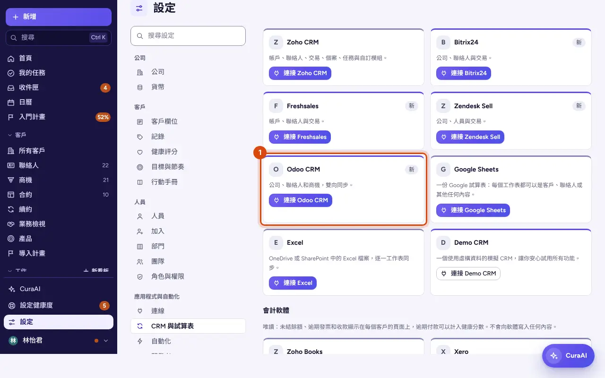

# Odoo CRM

來自 Odoo Online、Odoo.sh 或自有伺服器的公司、聯絡人和商機，雙向保持一致：Odoo 中的變更一小時內同步過來，Curahold 中的變更立即寫回。

## 在 Curahold 中 {#connect}

1. 開啟 **設定 → CRM 與試算表**，點選 Odoo CRM 卡片上的 **連接 Odoo CRM**。
   

接著填寫四個欄位並點選 **連接**：

- **Odoo 位址**，例如：

```text
https://yourcompany.odoo.com
```

- **資料庫名稱**：只有在 Odoo.sh 或有多個資料庫的自有伺服器上需要。
- **登入名稱（電子郵件）**：Curahold 以其權限運作的 Odoo 使用者。
- **API 金鑰**：見下文。

然後勾選 **公司**、**聯絡人** 和 **商機**，檢查建議的欄位對應，點選 **開始同步**。商機在機率 100% 時算贏單，被 Odoo 封存時算輸單。

## 在 Odoo 中

1. 點選右上角頭像 → **偏好設定**（Odoo 17 以後為 **我的個人資料**）。
2. 開啟 **帳戶安全**，點選 **新增 API 金鑰**。
3. 輸入名稱（例如 `Curahold`），選擇有效期限，點選 **產生金鑰**。
4. 複製金鑰。Odoo 只會顯示一次。

在 Odoo Online 上使用 API 需要 **Custom** 方案（Odoo 的規定），而且必須安裝 CRM 應用程式。

## 限制與頻率

Odoo 沒有公布固定限制；Curahold 維持每秒約兩次請求。Odoo 19 以後使用 JSON-2 API，舊版使用 JSON-RPC（Odoo 將在第 20 版移除）。Odoo 19 中金鑰最長有效三個月：到期前建立新的並重新連線。

## 衝突、錯誤與移除

雙方修改了同一欄位時，由這個連線選定的規則決定（預設：較晚的變更）。被拒絕的值會帶著 Odoo 自己的訊息留在連線的 **狀態** 分頁。金鑰被撤銷或過期時，連線顯示 **需要處理**：用 **重新連線** 貼上新金鑰，對應保持不變。**移除** 會刪除金鑰；已同步的客戶和紀錄保留在 Curahold 中。

## 另請參閱

- [連線與 CRM](/docs/zh-Hant/connections/)
- [Odoo（會計）](/docs/zh-Hant/accounting-odoo/)
