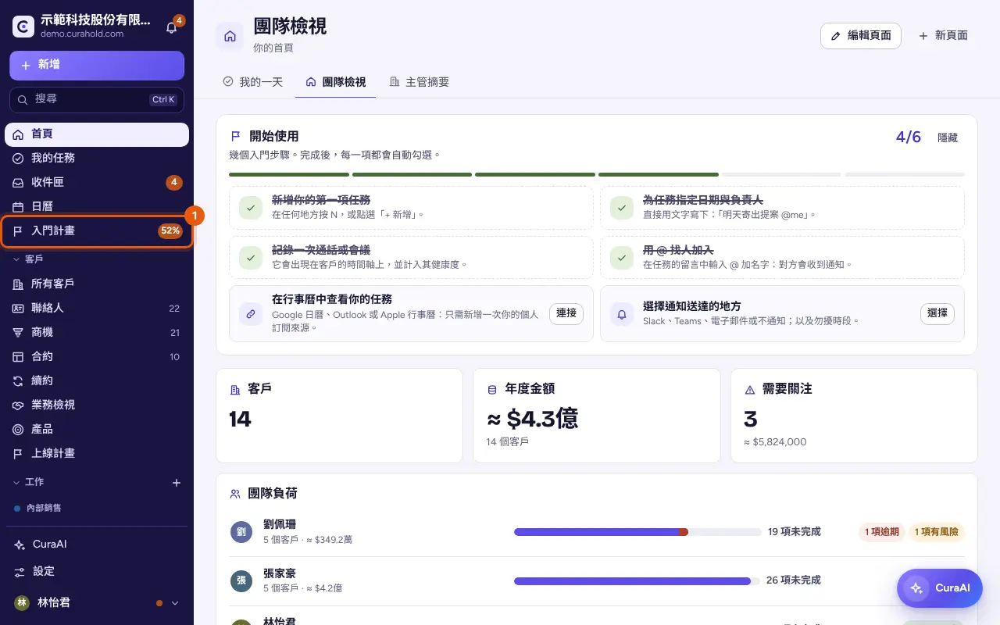
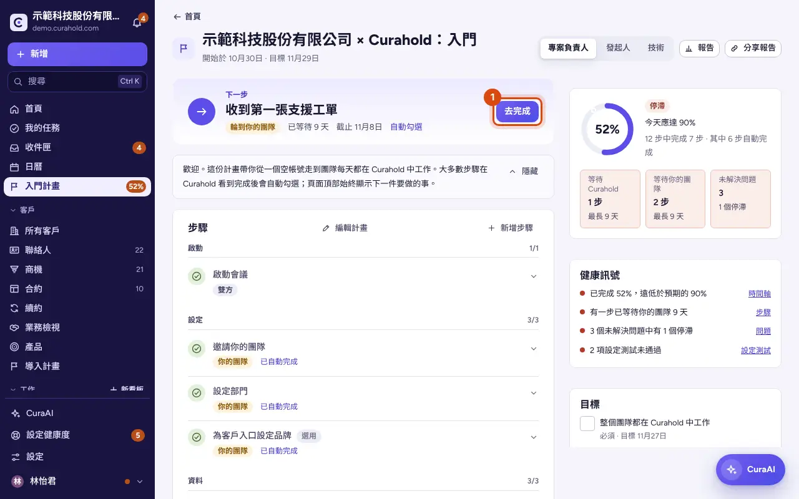
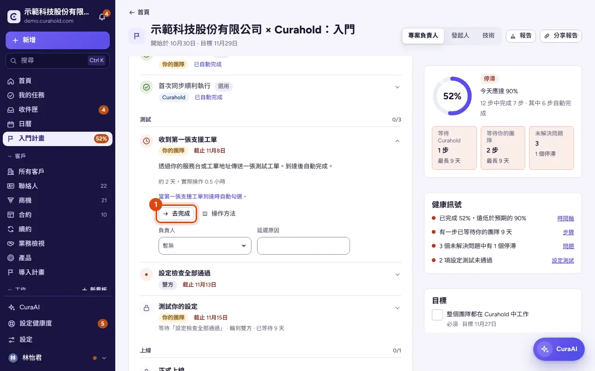
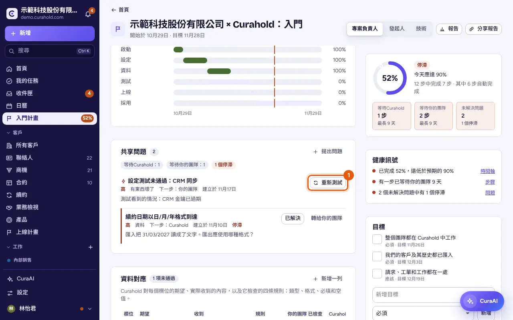
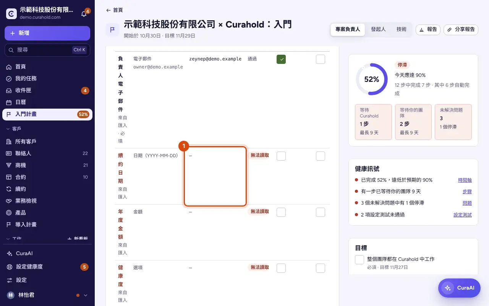
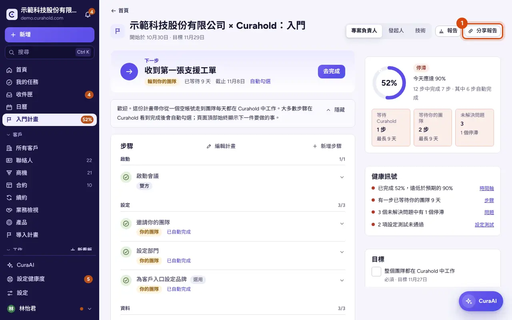
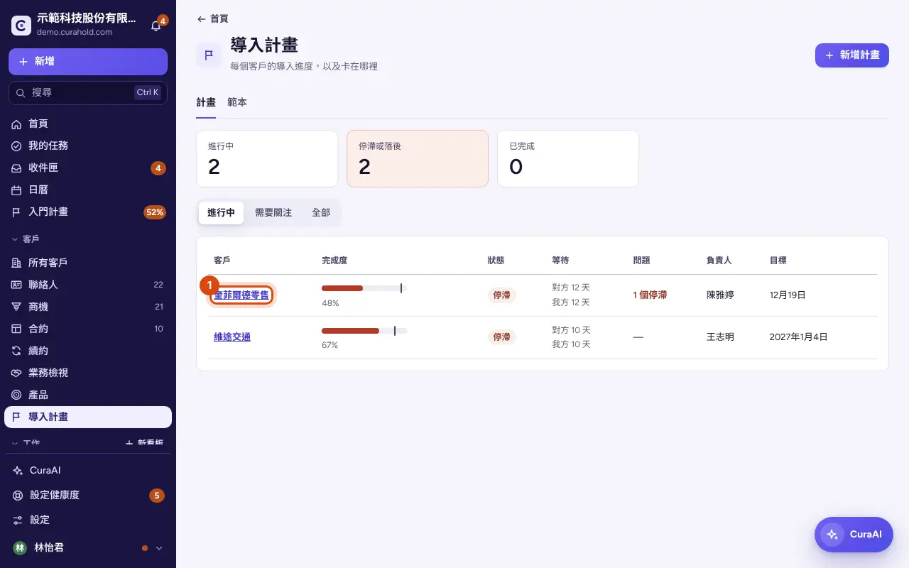
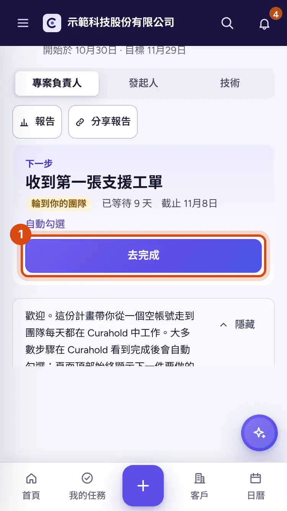

# 上線計畫

上線計畫是雙方共同使用的一個頁面。你的公司用它開始使用 Curahold，你也為每個上線的客戶使用同一份計畫。大多數步驟在 Curahold 看到完成後自動勾選；只有 Curahold 看不到的事（例如會議）才需要手動勾選。

## 1. 開啟你的計畫 {#start}

點擊左側選單中的**入門計畫**。旁邊的數字是已完成的比例。

```text
https://<你的公司>.curahold.com/onboarding
```



## 2. 完成下一件事 {#next}

頂部卡片始終顯示下一件要做的事、輪到誰以及已等待多久。點擊**去完成**：Curahold 會開啟完成該事項的畫面。



## 3. 開啟一個步驟 {#team}

點擊任意步驟，查看它的用途、所需時間以及是否自動勾選。帶鎖的步驟在等待另一個步驟；下方一行說明在等哪一步、輪到誰。只對 Curahold 看不到的步驟點擊**標記完成**。



## 4. 解決共享問題 {#health}

每個問題都說明輪到誰；開啟超過五天或已過期的問題標為**停滯**。未通過的設定測試在這裡只出現一次。修復後點擊**重新測試**：測試通過後問題自動關閉。



## 5. 檢查你的資料 {#mapping}

資料表為每個欄位顯示 Curahold 的期望、實際收到的內容以及四條規則：類型、格式、必填和空值。未通過的列會說明哪條規則不符。值正確時，勾選你這一方的方框。

```text
2027-03-31
```



## 6. 指定人員 {#people}

在**雙方人員**下點擊**新增人員**並選擇角色。輪到某一步的負責人時，Curahold 會在應用程式內提醒他，步驟停滯時會再次提醒。郵件提醒預設關閉，需管理員開啟。

## 7. 分享進度報告 {#report}

點擊**分享報告**並複製連結。擁有連結的人只能看到報告（不含備註和聯絡方式）。開啟**報告**可列印或另存為 PDF。



## 8. 你的客戶的入門計畫 {#customers}

點擊客戶下的**上線計畫**。贏得交易時會自動開啟附交接備註的草稿計畫，交接確認後開始。客戶會在你的入口中以你的品牌顏色看到同一份計畫。完成後點擊**完成並交接**：健康分作為基準儲存，客戶成功團隊會收到交接卡。



## 9. 為客戶量身調整計畫 {#personal}

每個客戶的計畫都是獨立的副本：修改它不會影響範本。

1. 在計畫的**步驟**中，點擊**編輯計畫**。
2. 在階段的輸入框中改名，用箭頭移動，或用**新增階段**新增階段。仍有步驟的階段不能刪除：請先移動或刪除其中的步驟。
3. 在步驟的輸入框中改名，用箭頭移動，為它選擇其他階段，或刪除它。
4. 點擊**完成編輯**。若要再次使用此計畫，點擊**另存為範本**並命名。

## 10. 自動開啟的計畫 {#won}

由管理員在**上線計畫 → 範本**頁面底部決定：

1. 勾選**贏得交易時開啟入門計畫**。在你開啟之前它是關閉的。
2. 選擇要使用的範本，或選擇**每次詢問**：草稿會請接手客戶的人來選擇。
3. 選填：依區隔、方案或地區（任何客戶欄位）新增規則。客戶符合的第一條規則決定範本。

提醒一律顯示在應用程式中。是否同時透過電子郵件接收，由每個人在自己的通知設定中決定。

## 在手機上

同一個頁面，單欄顯示：下一件事在最前。


