# 設定檢查與測試設定

兩個頁面幫你不靠猜測完成設定。**設定健康度**告訴你缺什麼、哪裡不對。**測試你的設定**讓你按團隊的實際用法逐項試用。系統不會替你更改任何東西：每個修正都是一個開啟正確頁面的按鈕，剩下的由你完成。

## 找出缺少的內容

1. 在左側選單中點選**設定健康度**。旁邊的數字表示有幾項值得查看；一切正常後它會消失。
   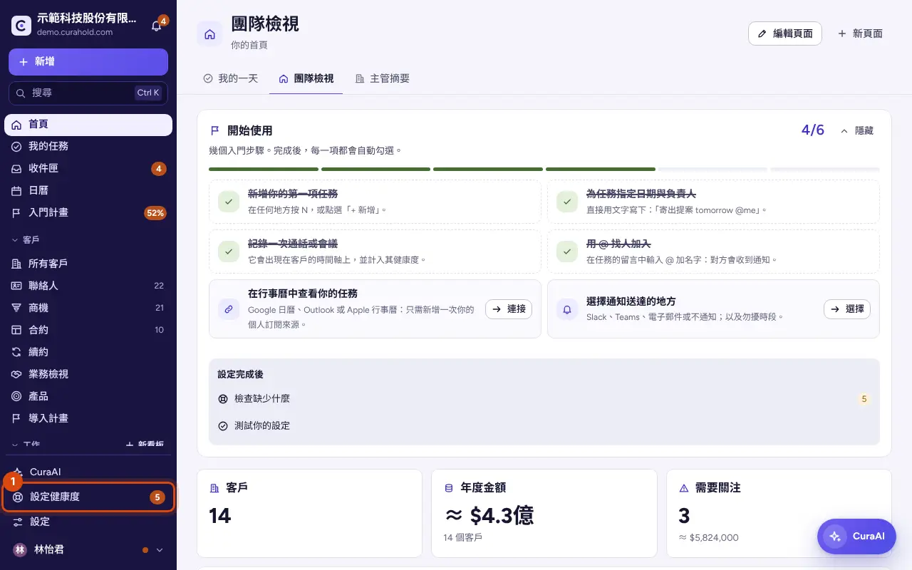
2. 閱讀第一行。最重要的排在最前：**優先處理**，然後是**值得修正**，最後是**有空時處理**。每一行都寫明我們發現了什麼、為什麼重要。
   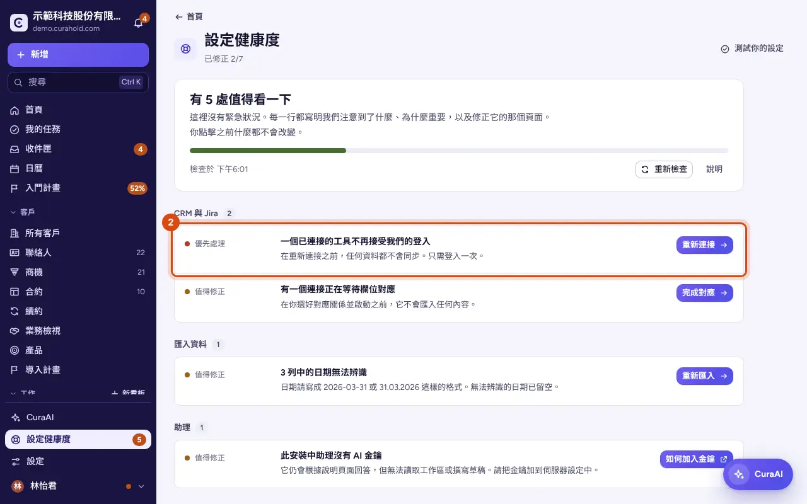
3. 點選該行的按鈕，會直接開啟修正它的頁面。
   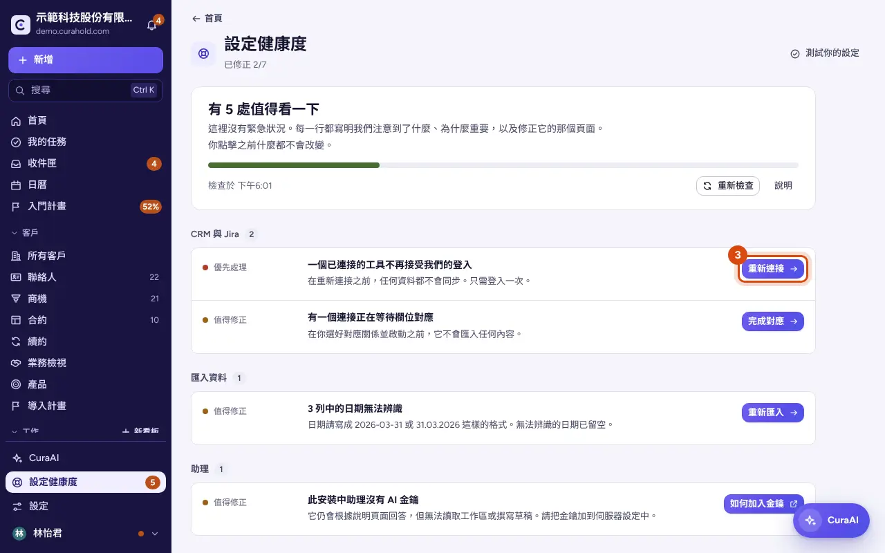
4. 修正後回來點選**重新檢查**。該行會移到**已修正**，頁面頂部會顯示已修正幾項。
   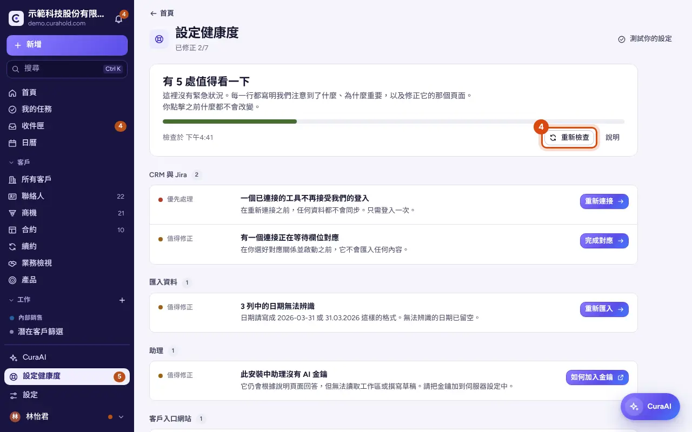
5. 在負責修正的頁面頂部，也會用黃色框顯示這個問題。點選**查看全部**查看完整清單。
   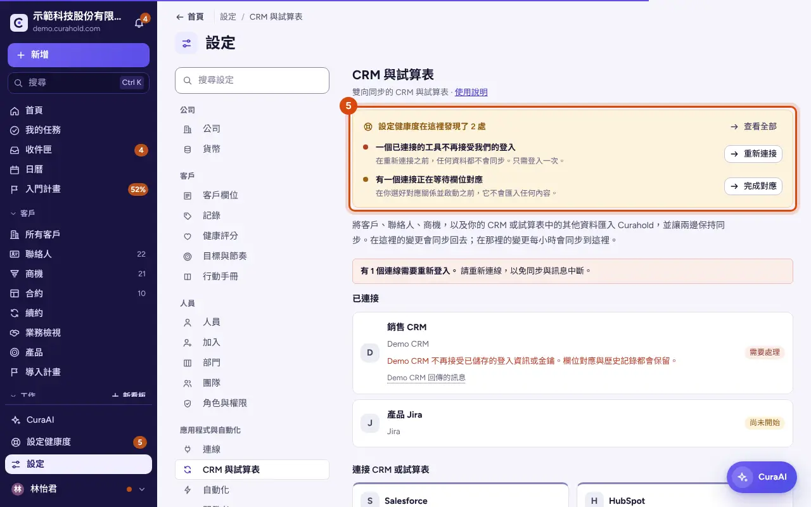

有些內容我們無法在這裡讀取，例如郵件網域的 SPF、DKIM 和 DMARC 紀錄。新增後，在該行點選**我已完成**。

每個人只看到自己能修正的內容。管理員看到公司的全部檢查；執行 Curahold 伺服器的人還會看到郵件和 AI 金鑰。我們每天重新檢查一次，並標出新出現的問題。

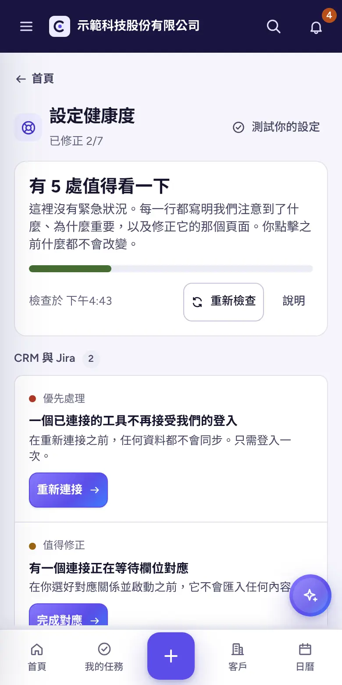

## 詢問助理

開啟助理，原樣輸入：

```text
我的設定有什麼問題？
```

它會列出同樣的問題和對應按鈕。它只讀取，從不自行修正任何東西。

## 測試你的設定

1. 在**設定健康度**頁面，點選右上角的**測試你的設定**。
   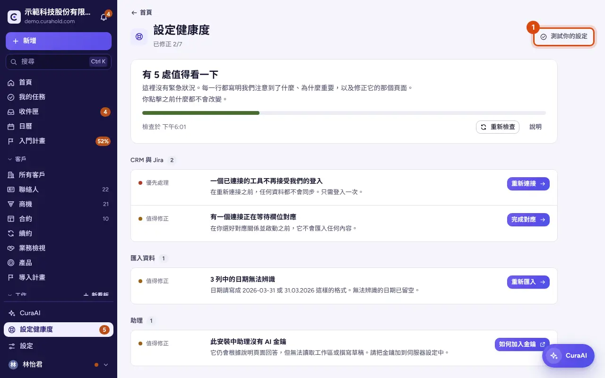
2. 在某個步驟上點選**測試**。需要你親眼確認的步驟則顯示**可以了**和**不行**。如果步驟詢問用什麼來測試（客戶、連線、同事），只需選擇一次，下次測試會沿用。
   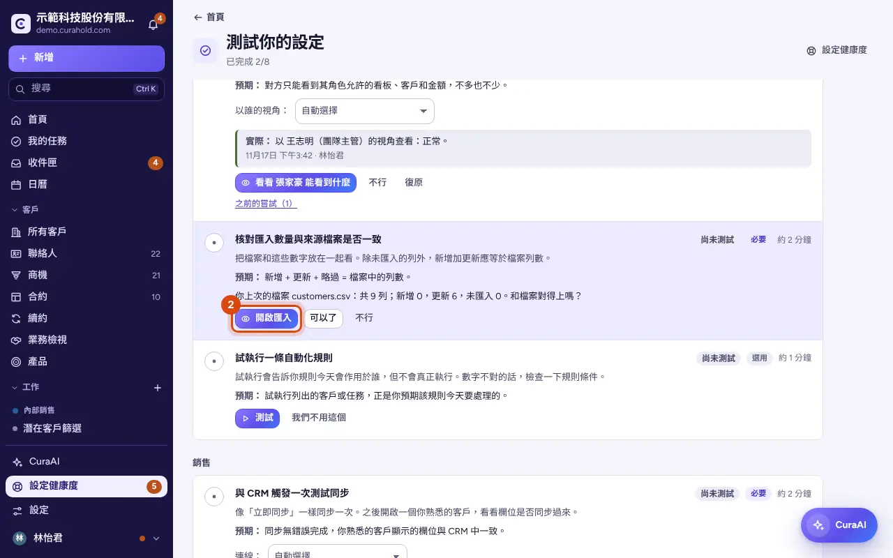
3. 對照**實際**和**預期**。兩者一致即表示通過。每次嘗試都會記錄執行人和時間，你可以隨時重測。
   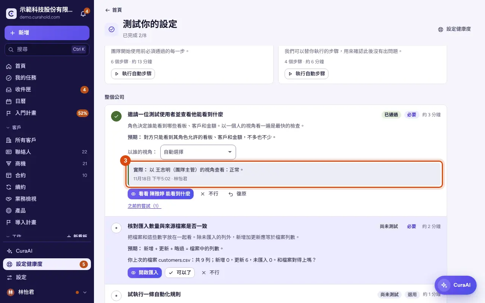
4. 如果沒有成功，點選**開啟修正頁面**，修正後再測。如需協助，點選**建立問題**：問題會和該步驟放在一起，步驟通過後自動關閉。
   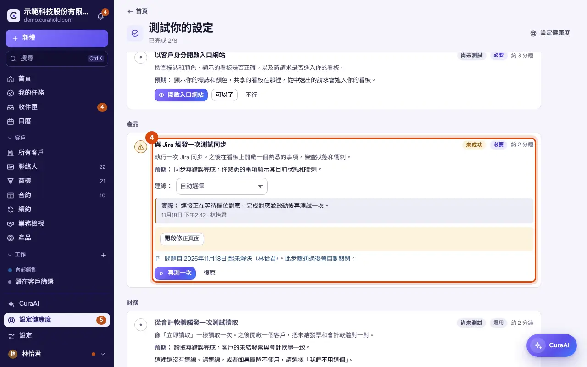
5. 要一次執行多個步驟，選擇一個組合：**上線前**或**每月檢查**，然後點選**執行自動步驟**。
   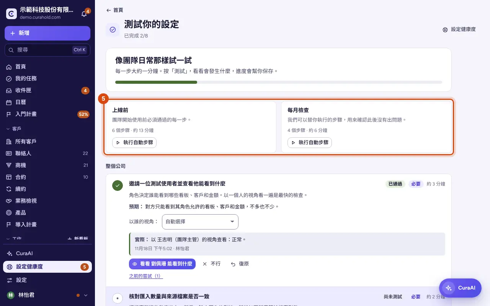
6. 所有**必要**步驟通過後，先由貴公司的管理員點選**核准**，再由 Curahold 的人核准。頁面隨即顯示**設定完成**和日期。
   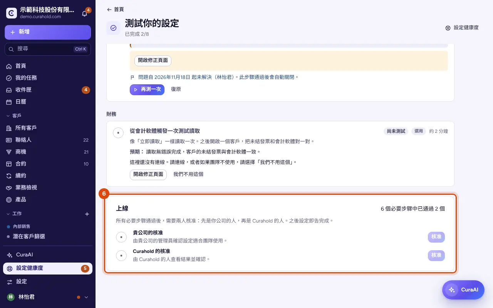

## 每項檢查的含義

此表直接取自產品本身的文字，因此始終與頁面一致。

<!-- setup-checks:start (scripts/docs/setup-health-page.ts writes this part) -->

### 團隊

| 我們發現的問題 | 為什麼重要 | 按鈕 |
| --- | --- | --- |
| 目前這裡只有你一個人 (優先處理) | 任務、交接和提醒都需要有人接收。請邀請會在 Curahold 中工作的人。 | **邀請成員** |
| … 個邀請超過一週未被接受 (有空時處理) | 他們可能錯過了郵件。請重新寄送，或檢查電子郵件地址。 | **查看邀請** |
| … 個角色沒有任何成員 (有空時處理) | 沒人擔任的角色不起作用。把它指派給合適的人，或刪除它讓清單保持清楚。 | **開啟角色** |

### 部門

| 我們發現的問題 | 為什麼重要 | 按鈕 |
| --- | --- | --- |
| 部門尚未設定 (值得修正) | 看板、交接以及誰能看到什麼都依據部門。請把每個人加入所屬部門。 | **設定部門** |
| … 個部門沒有負責人 (值得修正) | 只有負責人能開啟部門的看板，交給該部門的交接也會送到負責人。 | **選擇負責人** |

### 匯入資料

| 我們發現的問題 | 為什麼重要 | 按鈕 |
| --- | --- | --- |
| 上次匯入有 … 列沒有匯入 (值得修正) | 這些列裡有內容無法讀取。匯入完成後會立即列出它們的列號；在檔案中改好後重新匯入：已匯入的列會更新，不會重複。 | **開啟匯入** |
| 上次匯入有 … 列沒有客戶名稱 (值得修正) | 名稱是每列都必須有的一欄。請在檔案中填寫後重新匯入：已匯入的列會被更新，不會重複。 | **重新匯入** |
| … 列中的日期無法辨識 (值得修正) | 日期請寫成 2026-03-31 或 31.03.2026 這樣的格式。無法辨識的日期已留空。 | **重新匯入** |
| … 列中的金額無法辨識 (值得修正) | 只用數字，例如 12500 或 12.500,00，幣別單獨放一欄。這些金額已留空。 | **重新匯入** |
| … 個客戶重複出現 (有空時處理) | 任務和筆記會分散在兩份記錄裡。保留一份，把另一份合併進去。 | **查看** |

### CRM 與 Jira

| 我們發現的問題 | 為什麼重要 | 按鈕 |
| --- | --- | --- |
| 一個已連接的工具不再接受我們的登入 (優先處理) | 在重新連接之前，任何資料都不會同步。只需登入一次。 | **重新連接** |
| 與 … 個工具的上次同步沒有完成 (優先處理) | 此後的變更都在等待。連接頁面會說明是什麼讓它停下的。 | **查看原因** |
| 有一個傳入 Webhook 一天內沒有使用任何推送 (值得修正) | 每次推送都被拒絕（密鑰錯誤）或無法使用（沒有相符的客戶、內容格式變了）。它的紀錄會說明原因。 | **開啟傳入 Webhook** |
| WhatsApp 已連接，但還沒有收到任何訊息 (值得修正) | 過了一天還這樣，通常是回呼位址和驗證權杖沒有儲存在 Meta 應用程式中，或沒有訂閱「messages」。 | **開啟連線** |
| 有一個連接正在等待欄位對應 (值得修正) | 在你選好對應關係並啟動之前，它不會匯入任何內容。 | **完成對應** |
| … 項變更無法傳送到另一個工具 (值得修正) | 我們已嘗試三次。連接頁面會列出每一項及原因，並可以重試。 | **查看** |
| … 個 API 金鑰將在兩週內失效 (值得修正) | 使用它的地方都會停止傳送。請在此之前建立新金鑰並替換。 | **開啟 API 金鑰** |
| 本週有 … 項變更被另一個工具覆寫 (有空時處理) | 兩邊改了同一處。什麼都沒丟：被取代的值保存在每個任務的歷程裡。請確認連接的規則是你想要的。 | **檢查規則** |

### 會計

| 我們發現的問題 | 為什麼重要 | 按鈕 |
| --- | --- | --- |
| 無法讀取你的會計軟體 (優先處理) | 客戶頁面上的發票和付款會停留在上次成功讀取時的狀態。 | **開啟連接** |
| 會計資料已兩天沒有讀取 (值得修正) | 逾期發票可能不是最新的。現在讀取一次，或查看每日讀取為何停止。 | **開啟連接** |

### BI 工具

| 我們發現的問題 | 為什麼重要 | 按鈕 |
| --- | --- | --- |
| … 個分析金鑰將在兩週內失效 (值得修正) | BI 工具中的報表將停止重新整理。請更換金鑰，並把新金鑰貼過去。 | **開啟分析金鑰** |
| 你的 BI 工具已一週沒有擷取資料 (有空時處理) | 它的儀表板顯示的是上週的數字。請檢查排程重新整理，或它使用的金鑰。 | **開啟分析金鑰** |

### 客戶入口網站檢查

| 我們發現的問題 | 為什麼重要 | 按鈕 |
| --- | --- | --- |
| 客戶入口網站已開啟，但沒有向客戶顯示任何內容 (值得修正) | 至少與入口網站共用一個看板，客戶才能提交並追蹤請求。 | **選擇共用內容** |
| 還沒有人被邀請到入口網站 (有空時處理) | 客戶只有被邀請後才能登入。先邀請某個客戶的一位聯絡人開始吧。 | **邀請客戶** |
| 入口網站仍在使用 Curahold 的配色 (有空時處理) | 你的標誌和顏色讓客戶知道自己來對了地方。 | **加入品牌** |

### 自動化

| 我們發現的問題 | 為什麼重要 | 按鈕 |
| --- | --- | --- |
| … 條自動化規則監看的欄位不存在 (優先處理) | 照現在這樣它永遠不會執行。點「修改規則」，再點「編輯」和「儲存」：它會改用你們自己的日期欄位。或者關閉這條規則。 | **修改規則** |
| … 條自動化規則指向已不存在的看板 (優先處理) | 它要建立的任務無處可去。請選擇另一個看板。 | **修改規則** |
| 還沒有自動化規則 (有空時處理) | 一條規則，比如每次續約前 60 天自動建立任務，每次都替你提醒。現成的規則可以直接開啟。 | **查看現成規則** |

### 你的資料檢查

| 我們發現的問題 | 為什麼重要 | 按鈕 |
| --- | --- | --- |
| … 個客戶沒有負責人 (值得修正) | 它們的提醒發不到任何人，也不在任何人的清單裡。請為每一個指定負責人。 | **指定負責人** |
| … 個進行中的交易沒有階段 (值得修正) | 它們不會出現在銷售漏斗和預測中。 | **開啟交易** |
| … 個未結工單無人跟進 (有空時處理) | 沒有負責人的工單不在任何人的佇列裡。請逐一指派，或新增一條自動指派的規則。 | **開啟工單** |

### 郵件

| 我們發現的問題 | 為什麼重要 | 按鈕 |
| --- | --- | --- |
| 此安裝還不能寄送郵件 (優先處理) | 邀請、登入連結和提醒只會寫進伺服器記錄。請設定郵件中繼或郵件服務商。 | **如何設定郵件** |
| 確認郵件網域的 SPF、DKIM 和 DMARC 記錄 (值得修正) | 沒有它們，邀請會進垃圾郵件或被拒收。我們無法從這裡讀取你的 DNS：請新增記錄後再確認。 | **查看記錄** |

### 隱私

| 我們發現的問題 | 為什麼重要 | 按鈕 |
| --- | --- | --- |
| 沒有人能處理個人資料請求 (值得修正) | 根據 KVKK 和 GDPR，必須有人能匯出或刪除某人的資料。請給一個角色隱私權限。 | **開啟角色** |

### 試用與方案

| 我們發現的問題 | 為什麼重要 | 按鈕 |
| --- | --- | --- |
| 你的試用將於 … 結束 (值得修正) | 之後在選擇方案前，工作區將變為唯讀。不會刪除任何內容。 | **選擇方案** |
| 試用的席位已全部占用 (值得修正) | 新成員只能以檢視者身分加入。請申請更多席位，或空出一個。 | **查看席位** |

### 助理

| 我們發現的問題 | 為什麼重要 | 按鈕 |
| --- | --- | --- |
| 此安裝中助理沒有 AI 金鑰 (值得修正) | 它仍會根據說明頁面回答，但無法讀取工作區或撰寫草稿。請把金鑰加到伺服器設定中。 | **如何加入金鑰** |

<!-- setup-checks:end -->

## 給開發者

同樣的檢查也可透過 API 讀取，以金鑰擁有者的身分執行。把兩個範例換成你公司的網址和你的金鑰：

```bash
curl -H "Authorization: Bearer YOUR_API_KEY" https://your-company.curahold.com/api/setup-health
```

完整網址清單見[參考：設定檢查](/docs/zh-Hant/ref-setup/)。
