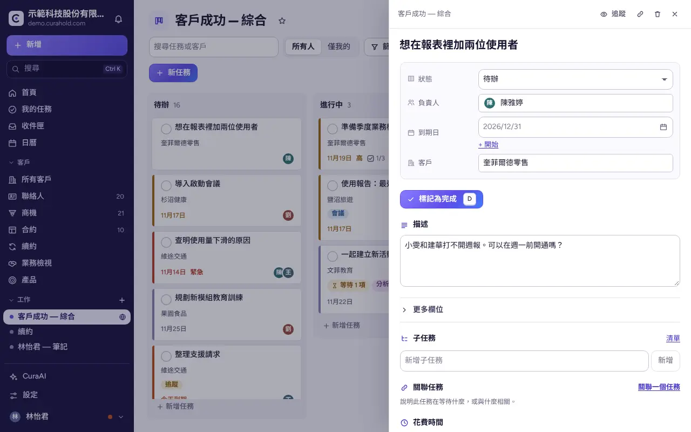

# 任務與看板

工作在看板上進行。看板可以屬於一個團隊、整個公司或只屬於你，欄位由你決定。

## 任務

任務有標題、說明、負責人（最多 10 人）、截止日期、優先順序，也可以連結一個客戶。可以加入子任務、檔案和留言。任務會在看板旁的面板中開啟，任務連結傳給誰都能開啟。

每張卡片邊緣的細條顯示任務和時間的關係：從容、將至、今天、逾期、完成。同樣的顏色也會出現在日曆和「我的任務」中。日期使用產品內建的日期選擇器挑選，以你的語言和你習慣的日期順序顯示。

## 兩個人同時修改同一個任務時

Curahold 從不悄悄覆蓋任何人的變更。如果你在編輯時別人先儲存了，他的變更會保留，你的變更再套用在上面。只有同一個欄位真的衝突時才會詢問你。

## 一次修改多筆與復原

在看板或清單中選取多個任務，一次變更狀態、負責人、日期或優先順序。底部的通知會提供 **復原**。

## 重複任務

可以讓任務每隔幾天、幾週或幾個月重複一次。目前的任務完成後，下一個才會出現。新日期有兩種算法：

- **從截止日期起算：** 適合固定行程，例如「每月 1 日交報告」。
- **從完成那天起算：** 適合「上次通話兩週後再打一次」這類工作。

## 提及與靜音

在留言中輸入 `@` 提及某人，對方就會收到通知。如果不想再收到某個任務的消息，在它的選單中選擇 **停止此任務的留言通知**。

## 快速搜尋

在任何地方按 Ctrl K（Mac 為 ⌘ K）就能找到客戶、任務、人員、看板或頁面。用方向鍵移動，按 Enter 開啟。

## 任務的更多功能

- **追蹤：** 用任務頂端的按鈕，即使任務不是你的，也能收到留言和欄位移動的消息。
- **關聯任務：** 指定一個任務 **等待** 另一個任務、**阻擋** 另一個任務，或 **相關於** 另一個任務。等待中的任務卡片上會顯示「等待 1 項」；它等待的任務完成後，負責人會收到「你可以開始了」的通知。任務之間不能形成循環等待。
- **開始日期：** 截止日期旁的 **+ 開始** 會記錄工作何時開始；時間軸會把它畫成一條長條。
- **花費時間：** 用 +15 分、+30 分、+1 小時按鈕，或自行輸入（「1.5」、「45m」、「1:30」）。客戶頁面會顯示為該客戶記錄的總時間。
- **清單：** 把常用步驟儲存一次（加入子任務 → **將這些子任務儲存為清單**），之後一鍵加到任何任務。
- **歷史：** 誰在何時改了什麼，逐行顯示在任務底部。
- **相似提醒：** 如果你要新增的任務和某個仍未完成的任務很像，快速新增會提醒你。

## 看板專屬欄位

看板設定 → **欄位與申請表單**：為該看板上的每個任務加入欄位（文字、數字、金額、日期、選項、連結、電子郵件、人員、是/否）。標示為 **完成前必須填寫** 的欄位，必須填好任務才能移到「完成」欄；批次變更會略過這些任務，並告訴你有幾個。選項欄位在卡片上以彩色標籤顯示，也能用來篩選。

## 篩選與已儲存的檢視

看板頂端的 **篩選** 可以依人員、截止日期（逾期、今天、7 天內等）、優先順序和看板的選項欄位縮小範圍。在手機上，所有篩選條件都集中在同一個 **篩選** 面板裡。用 **檢視 → 儲存** 為目前的篩選命名，願意的話也可以把這個檢視分享給看板上的每個人。

## 申請表單

在看板設定中開啟 **透過表單接收請求**，並選擇表單要問什麼。同事使用看板上的 **申請表單** 按鈕；請求會以任務的形式進入你指定的欄位，提出請求的人會自動追蹤它。

## 從其他工具搬過來：從檔案匯入任務

看板頂端的向上箭頭按鈕（**從檔案匯入任務**）可以匯入你從舊工具匯出的 CSV 或 Excel 檔案。檔案在瀏覽器中讀取；在你確認每一欄要去哪裡之前，什麼都不會傳送。

- 欄位會自動辨識（Title、Description、Status、Assignee、Due date、Start date、Priority、Customer、Completed on，以及它們的土耳其文名稱）。每一欄都能更改；「對應為」欄會顯示前幾列會如何匯入。
- **Status** 會進入看板上同名的欄位。「To do」、「In progress」、「Done」等常見名稱也能辨識；其他值會進入第一欄，並在結果中列出。
- **Assignee** 依姓名或電子郵件比對；找不到的人會被略過，並告訴你是誰。客戶名稱也用同樣方式比對。
- 已完成的任務預設不匯入，除非勾選「也匯入已完成的任務」。
- 不會通知任何人，也不會執行任何規則。整次匯入可在 30 天內 **復原**：沒人動過的任務會被刪除，有人處理過的會移到封存。

每次最多 5,000 列。

## 日曆

**日曆** 顯示每一天有哪些事：依截止日期排列的任務、已舉行的會議、通話和檢視、續約，以及到期的業務檢視。上方的標籤可以開關每一種類型。

- **日、週、月、年：** 頂端的切換按鈕。日檢視列出當天所有事項，以及對應的客戶和負責人；年檢視顯示十二個小月份，事項越多顏色越深。點日期數字就會開啟那一天。
- **誰的日曆：** 你自己的，或你能看到的所有人。角色允許 *查看隊友日曆* 的人（一開始是管理員和團隊主管）也能挑選某個人或整個團隊。這只會縮小他們原本就看得到的範圍，不會顯示新的內容，所以私人看板仍然是私人的。
- 檢視、日期和是誰的日曆都保存在網址中，所以連結會開啟同樣的畫面。

## 封存

已完成的任務在看板保留夠久之後（預設 90 天；可在看板設定中設為 30–365 天或「永遠」），會自動移到看板的 **封存**。使用多年的看板也能立刻開啟。封存的任務仍會計入報表；在看板 / 清單旁的 **封存** 檢視中搜尋，並用 **還原** 把任務放回來。還原的任務會再在看板上停留同樣的天數。你在清單檢視中手動封存的任務也在這裡。

## 刪除任務，以及還原已刪除的任務

刪除的任務會連同子任務、留言、時間記錄和檔案一起移到 [垃圾桶](/docs/zh-Hant/trash/)，30 天內都能還原：刪除後立刻在通知中選擇 **復原**，或開啟你的選單，選擇 **垃圾桶**，再點 **還原**。只有任務的建立者，或角色允許刪除任何任務的人，才能刪除任務。如果只是想把已完成的任務移開而不刪除，可以將它封存。
