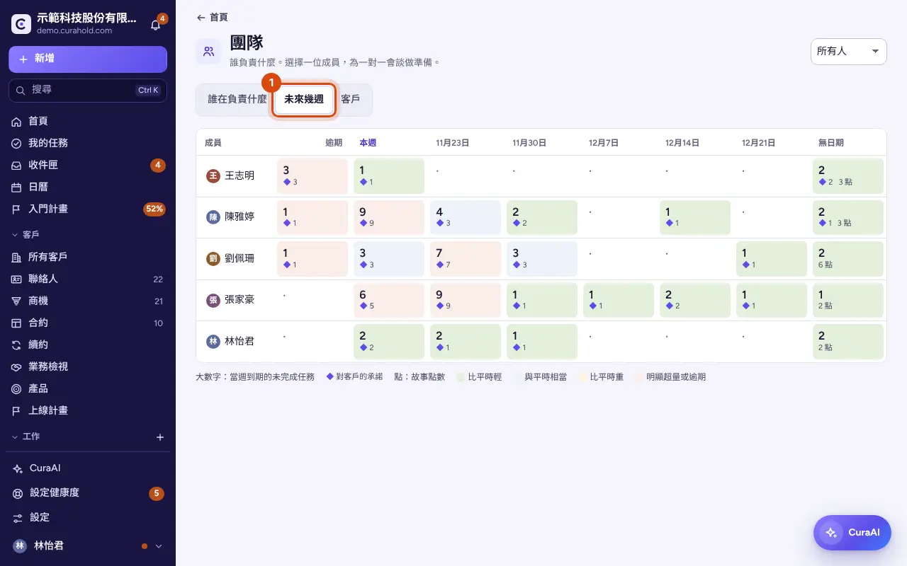
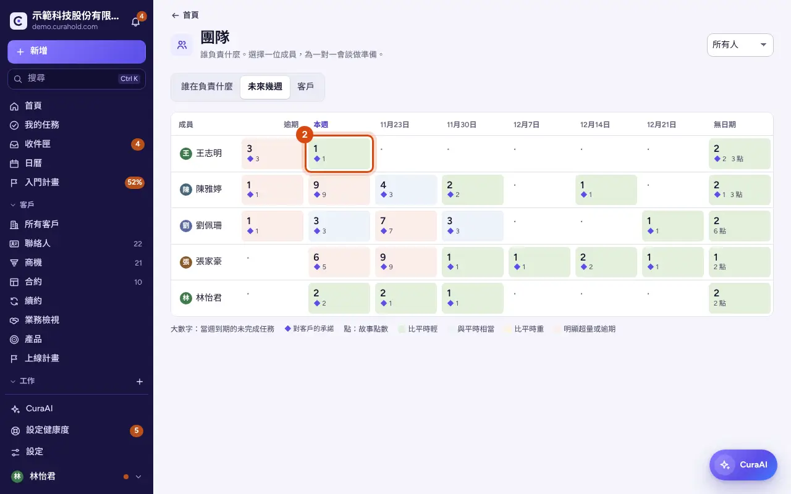
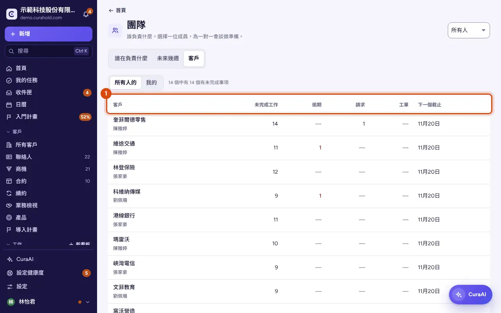

# 團隊的未來幾週、客戶組合和服務成本

**團隊**（左側選單中）有三種檢視：**誰在負責什麼**、**未來幾週** 和 **客戶**。在頂端選擇一個團隊可縮小任一檢視的範圍。只計算你有權查看的任務。

## 未來幾週誰有空 {#weeks}

1. 開啟 **團隊**，點選 **未來幾週**。
   
2. 逐週查看某個人的列。每個格子裡，大數字是當週到期的未完成任務，◆ 是其中對客戶的承諾數量，**pt** 是它們的故事點。顏色把這一週與此人平常的負荷相比：較輕、正常、較重或遠超。**逾期** 和 **無日期** 各有獨立的欄。點選格子可開啟此人的一對一檢視。
   

## 每個客戶的未完成工作 {#customers}

1. 開啟 **團隊**，點選 **客戶**。列出每個有未完成事項的客戶，最忙的在前：未完成工作、其中逾期多少、其人員透過入口網站送來的申請、尚未解決的支援工單以及下一個截止日期。點選欄名可依該欄排序；在 **所有人的** 和 **我的** 之間切換。
   

這裡刻意不顯示金額：誰能看到金額是依欄位決定的。

## 服務成本 {#cost-to-serve}

1. 在選單中開啟 **報表**，點選 **報表** 分頁，再點選 **服務成本**。它依客戶顯示近 12 個月在其工作上記錄的工時，以每 1,000 年度價值計算（ARR，否則 MRR × 12，否則第一個金額欄位）。數值最高的就是服務成本最高的客戶。
   

它在報表建構器中附帶兩個欄位：**記錄工時（近 12 個月）** 和 **每 1,000 年度價值所用小時**。無權查看客戶價值的人看不到成本數字。
