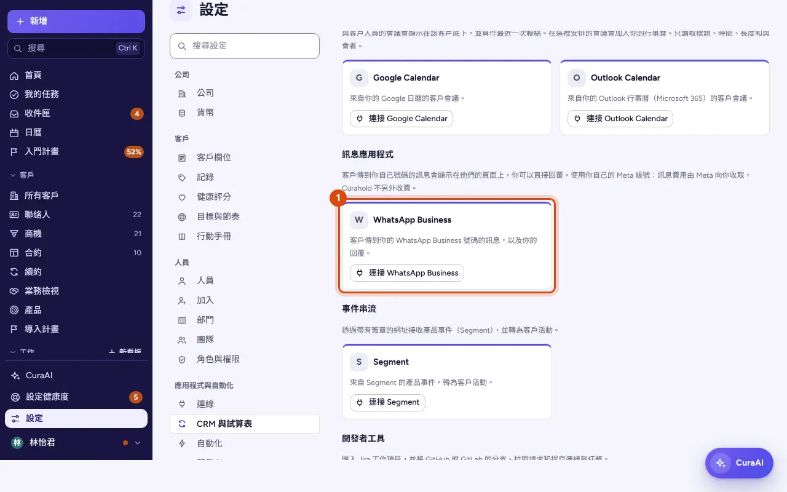
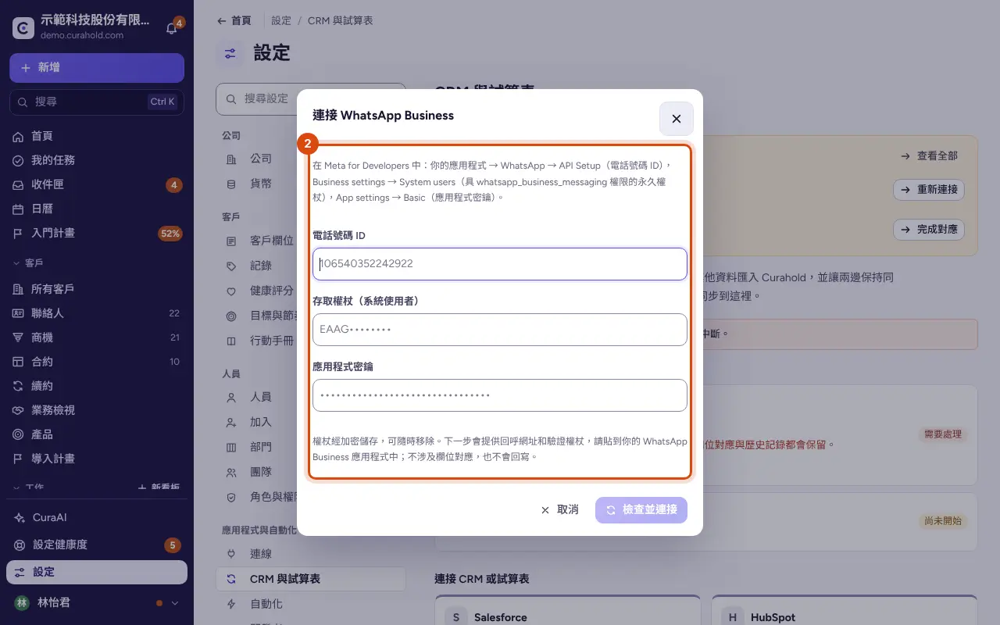

# WhatsApp Business

客戶傳到你的 WhatsApp Business 號碼的訊息會顯示在他們的頁面上，你可以在那裡回覆。使用的是你 **自己** 的 Meta 應用程式和號碼：訊息費用由 Meta 向你收取，Curahold 不另外收費，也看不到你的 Meta 帳單。

## 開始之前

你需要一個在 Cloud API 上有 WhatsApp Business 號碼的 Meta 商業帳號、一個加入 WhatsApp 產品的 Meta 應用程式，以及一個有永久權杖的 **系統使用者**（權限 `whatsapp_business_messaging`）。Meta 的頁面會一步步引導，大約 15 分鐘。

## 在 Curahold 中 {#connect}

1. 開啟 **設定 → CRM 與試算表**，找到 **訊息應用程式**，點選 **連接 WhatsApp Business**。
   
2. 貼上下列三個值並點選 **連接**。之後連線頁面會顯示 **回呼位址** 和 **驗證權杖**。
   

- **電話號碼 ID**：Meta for Developers → 你的應用程式 → **WhatsApp → API Setup**。
- **存取權杖（系統使用者）**：Business settings → **System users** → 該使用者 → **Generate new token**。
- **應用程式密鑰**：你的應用程式 → **App settings → Basic** → **App secret** → **Show**。

## 在 Meta 中

1. 開啟應用程式 → **WhatsApp → Configuration**，在 **Webhook** 旁點選 **Edit**。
2. 把回呼位址貼到 **Callback URL**，把驗證權杖貼到 **Verify token**，點選 **Verify and save**。
3. 在 **Webhook fields** 下點選 **Manage**，訂閱 **messages**。

## 會收到什麼，如何回覆

訊息會以備註的形式歸入聯絡人中有寄件者號碼的客戶（`0532…` 這類本地寫法也能比對）。在這則備註上點選 **在 WhatsApp 上回覆**。WhatsApp 只允許在客戶最後一則訊息後的 24 小時內傳送自由文字；之後 Curahold 會要求填寫已核准的 **範本** 名稱和語言。

## 限制與頻率

訊息依 Meta 的推送抵達。Meta 會對失敗的推送重試最多 7 天；每則訊息只儲存一次。Meta 限制單一號碼的傳送速度；「忙碌」的回應會說明，不會遺失任何內容。

## 發生問題時

權杖過期或被撤銷會在回覆時顯示：用 **重新連線** 貼上新權杖。來自任何聯絡人都沒有的號碼的訊息只會計數，不會儲存。**移除** 會立即停止回呼；客戶底下既有的備註保留。

## 另請參閱

- [時間軸與健康評分](/docs/zh-Hant/timeline-and-health/)
- [連線與 CRM](/docs/zh-Hant/connections/)
