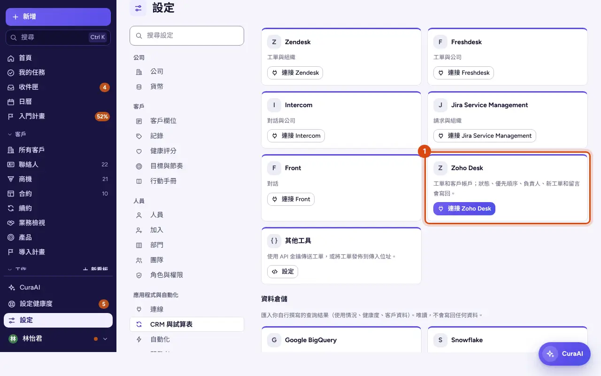

# Zoho Desk

Zoho Desk 的工單和客戶帳戶會顯示在相符的客戶底下、彙總中和健康評分裡。在 Curahold 中變更的狀態、優先順序和負責人會寫回 Zoho Desk，在 Curahold 中建立的工單也會在那裡建立，回覆或內部備註會以留言形式加入。

## 在 Curahold 中 {#connect}

1. 開啟 **設定 → CRM 與試算表**，找到 **支援工具**，點選 **連接 Zoho Desk**。
   

會開啟 Zoho 頁面。用服務台的一位客服帳號登入並點選 **接受**。Curahold 會找到你的資料中心（.com、.eu、.in、.com.au、.jp、.sa、.uk、.ae、.ca、.com.cn）和入口網站。回來後勾選 **工單** 和 **客戶帳戶**，檢查欄位對應，點選 **開始同步**。

## 限制與頻率

每小時讀取一次變更。Zoho 依方案的每日額度為每次呼叫扣點；用完時 Zoho 會要求等待，Curahold 下次繼續。從 Curahold 送出的公開回覆是工單上的公開留言；電子郵件回覆由 Zoho Desk 寄出。

## 發生問題時

登入過期會自動更新。客服失去存取權時，連線會顯示 **需要處理**：點選 **重新連線** 並重新登入。**移除** 會刪除登入資訊；已同步的工單保留。

## 另請參閱

- [連線與 CRM](/docs/zh-Hant/connections/)
